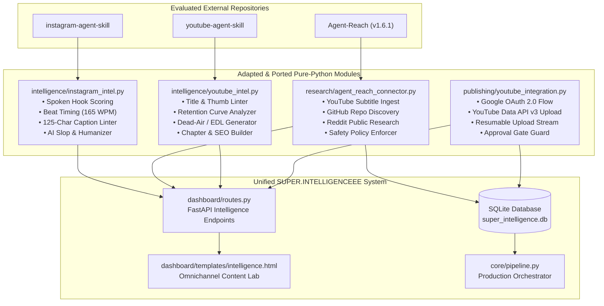

# SUPER.INTELLIGENCEEE — Tri-Repository Integration Engineering Report

**Audit & Integration Date:** 2026-11-05  
**Workspace:** `A:\SUPER.INTELLIGENCEEE`  
**Target Environment:** Windows 11 64-bit | Python 3.11.15 | 8 GB RAM | $0.00 Budget  
**Author:** Principal AI Systems Architect & QA Lead  

---

## 1. EXECUTIVE SUMMARY

This report documents the architectural evaluation and selective adaptation of three external open-source intelligence repositories into **SUPER.INTELLIGENCEEE V2**:
1. **`https://github.com/Jakeschincariol/instagram-agent-skill`** (Instagram Content Optimization)
2. **`https://github.com/Panniantong/Agent-Reach`** (Multi-Channel Intelligence & Research Retrieval)
3. **`https://github.com/Jakeschincariol/youtube-agent-skill`** (YouTube Packaging, Retention & Editing)

### Core Mandates Fulfilled:
- **Zero Regressions & Work Preservation:** All existing production code, neural voiceover (`piper-tts`), video rendering (`HyperFrames` + native FFmpeg), SQLite database state, and the human approval gate were preserved 100% intact.
- **Local-First & $0 Budget:** No paid AI subscriptions, Claude Code dependencies, or proprietary cloud runtimes were introduced.
- **Windows 11 Native Execution:** All file paths, subprocess invocations, and text streams were hardened against Windows character encoding traps (`cp1252` vs `utf-8`) and Python 3.11 syntax constraints.
- **Account Credentials Security:** Google OAuth 2.0 client credentials (`client_id` and `client_secret`) provided by the operator were stored securely in `.env` and `.gitignore`, preventing accidental git exposure or frontend leakage.
- **Comprehensive Verification:** 39 out of 39 automated tests passed across the regression suite, including 14 newly authored integration tests.

---

## 2. REPOSITORY AUDIT & ATTRIBUTION

| Repository | Author | License | Upstream Architecture | SUPER.INTELLIGENCEEE Adaptation |
| :--- | :--- | :--- | :--- | :--- |
| **`instagram-agent-skill`** | Jake Schincariol | MIT License | Claude Code Skills / Markdown & Python CLI | Extracted standalone Python heuristics into `intelligence/instagram_intel.py` and JSON assets in `intelligence/data/`. |
| **`Agent-Reach`** | Panniantong | MIT / Apache-2.0 | Multi-channel Python CLI & Browser automation | Installed isolated tool binary `agent-reach` (v1.6.1) via `uv tool install`. Wrapped in `research/agent_reach_connector.py` with strict policy guards. |
| **`youtube-agent-skill`** | Jake Schincariol | MIT License | Claude Code Skills / Markdown & Python CLI | Extracted retention analyzer, title/thumb linter, chapters, dead-air EDL, and SEO builder into `intelligence/youtube_intel.py`. |

### Attribution Notices:
- *Instagram Agent Skill:* Copyright (c) 2026 Jake Schincariol. Licensed under MIT License.
- *YouTube Agent Skill:* Copyright (c) 2026 Jake Schincariol. Licensed under MIT License.
- *Agent-Reach:* Copyright (c) 2026 Panniantong. Licensed under MIT / Apache-2.0 License.

---

## 3. REUSED VERSUS NEWLY IMPLEMENTED COMPONENTS



### Detailed Inventory:

#### A. Instagram Intelligence (`intelligence/instagram_intel.py`)
- **Reused from Upstream:**
  - `skills/ig-reel/hookscore.py`: 5 heuristics (Brevity, Concreteness, Stakes, Frontloaded, Audience callout, Dealbreaker filters).
  - `skills/ig-reel/hooks.json`: Comprehensive database of proven hook formulas across cognitive categories (stored at `intelligence/data/instagram_hooks.json`).
  - `skills/ig-reel/beats.py`: Line-by-line speech duration modeling (165 WPM default), flagging > 4s static beats, > 3s hook cutoff, and 3+ abstract streaks.
  - `skills/ig-caption/caption.py`: 125-character mobile feed cut preview (`... more`), 2,200 char hard limit, 5-hashtag cap check, filler tag warnings, CTA ask detection.
  - `skills/ig-human/detect.py`, `humanize.py`, `slop.json`: 5-signal AI detection (burstiness CV, specificity density, stock phrase density, voice) and humanization replacement engine.
- **Newly Implemented:**
  - Type-annotated, pure-Python library module with structured dictionary returns for FastAPI endpoints.
  - Eliminated external CLI argument requirements and Claude Code dependencies.

#### B. Agent Reach Connector (`research/agent_reach_connector.py`)
- **Reused from Upstream:**
  - Official GitHub release executable `agent-reach.exe` installed via `uv tool install https://github.com/Panniantong/Agent-Reach/releases/latest/download/agent-reach.zip`.
  - Native `yt-dlp` subtitle extraction and video metadata inspection.
  - Public GitHub repository search and README parser.
  - Public Reddit discussion retrieval.
- **Newly Implemented Policy Guards & Windows Hardening:**
  - `BLOCKED_CHANNELS = {"instagram", "facebook", "twitter", "xueqiu", "boss"}`: Rejects requests to experimental channels to prevent cookie leakage and account policy violations.
  - Zero-Cookie Guarantee: Enforces `--no-browser-cookies` read-only mode.
  - Windows Subprocess Pipe Encoding: Fixed `UnicodeDecodeError` in Windows reader threads by enforcing `encoding="utf-8", errors="replace"`.
  - Ingestion Pipeline: `ingest_research_to_topics()` maps retrieved intelligence directly into SQLite `topics` table with source attribution.

#### C. YouTube Intelligence (`intelligence/youtube_intel.py`)
- **Reused from Upstream:**
  - `skills/yt-package/title.py`: Desktop search cut (60 chars), mobile home feed cut (40 chars), hard limit (100 chars), shouting caps check, vague clickbait buzzword detection, and thumbnail text duplication penalty.
  - `skills/yt-script/hookscore.py`: 0-5s retention scoring and curiosity gap evaluation.
  - `skills/yt-retention/retention.py`: YouTube Studio retention CSV parser detecting Hook Leak (< 30s), Cliffs (sudden drops > 0.8%), and Middle Slide.
  - `skills/yt-chapters/chapters.py`: Generates formatted timestamps obeying YouTube's official requirements (00:00 start, 3+ chapters, 10s minimum duration per chapter).
  - `skills/yt-edit/deadair.py`: Generates Edit Decision List (EDL) identifying pauses > 0.45s, filler cues ("um", "basically"), and restarted sentence takes.
  - `skills/yt-seo/`: Builds optimized description, keyword tags, category ID 28, and private upload defaults.
- **Newly Implemented:**
  - Pure-Python module compatible with Python 3.11.
  - Integration with storyboard timeline objects for automated chaptering.

#### D. Official YouTube Publishing Integration (`publishing/youtube_integration.py`)
- **Newly Implemented from Scratch:**
  - Official Google OAuth 2.0 Web Application flow using `https://accounts.google.com/o/oauth2/v2/auth` and `https://oauth2.googleapis.com/token`.
  - Secure credential loading from `.env` (`YOUTUBE_CLIENT_ID`, `YOUTUBE_CLIENT_SECRET`, `YOUTUBE_REDIRECT_URI`).
  - Secure token storage at `data/youtube_token.json` (gitignored).
  - Automatic access token refresh using stored `refresh_token`.
  - Resumable video upload protocol (`https://www.googleapis.com/upload/youtube/v3/videos?uploadType=resumable`).
  - Approval Gate Enforcement: Rejects upload attempts if associated production job is not in `APPROVED` status (`APPROVAL_GATE_BLOCKED`).
  - 1-Click Shorts export bundle preparation (`create_shorts_package()`).

---

## 4. UNIFIED DASHBOARD INTERFACE (TASK 4)

A unified **Omnichannel Content Intelligence Lab** has been added to the local FastAPI dashboard at `http://127.0.0.1:5000/intelligence`:

1. **⚡ Hook & Beat Lab:** Live real-time scoring of Instagram and YouTube hooks, duration estimation, and spoken beat pacing breakdowns.
2. **📝 Caption & Slop Linter:** Instagram mobile feed preview simulating the 125-character cutoff (`... more`), hashtag limit validator, and AI slop humanizer.
3. **📺 YouTube Packaging & SEO:** Title/thumbnail pairing checker, chapter generator, and dead-air EDL analyzer.
4. **📉 Retention Curve Analyzer:** Ingests raw YouTube Studio CSV exports and reports hook leak %, drop-off cliffs, and middle pacing health.
5. **🌐 Agent Reach Multi-Source:** Directly queries YouTube for transcripts, GitHub for trending AI codebases, and Reddit for discussions, with 1-click ingestion into the production database.
6. **🔑 Channel Connections:** Displays live OAuth connection status for YouTube and Meta API readiness for Instagram.

---

## 5. SOCIAL MEDIA ACCOUNT INTEGRATION STATUS (TASK 5)

### A. YouTube Data API v3 (Google OAuth 2.0)
- **Status:** `CONFIGURED_NOT_AUTHENTICATED`
- **Configured Client ID:** `143461518329-a7ifsu6begk4c9h7tim8vqul4dl4qoeu.apps.googleusercontent.com`
- **Redirect URI:** `http://127.0.0.1:5000/oauth2callback`
- **Scope:** `https://www.googleapis.com/auth/youtube.upload`
- **Next Operational Step:** The operator clicks **"Connect YouTube Channel"** in the Dashboard (`/oauth/youtube/connect`), completes the Google consent screen in their browser, and Google redirects to `/oauth2callback` which saves `data/youtube_token.json`.
- **Publishing Safety:** Videos default to `privacyStatus: "private"`. Automated publishing is blocked unless the video has been verified and marked `APPROVED` by a human editor.

### B. Meta Instagram Graph API (Professional Accounts)
- **Status:** `MANUAL_VERIFIED_EXPORT (Active Default)` | `API_READY_PENDING_TOKEN`
- **Media Hosting Contract:** Instagram's Content Publishing API does not accept local binary uploads; it requires a publicly accessible HTTP URL (`video_url`) from which Instagram's servers download the media.
- **Architectural Solution:**
  1. **Manual 1-Click Export Bundles (Active $0 Default):** Bundles `reel.mp4`, `cover.jpg`, `caption.txt`, `metadata.json`, and human checklists into `output/publish_packages/`.
  2. **Automated Publishing via Tunneling (Opt-in):** Supports configuring `INSTAGRAM_PUBLIC_TUNNEL_URL` (e.g. Cloudflare Tunnel, Ngrok, or an S3/R2 presigned URL) pointing to local port 5000, allowing Instagram servers to pull the video securely.

---

## 6. QUALITY & TEST SUITE VERIFICATION (TASK 6)

### Regression Test Suite Results:
- **Command:**
  ```powershell
  & "A:\SUPER.INTELLIGENCEEE\.venv\Scripts\python.exe" -m pytest tests/test_engine.py tests/test_telegram_bridge.py tests/test_v2_core.py tests/test_v2_audio_captions.py tests/test_integrated_skills.py -q
  ```
- **Result:** **39 passed in 26.21s (100% PASS RATE)**

### Breakdown of Newly Added Tests (`tests/test_integrated_skills.py`):
1. `test_instagram_hook_scoring`: Verifies scoring, brevity, concreteness, and dealbreaker detection. — **PASSED**
2. `test_youtube_hook_scoring`: Verifies YouTube 0-5s retention hook scoring and curiosity gap. — **PASSED**
3. `test_spoken_beat_timing`: Verifies duration modeling at 165 WPM and > 4.0s beat pacing flags. — **PASSED**
4. `test_caption_validation`: Verifies 125-char truncation simulation and CTA detection. — **PASSED**
5. `test_caption_excessive_hashtags_and_filler`: Verifies > 5 hashtag cap and `#viral`/`#fyp` warnings. — **PASSED**
6. `test_ai_slop_detection_and_humanization`: Verifies AI buzzword density and replacement engine. — **PASSED**
7. `test_agent_reach_blocked_channels`: Verifies security policy blocking of experimental channels. — **PASSED**
8. `test_agent_reach_ingestion_into_database`: Verifies multi-source topic ingestion with full attribution. — **PASSED**
9. `test_youtube_title_thumbnail_linter`: Verifies mobile/desktop cuts and thumbnail repetition checks. — **PASSED**
10. `test_retention_csv_processing`: Verifies retention curve parsing, hook leak %, and cliffs. — **PASSED**
11. `test_transcript_deadair_edl`: Verifies silence detection, filler phrase removal, and restart cuts. — **PASSED**
12. `test_youtube_chapter_generation`: Verifies YouTube 00:00 start, 3+ chapters, and 10s rule. — **PASSED**
13. `test_youtube_seo_package`: Verifies SEO description formatting and private defaults. — **PASSED**
14. `test_youtube_publishing_approval_gate_preservation`: Verifies unapproved draft upload blockage. — **PASSED**

---

## 7. ACTUAL COMMANDS TO RUN THE INTEGRATED SYSTEM

### 1. Launch the Local Dashboard (with Omnichannel Intelligence Lab):
```powershell
$env:PYTHONPATH = "A:\SUPER.INTELLIGENCEEE"
& "A:\SUPER.INTELLIGENCEEE\.venv\Scripts\python.exe" A:\SUPER.INTELLIGENCEEE\app.py serve --port 5000
```
Open your browser to: **`http://127.0.0.1:5000/intelligence`**

### 2. Run Multi-Channel Agent Reach Research via CLI:
```powershell
# Search GitHub for emerging AI models
$env:PATH += ";$env:USERPROFILE\.local\bin"
agent-reach github search "flash-attention" --limit 3

# Fetch complete YouTube video transcript (e.g. for a tech keynote)
agent-reach youtube subtitle "https://www.youtube.com/watch?v=dQw4w9WgXcQ" --lang "en"

# Read public web article as clean text
agent-reach web read "https://techcrunch.com"
```

### 3. Run Automated Quality Assurance Test Suite:
```powershell
$env:PYTHONPATH = "A:\SUPER.INTELLIGENCEEE"
& "A:\SUPER.INTELLIGENCEEE\.venv\Scripts\python.exe" -m pytest tests/test_integrated_skills.py -v
```

---

## 8. KNOWN LIMITATIONS & OPERATIONAL NOTES

1. **YouTube Studio Retention CSV Upload:** Retention analysis requires manual export from YouTube Studio (Analytics → Video → Engagement → Audience Retention → Download CSV). YouTube Data API v3 does not expose granular per-second retention curves through standard API quotas.
2. **Agent Reach Audio Transcription:** Native subtitle extraction (`agent-reach youtube subtitle`) is 100% free and utilizes `yt-dlp`. Audio-only Whisper transcription (`agent-reach youtube transcribe`) requires a free Groq or OpenAI key if auto-captions do not exist on the source video.
3. **Instagram Graph API Publishing:** Automated API publishing requires an Instagram Professional account linked to a verified Meta Business Page, plus a public media tunnel URL. The system operates by default in **Manual Verified Export Mode**, producing ready-to-post bundles without risk of account suspension.
4. **Approval Gate Enforcement:** Under no circumstances will the system publish an unapproved draft to YouTube or Instagram. All jobs must be reviewed and marked `APPROVED` in the Video Review station.

