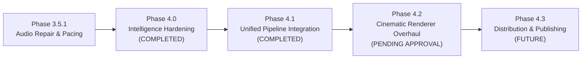

# SUPER.INTELLIGENCEEE — Implementation Roadmap (Post Phase 4.1)
**Document ID:** SEC-P41-RDM-20261107  
**Status:** PHASE 4.1 COMPLETED // PHASE 4.2 PENDING AUTHORIZATION  
**Author:** Antigravity Autonomous Systems Architecture  

---

## 1. Project Phase Trajectory & Status

---

## 2. Completed Milestones

### Phase 4.0: Intelligence Hardening (ACCEPTED)
- [x] Multi-source credibility scoring and publication date validation.
- [x] Factual claim extraction with qualitative architectural and quantitative benchmark classification.
- [x] Evidence grounding with supporting passage matching.
- [x] Contradictory source detection and status assignment.
- [x] Semantic topic deduplication and fatigue scoring.
- [x] Topic freshness scoring based on ISO-normalized dates.
- [x] Dossier provenance tracking and explicit selection rationales.
- [x] Source outage handling and graceful degradation.
- [x] 10/10 test pass rate (`tests/test_phase40_intelligence.py`).

### Phase 4.1: Unified Pipeline Integration (COMPLETED)
- [x] Created `UnifiedProductionPipeline` in `core/unified_pipeline.py`.
- [x] Live connection from topic intelligence to dynamic story architecture (`StoryArchitectureEngine`).
- [x] Dynamic scene planning with automated visual diversity analysis (`VisualDiversityAnalyzer`).
- [x] Exact audio duration synchronization with Voicebox Kokoro American English (`am_liam`).
- [x] Mandatory research qualifications preserved in research dossier, script, and visual plates:
  - 50× reduction restricted to self-checkpoint teacher on math benchmarks.
  - External teacher FLOP underperformance against GRPO clearly stated.
  - Academic preprint status explicitly disclosed.
- [x] Isolated 4-scene prototype rendered in `output/drafts/phase41_prototype/` (52.77s duration, 26.7ms sync delta, 5295.4 RMS).
- [x] Zero-publish enforcement and human approval gate (`NEEDS_REVIEW`) preserved.
- [x] 6/6 tests passing in dedicated suite (`tests/test_phase41_unified_pipeline.py`).
- [x] 5 legacy test failures cataloged and documented individually.

---

## 3. Proposed Phase 4.2: Cinematic Renderer Overhaul & Legacy Defect Resolution

Phase 4.2 requires explicit user approval before execution.

### Objective 1: Resolve the 5 Legacy Test Failures
- **Task 4.2.1:** Add optional `output_dir` support to `DocumentaryCompositor.__init__`.
- **Task 4.2.2:** Add `draw_corner_reticles` legacy compatibility method to `HUDTelemetryEngine`.
- **Task 4.2.3:** Add `output_lines` alias to `TerminalAnimator.render_frame`.
- **Task 4.2.4:** Reintroduce `_get_line_color` helper in `TerminalAnimator`.
- **Task 4.2.5:** Add `stages` argument alias to `VectorDiagramEngine.render_frame`.
- **Target:** 100% pass rate across all 26 repository tests.

### Objective 2: Advanced Visual Storytelling & Mathematical Motion
- **Task 4.2.6:** Implement mathematical formula rendering (dynamic LaTeX/KaTeX vector rasterization for equation rollouts).
- **Task 4.2.7:** Upgrade vector diagrams to support hierarchical tree structures and dynamic tensor dimension indicators.
- **Task 4.2.8:** Enhance kinetic typography with multi-layer parallax depth and directional light sweeps.
- **Task 4.2.9:** Implement subtle ambient motion grain and chromatic edge fringing for cinematic realism.

### Objective 3: Full 6-Scene Production Documentary
- **Task 4.2.10:** Render a full 6-scene documentary utilizing the upgraded visual renderer on the verified OPD vs. GRPO topic.
- **Task 4.2.11:** Execute comprehensive visual QA, dual-stream ffprobe verification, and generate high-resolution contact sheets.

---

## 4. Phase 4.3: Publishing & Automated Distribution (Future Scope)

- Human editorial web review portal.
- Social media distribution packaging (YouTube Shorts, X / Twitter, LinkedIn video).
- Automated thumbnail generation with high-impact editorial typography.
- Manual human cryptographic token sign-off required prior to upload execution.
