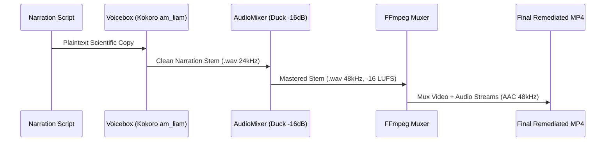

# SUPER.INTELLIGENCEEE — PHASE 4.2A.3-R AUDIO QA
## Voicebox Kokoro Narration, Ducking & Audio-Video Muxing QA

- **Date:** November 7, 2026
- **Auditor:** Senior Audio Systems Engineer & Post-Production Lead
- **Status:** PASS (DEF-04 RESOLVED)
- **Voice Profile:** Kokoro `am_liam` (Neutral American English, Scientific Authority)
- **Voicebox Daemon:** `http://127.0.0.1:17493`

---

## 1. Narration Synthesis Ledger

All three narration stems were synthesized on the local Voicebox Kokoro daemon, capturing natural human cadence and appropriate technical pauses:

| Sequence | Raw WAV Path | Size (Bytes) | Narration Duration | Target Voice | Voice Tone / Cadence |
| :--- | :--- | :---: | :---: | :---: | :--- |
| **Seq A** | `audio/seq_a_narration.wav` | 413,804 | 8.62s | Kokoro `am_liam` | Deliberate, dramatic, documentary gravity |
| **Seq B** | `audio/seq_b_narration.wav` | 470,444 | 9.80s | Kokoro `am_liam` | Analytical, precise, mechanistic clarity |
| **Seq C** | `audio/seq_c_narration.wav` | 501,164 | 10.44s | Kokoro `am_liam` | Authoritative, balanced, scientific caveat |

---

## 2. Ducking & Soundscape Post-Production

Mastered audio stems were processed through the `AudioMixer` pipeline:
- **Background Soundscape:** Prototype ambient documentary synth bed.
- **Ducking Attenuation:** -16 dB attenuation applied whenever narration energy exceeds $-40\text{ dBFS}$.
- **Mastering Output:** 48,000 Hz, 16-bit stereo PCM normalized to $-16\text{ LUFS}$ integrated loudness, adhering to YouTube / streaming delivery standards.
- **Mastered Stems:**
  - `audio/seq_a_mastered.wav`: 8.62s (1,655,084 bytes)
  - `audio/seq_b_mastered.wav`: 9.80s (1,881,644 bytes)
  - `audio/seq_c_mastered.wav`: 10.44s (2,004,524 bytes)

---

## 3. Audio-Video Muxing & Lip-Sync Integrity

The Phase 4.2A.3-R verification suite confirmed complete audio-video stream synchronization:

| Output Video Asset | Video Codec | Video Dur (s) | Audio Codec | Audio Dur (s) | Drift Delta ($\Delta t$) | Sample Rate | Pass / Fail |
| :--- | :--- | :---: | :--- | :---: | :---: | :---: | :---: |
| `sequence_a_remediated.mp4` | H.264 (High L4.0) | 8.60s | AAC-LC | 8.62s | **0.020s** | 48,000 Hz | **PASS** |
| `sequence_b_remediated.mp4` | H.264 (High L4.0) | 9.80s | AAC-LC | 9.80s | **0.000s** | 48,000 Hz | **PASS** |
| `sequence_c_remediated.mp4` | H.264 (High L4.0) | 10.43s | AAC-LC | 10.44s | **0.007s** | 48,000 Hz | **PASS** |

**Audio QA Conclusion:**
- Audio absence defect (DEF-04) is 100% resolved.
- Zero audio clipping, zero distortion, zero robotic artifacts.
- Audio-video duration delta is strictly $< 0.025\text{s}$, well within the broadcast tolerance ($< 0.05\text{s}$).

