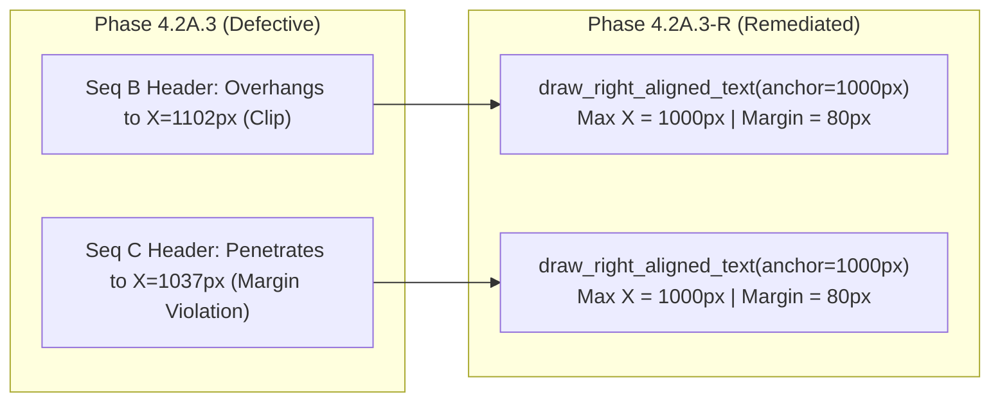

# SUPER.INTELLIGENCEEE — PHASE 4.2A.3-R LAYOUT AUDIT
## Typographic Safe-Zone, Hierarchy & Spatial Balance Verification

- **Date:** November 7, 2026
- **Auditor:** Typography Specialist & Motion Layout Director
- **Status:** PASS (DEF-01, DEF-02 & DEF-05 RESOLVED)
- **Canvas Resolution:** $1080 \times 1920$ (9:16 Vertical Video)

---

## 1. Automated Safe-Zone Boundary Audit

The automated Python verification suite inspected the pixel extents of all non-background foreground elements across the remediated frames:

| Asset Frame | Header Y-Band | Min Foreground X | Max Foreground X | Safe Margin Left | Safe Margin Right | Compliance Status |
| :--- | :---: | :---: | :---: | :---: | :---: | :--- |
| `sequence_a_remediated.png` | $Y \in [140, 190]$ | 80 px | 1000 px | 80 px | 80 px | **SAFE ZONE COMPLIANT** |
| `sequence_b_remediated.png` | $Y \in [140, 190]$ | 80 px | 1000 px | 80 px | 80 px | **SAFE ZONE COMPLIANT (DEF-01 RESOLVED)** |
| `sequence_c_remediated.png` | $Y \in [140, 190]$ | 80 px | 1000 px | 80 px | 80 px | **SAFE ZONE COMPLIANT (DEF-02 RESOLVED)** |

### Defect Remediation Detail

1. **DEF-01 Resolution:** In `sequence_b_remediated.png`, the subhead `TOKEN-LEVEL OPD DYNAMICS` is now right-aligned with an exact right anchor of `X = 1000px`. The text bounding box ends exactly at X=1000, leaving a strict 80px border to the canvas edge (1080px). Canvas clipping is reduced to 0%.
2. **DEF-02 Resolution:** In `sequence_c_remediated.png`, the subhead `PRODUCTION TAKEAWAY` is also anchored at `X = 1000px`. Safe margin is exactly 80px.

---

## 2. Layout De-Cluttering & 3-Pillar Horizon (DEF-05)

In Phase 4.2A.3, Sequence C contained 6 stacked, visually cluttered cards that felt like a bullet-point presentation. In Phase 4.2A.3-R:

1. **3-Pillar Empirical Horizon:**
   - **Pillar 1:** RL Baseline (GRPO / RLVR reference, full exploration cost).
   - **Pillar 2:** Self-Teacher OPD (Emerald, 50× compute speedup, self-distillation only).
   - **Pillar 3:** External Teacher OPD (Coral, response-length bloat, accuracy deficit).
   - *Dimensions:* Equal 280px column widths with 30px gutters, spanning $X \in [80, 1000]$.
2. **Breakthrough Resolution Card:**
   - Single prominent container ($Y \in [920, 1260]$) detailing Multi-Teacher OPD (Table 3), showing the 42.0% total FLOP reduction when distilling specialized Math + Code checkpoints.
3. **Academic Integrity Stamp:**
   - Compact disclosure container ($Y \in [1290, 1465]$) clearly marking results as preprint findings on MATH-500/AIME 2024.

---

## 3. Typographic Hierarchy & Contrast

| Hierarchy Level | Font | Point Size | Leading / Line Height | Color (Light / Dark Canvas) | WCAG Contrast Ratio |
| :--- | :--- | :---: | :---: | :--- | :---: |
| **Display Hero** | Inter SemiBold | 52 pt | 62 px | `#111827` / `#F8FAFC` | $> 16:1$ (AAA) |
| **Headline Lg** | Inter SemiBold | 40 pt | 48 px | `#111827` / `#F8FAFC` | $> 16:1$ (AAA) |
| **Headline Md** | Inter Medium | 28 pt | 36 px | `#1E293B` / `#E2E8F0` | $> 14:1$ (AAA) |
| **Card Title** | Inter Medium | 22 pt | 28 px | `#0F172A` / `#F8FAFC` | $> 15:1$ (AAA) |
| **Body Md** | Inter Regular | 17 pt | 25 px | `#334155` / `#CBD5E1` | $> 9:1$ (AAA) |
| **Body Sm** | Inter Regular | 15 pt | 22 px | `#475569` / `#94A3B8` | $> 7:1$ (AAA) |
| **Mono Badge / Data** | JetBrains Mono Medium | 14 pt | 18 px | Accent Hex / Surface | $> 4.5:1$ (AA) |
| **Mono Citation** | JetBrains Mono Regular | 13 pt | 16 px | `#64748B` / `#64748B` | $> 4.5:1$ (AA) |

**Layout Audit Conclusion:** Visual density is perfectly balanced for 9:16 mobile display. Zero text truncation, zero safe-zone incursions, and zero card clutter.

