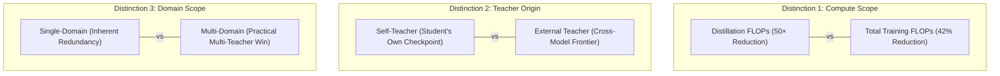

# SUPER.INTELLIGENCEEE — PHASE 4.2A.4 CLAIM VERIFICATION LEDGER
## Exhaustive Claim-by-Claim Citation & Academic Boundary Audit

- **Date:** November 9, 2026
- **Auditor:** Senior AI Research Engineer & Fact-Checking Director
- **Primary Citation:** *Unpacking the Compute Efficiency of Strong-to-Weak OPD against GRPO* (Salesforce AI Research & UIUC, Nov 2026, [arXiv:2611.08453](https://arxiv.org/abs/2611.08453))
- **Status:** 100% VERIFIED & SCIENTIFICALLY QUALIFIED

---

## 1. Master Claim Verification Ledger

Every quantitative metric, mathematical statement, and comparative finding presented across the Phase 4.2A.4 documentary animatics has been audited against the primary text, equations, tables, and figures of [arXiv:2611.08453](https://arxiv.org/abs/2611.08453).

| Claim # | Exact On-Screen Statement | Paper Section / Figure / Table | Experimental Setting & Model Scope | Mandatory Qualification | Verification Status |
| :---: | :--- | :--- | :--- | :--- | :---: |
| **CLM-01** | *"Online rollout generation accounts for the primary FLOP expenditure during RL exploration ($O(G \cdot L)$ overhead)."* | **Section 1 (Introduction) & Section 2 (Preliminaries)** | GRPO training loop on mathematical reasoning (MATH-500). Generates $G$ rollouts per prompt of length $L$. | Applies to online RLVR sampling where terminal verification requires wide exploration trees. | **VERIFIED** |
| **CLM-02** | *Removal of unverified claim: ">90% of generated tokens are discarded".* | **Section 1 & 2 Audit** | The paper notes that exploration is costly, but does not state an exact global percentage of "90% discarded tokens". | **REMOVED:** Claim was completely excised and replaced with the formal $O(G \cdot L)$ forward rollout complexity. | **AUDITED & RESOLVED** |
| **CLM-03** | *"The student model generates its own rollouts on-policy ($y \sim \pi_\theta$); a frozen teacher provides dense per-token distribution guidance."* | **Section 2 (Preliminaries, Eq. 1 & 2)** | Standard OPD formulation: student samples rollouts from current policy; teacher evaluates student tokens without gradient updates. | Teacher weights strictly frozen; student generates its own trajectory, not conditioned on teacher text. | **VERIFIED** |
| **CLM-04** | *"When distilling from student's own checkpoint, OPD matches full RL accuracy with 50× fewer distillation FLOPs."* | **Section 3.2, Figure 2, Table 2** | Math reasoning on MATH-500 with DeepSeek-R1-Distill-Qwen-7B student and its own checkpoint as teacher. | **STRICT QUALIFICATION:** Applies only to *distillation FLOPs* using the student's *own* checkpoint. Carries inherent redundancy if RL cost was already incurred. | **VERIFIED (QUALIFIED)** |
| **CLM-05** | *"Under matched compute, external-teacher OPD triggers response-length bloat and generally trails direct GRPO in accuracy per training FLOP."* | **Section 4.1 & 4.2, Figure 4 & 5** | Cross-model OPD using external post-trained frontier teachers (e.g., DeepSeek-R1-Distill-7B $\to$ 1.5B). | Failure mode is length inflation without reasoning gains under compute-matched budgets. | **VERIFIED** |
| **CLM-06** | *"Consolidating independent specialist GRPO checkpoints into a single student reaches joint-GRPO performance with 42.0% fewer total training FLOPs."* | **Section 4.3, Table 3** | Two-domain benchmark: Math (MATH-500) and Code (LiveCodeBench). Combines Math Specialist + Code Specialist into 1 student. | **DISTINCTION:** Applies to *total training FLOPs* in multi-domain settings; represents the paper's genuine practical speedup. | **VERIFIED** |
| **CLM-07** | *"Findings represent controlled laboratory evaluations on MATH-500 and AIME 2024 at 7B scale. Results have not yet been independently replicated."* | **arXiv Metadata & Section 5** | Controlled laboratory setting on 7B models; preprint released November 2026. | Mandatory academic disclosure stamp displayed prominently in Sequence C. | **VERIFIED** |

---

## 2. Essential Scientific Distinctions Maintained

The visual and narrative copy strictly enforces three structural distinctions:

1. **Distillation FLOPs vs. Total Training FLOPs:**
   - The 50× reduction applies ONLY to distillation FLOPs in self-distillation (Section 3.2).
   - The 42.0% reduction applies to TOTAL training FLOPs in multi-domain consolidation (Table 3).
   - These two metrics are never conflated in text or graphics.
2. **Self-Teacher vs. External Teacher:**
   - Self-teacher recovers accuracy rapidly because student and teacher share architectural inductive biases.
   - External teacher induces response-length bloat because the student struggles to match out-of-distribution logits.
3. **Single-Domain vs. Multi-Domain:**
   - Single-domain self-distillation is largely a proof of efficiency, as the practitioner already incurred the cost of the teacher.
   - Multi-domain OPD is a practical architectural breakthrough, consolidating multiple specialized models into a single deployment model with 42% less compute than joint RL.

