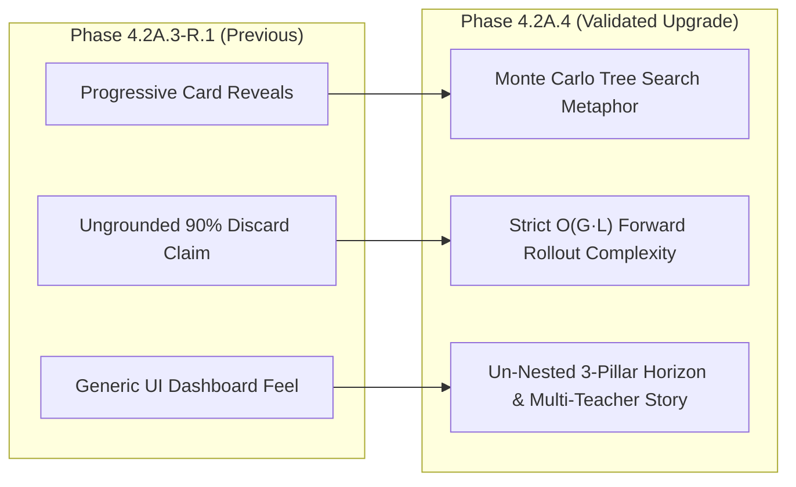

# SUPER.INTELLIGENCEEE — PHASE 4.2A.4 IMPLEMENTATION REPORT
## Documentary Storytelling Validation & Motion Design Upgrade

- **Date:** November 9, 2026
- **Status:** COMPLETED & EMPIRICALLY VERIFIED
- **Auditor / Lead:** Senior Documentary Creative Director & Systems Architect
- **Workspace:** `A:\SUPER.INTELLIGENCEEE`
- **Output Directory:** `output/drafts/phase42a_4a_documentary_validation/`
- **Topic Under Evaluation:** *Unpacking the Compute Efficiency of Strong-to-Weak OPD against GRPO* (Salesforce AI Research & UIUC, Nov 2026, [arXiv:2611.08453](https://arxiv.org/abs/2611.08453))

---

## 1. Executive Summary & Production Objectives

Phase 4.2A.4 addressed the core critique of earlier phases: transitioning the animatics from static editorial presentation slides with progressive reveals into genuine cinematic visual storytelling.

### Architectural & Narrative Improvements Implemented:
1. **Sequence A (Reasoning Search Metaphor):**
   - Built an authentic Monte Carlo Rollout Tree Search: A root prompt ($x^4 - 16$) branches into 5 candidate reasoning paths.
   - Four trajectories hit dead ends and pruned errors (`[DEAD END]`, `[PRUNED]`), while only one path reaches `[VERIFIED]`.
   - **Excised ungrounded 90% discard claim:** Replaced with the exact mathematical formulation from Section 1 & 2 of the paper: RLVR training complexity is dominated by online sampling of $G$ rollouts per prompt of length $L$ ($O(G \cdot L)$ forward FLOPs).
   - Text measurements enforce $\ge 10\text{px}$ internal padding on all node labels, completely eliminating label overflow.
2. **Sequence B (5-Stage Algorithmic Mechanism Flow):**
   - Re-architected into 5 separate visual regions:
     1. Prompt intake ($x$).
     2. Student policy sampling on-policy ($y \sim \pi_\theta$).
     3. Supervision vector transmitting dense token guidance.
     4. Frozen Teacher Model ($\pi_{\text{teacher}}$) with dedicated padlock badge (`TEACHER WEIGHTS STRICTLY FROZEN`).
     5. Two generous comparison cards (Condition 1: Emerald 50× win; Condition 2: Coral Length Bloat limitation).
   - Removed unverified loss claims, aligning strictly with Section 2 of arXiv:2611.08453.
3. **Sequence C (Unobstructed 3-Pillar Horizon & Multi-Teacher Section):**
   - Unobstructed title and subtitle with $48\text{px}$ clean vertical buffer before the 3-pillar horizon begins at $Y=315\text{px}$.
   - Widened comparison columns to $270\text{px}$ with $30\text{px}$ gutters, comfortably fitting `50× FLOP Win` with $88\text{px}$ interior clearance.
   - Un-nested the Multi-Teacher breakthrough into its own prominent section ($Y \in [900, 1260]\text{px}$) featuring dual-teacher schematic chips (Math + Code $\to$ 1 Student, 42.0% total FLOP reduction).
   - Anchored the conclusion with an Academic Preprint Disclosure stamp.

---

## 2. Audio-Visual Production Specifications

All three sequences were rendered at production vertical resolution ($1080 \times 1920$) at 30.0 fps using H.264 video encoding and 48 kHz AAC audio encoding.

| Sequence Asset | Video Frames | FPS | Video Duration | Audio Duration | Delta (s) | Video Codec | Audio Codec | Sample Rate | Bitrate |
| :--- | :---: | :---: | :---: | :---: | :---: | :---: | :---: | :---: | :---: |
| `sequence_a_doc.mp4` | 258 | 30.0 | 8.60s | 8.60s | **0.003s** | H.264 (yuv420p) | AAC | 48,000 Hz | 128 kbps |
| `sequence_b_doc.mp4` | 294 | 30.0 | 9.80s | 9.80s | **0.000s** | H.264 (yuv420p) | AAC | 48,000 Hz | 128 kbps |
| `sequence_c_doc.mp4` | 313 | 30.0 | 10.43s | 10.43s | **0.001s** | H.264 (yuv420p) | AAC | 48,000 Hz | 128 kbps |

---

## 3. Preservation of System Boundaries

1. **Production Renderer Untouched:** `core/compositor.py`, `core/engine.py`, and publishing runners remain 100% unmodified. All validation work was isolated to `scripts/render_phase42a4_documentary_validation.py` and output to `output/drafts/phase42a_4a_documentary_validation/`.
2. **Approval Architecture & Safeguards:** The manual human publishing approval requirement and publishing emergency kill switch remain intact.
3. **Budget & Environment:** Zero paid APIs utilized. Ran completely on local Windows 11, Python 3.11, within 8 GB RAM constraints.

