# SUPER.INTELLIGENCEEE — PHASE 4.2A.4 MOTION-EVENT TIMELINE
## Purposeful Narrative Motion Design & Event Choreography

- **Date:** November 9, 2026
- **Auditor / Lead:** Senior Motion Designer & Visual Effects Director
- **Status:** VALIDATED
- **Standard:** Every animation event must serve a distinct storytelling purpose tied to the spoken narration. Zero decorative particles, zero unmotivated scanning beams, zero background luminance flicker.

---

## 1. Sequence A Motion-Event Choreography
**Asset:** `sequence_a_doc.mp4` | **Duration:** 8.60s (258 frames @ 30.0 fps)  
**Narration:** *"Group Relative Policy Optimization delivers frontier reasoning, but exploring vast mathematical solution spaces creates a massive compute bottleneck."*

```mermaid
gantt
    title Sequence A: Narrative Motion Timeline
    dateFormat X
    axisFormat %s s
    section Narrative Cues
    "Prompt Entry & Root State" :0, 2
    "Branching Trajectory Expansion" :2, 5
    "Dead-End Rejection & Pruning" :5, 7
    "Verified Path & Compute Context" :7, 9
```

| Event ID | Timestamp Range | Event Type | What Changes On-Screen | Why It Changes (Narration Trigger) | Viewer Takeaway |
| :--- | :---: | :---: | :--- | :--- | :--- |
| **EVT-A1** | $0.00\text{s} - 1.80\text{s}$ *(Frames 0–54)* | **Spatial & Informational** | The Root Problem State ($x^4 - 16$) illuminates center-stage ($X=540, Y=430$) within an active neural container. The problem boundary establishes the origin of search. | Triggered by *"Group Relative Policy Optimization..."*. Establishes the mathematical problem origin. | The reasoning process does not begin with an answer; it begins from an unsolved prompt state in a formal domain (MATH-500). |
| **EVT-A2** | $1.80\text{s} - 5.50\text{s}$ *(Frames 54–165)* | **Transformational & Spatial** | Five candidate trajectories fan out dynamically downward. Vectors trace progressively into intermediate mathematical thought nodes ($\tau_1$ through $\tau_5$), revealing candidate algebraic steps. | Triggered by *"...but exploring vast mathematical solution spaces..."*. Visualizes wide exploration search. | The model cannot simply guess or predict a single line; it must sample multiple divergent chains of thought across the search tree. |
| **EVT-A3** | $5.50\text{s} - 7.20\text{s}$ *(Frames 165–216)* | **Transformational (Pruning)** | Four of the five paths terminate: Branch 1 turns muted amber (`[INCOMPLETE]`); Branch 2 flashes coral red (`[EXPANSION ERROR]`); Branch 4 flashes coral red (`[INVALID STEP]`); Branch 5 turns amber (`[REDUNDANT LOOP]`). Unrewarded branches dim to 30% opacity. | Triggered by *"...creates a massive compute bottleneck."* Visualizes failure of non-viable reasoning paths. | Exploration in RL reasoning is brutal: most candidate steps fail mathematical verification and provide zero terminal reward. |
| **EVT-A4** | $7.20\text{s} - 8.60\text{s}$ *(Frames 216–258)* | **Informational & Spatial** | Branch 3 illuminates with vibrant emerald glow (`[VERIFIED SOLUTION]`), while the bottom Compute Exhaustion card appears, showing that $O(G \cdot L)$ forward rollouts dominate training compute. | Concluding clause on compute expenditure. Connects visual dead-ends to computational reality. | The compute bottleneck is generating dozens of full-length rollouts during search, not backward gradient propagation. |

---

## 2. Sequence B Motion-Event Choreography
**Asset:** `sequence_b_doc.mp4` | **Duration:** 9.80s (294 frames @ 30.0 fps)  
**Narration:** *"The student model generates rollouts; a frozen teacher provides per-token supervision. When distilling from the student's own checkpoint, OPD matches full RL accuracy with fifty times fewer distillation FLOPs. But with external teachers, OPD struggles."*

```mermaid
gantt
    title Sequence B: Narrative Motion Timeline
    dateFormat X
    axisFormat %s s
    section Narrative Cues
    "Student On-Policy Rollout" :0, 3
    "Teacher Logit Supervision" :3, 6
    "Self-Teacher 50x Win" :6, 8
    "External Teacher Bloat" :8, 10
```

| Event ID | Timestamp Range | Event Type | What Changes On-Screen | Why It Changes (Narration Trigger) | Viewer Takeaway |
| :--- | :---: | :---: | :--- | :--- | :--- |
| **EVT-B1** | $0.00\text{s} - 3.20\text{s}$ *(Frames 0–96)* | **Transformational & Spatial** | Prompt tokens enter the Student Policy container. The student generates its own rollout tokens (`Factor`, `x⁴-16`, `= (x²-4)(x²+4)`) sequentially with active blue focus highlights. | Triggered by *"The student model generates rollouts..."*. Establishes on-policy generation. | The student is generating on its own policy distribution ($y \sim \pi_\theta$), not simply memorizing offline data or teacher demonstrations. |
| **EVT-B2** | $3.20\text{s} - 5.80\text{s}$ *(Frames 96–174)* | **Informational & Spatial** | The Frozen Teacher Model box illuminates below with padlock status badge (`TEACHER WEIGHTS STRICTLY FROZEN`). Vertical supervisory vectors stream dense per-token distribution guidance into the student weights $\theta$. | Triggered by *"...a frozen teacher provides per-token supervision."*. Explains the distillation mechanism. | The teacher evaluates student-generated tokens without gradient updates; dense distribution matching replaces terminal sparse rewards. |
| **EVT-B3** | $5.80\text{s} - 7.50\text{s}$ *(Frames 174–225)* | **Spatial & Informational** | Condition 1 (Self-Teacher OPD) card slides in with an emerald border and animated FLOP efficiency indicator showing 50× reduction. | Triggered by *"When distilling from the student's own checkpoint..."*. Introduces the primary lab speedup. | When the teacher is the student's own checkpoint, distillation recovers full accuracy at a fraction of search compute. |
| **EVT-B4** | $7.50\text{s} - 9.80\text{s}$ *(Frames 225–294)* | **Spatial & Informational** | Condition 2 (External Teacher OPD) card reveals with a coral border and animated Length Bloat warning bar. | Triggered by *"But with external teachers, OPD struggles."*. Highlights the critical failure mode. | External frontier teachers trigger response verbosity and fail to beat direct GRPO under matched compute budgets. |

---

## 3. Sequence C Motion-Event Choreography
**Asset:** `sequence_c_doc.mp4` | **Duration:** 10.43s (313 frames @ 30.0 fps)  
**Narration:** *"OPD is not a universal compute accelerator. While self-distillation yields a 50× distillation speedup, external teachers underperform. In multi-domain settings, however, multi-teacher OPD reaches joint-GRPO performance with forty-two percent fewer training FLOPs."*

```mermaid
gantt
    title Sequence C: Narrative Motion Timeline
    dateFormat X
    axisFormat %s s
    section Narrative Cues
    "Title & Direct GRPO Baseline" :0, 3
    "Regimes 2 & 3 Comparison" :3, 6
    "Multi-Teacher 42% Consolidation" :6, 9
    "Preprint Rigor & Outro" :9, 11
```

| Event ID | Timestamp Range | Event Type | What Changes On-Screen | Why It Changes (Narration Trigger) | Viewer Takeaway |
| :--- | :---: | :---: | :--- | :--- | :--- |
| **EVT-C1** | $0.00\text{s} - 3.00\text{s}$ *(Frames 0–90)* | **Spatial & Informational** | Unobstructed headline `OPD is Not a Universal Accelerator` and subtitle settle cleanly. Column 1 (Direct GRPO Baseline) resolves as the 1.0× reference benchmark. | Triggered by *"OPD is not a universal compute accelerator."*. Establishes the qualified thesis. | Reinforcement learning without distillation remains the uncompromised exploration standard. |
| **EVT-C2** | $3.00\text{s} - 6.20\text{s}$ *(Frames 90–186)* | **Transformational & Spatial** | Column 2 (Self-Teacher, Emerald `50× FLOP Win`) and Column 3 (External Teacher, Coral `Length Bloat`) reveal side-by-side in balanced 270px columns. | Triggered by *"While self-distillation yields a 50× distillation speedup, external teachers underperform."*. Contrasts single-domain regimes. | Distillation efficiency is not inherent to the algorithm; it depends entirely on whether the teacher is an internal checkpoint or external model. |
| **EVT-C3** | $6.20\text{s} - 8.80\text{s}$ *(Frames 186–264)* | **Spatial & Transformational** | Dedicated Multi-Teacher Breakthrough section illuminates below with dual-teacher chips (`Math-Specialist` + `Code-Specialist` $\to$ `1 Joint Student`) and animated 42.0% FLOP reduction bar. | Triggered by *"In multi-domain settings, however, multi-teacher OPD reaches joint-GRPO performance with forty-two percent fewer training FLOPs."*. | Multi-teacher consolidation is the paper's genuine practical speedup: combining specialists saves compute without response bloat. |
| **EVT-C4** | $8.80\text{s} - 10.43\text{s}$ *(Frames 264–313)* | **Informational** | Academic Preprint Disclosure stamp settles into the footer, stating laboratory scope on MATH-500/AIME 2024 at 7B scale. | Outro cadence and pause. Closes the documentary with academic rigor. | Results are frontier lab findings awaiting peer-reviewed replication across foundation model scales. |

---

## 4. Elimination of Artificial Motion Techniques

The following artificial motion techniques were audited and confirmed removed from the rendering code:
- **Zero Random Particles:** Background particles used in earlier animatics to artificially raise frame delta metrics were completely stripped.
- **Zero Luminance Flicker:** Background canvas colors are strictly constant (`#080C15` in Seq A, `#FAF9F6` in Seq B & C).
- **Zero Unmotivated Scanning Beams:** Removed generic horizontal laser lines.
- **Zero Arbitrary Camera Wobble:** Micro-drift was replaced with stable, readable framing designed for mobile consumption.

