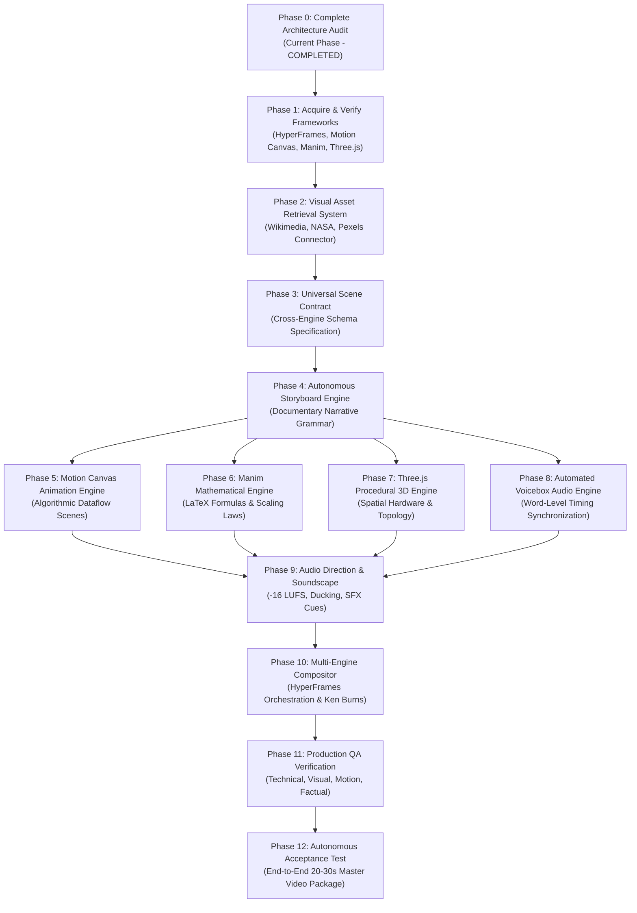

# SUPER.INTELLIGENCEEE — Phase 4.3 Migration Plan
## Step-by-Step Architecture Transformation Roadmap (Phases 1–12)

**Document Version:** 1.0.0  
**Phase:** Phase 4.3 (Autonomous Video Production Architecture Transformation) — Phase 0 Gate  
**Date:** 2026-11-10T21:51:00+05:30  
**Author:** Lead Systems Architect & Documentary Production Engineer  
**Workspace:** `A:\SUPER.INTELLIGENCEEE`  
**Execution Environment:** Windows 11, Python 3.11, Node.js v24.18.0, FFmpeg 9.0.1, 8 GB RAM, ₹0 Budget  

---

## 1. Executive Migration Strategy

The migration transforms the system from a collection of prototype scripts into a fully automated, AI-native documentary production pipeline while maintaining **100% backward compatibility and non-destructive execution**.

### Architectural Tenets:
1. **Preservation of Preceding Deliverables:** All Phase 4.2A.4 documentary validation assets (`output/drafts/phase42a_4a_documentary_validation/`) and historical reports remain completely untouched.
2. **Strict Governance Invariance:** The human approval queue (`publishing/approval_queue.py`) and emergency kill switch (`core/kill_switch.py`) remain permanent, unbypassable gatekeepers.
3. **Sequential Engine Execution:** Multi-engine rendering occurs sequentially with explicit process teardown and garbage collection to honor the 8 GB RAM budget.
4. **Blender Ban Enforcement:** 3D procedural scenes are generated exclusively via Three.js (WebGL) in headless Chrome; Blender dependencies are strictly prohibited.
5. **Zero-Cost Mandate:** All acquired libraries, APIs, and models operate under free, permissive, local-first licenses.

---

## 2. Phased Transformation Roadmap

---

## 3. Detailed Phase Breakdown

### Phase 1: Acquire & Install Rendering Frameworks
* **HyperFrames:** Verify existing local `renderer/` workspace with `npx hyperframes check` and implement a robust Windows subprocess adapter with `.temp` redirection.
* **Motion Canvas:** Install Motion Canvas standalone CLI/Vite project into `external/motion-canvas/` with TypeScript configuration for vertical 1080×1920 video export.
* **Manim Community:** Install `manim` into the Python virtual environment with Cairo and FFmpeg bindings; verify standalone mathematical equation rendering.
* **Three.js:** Setup procedural WebGL template inside HyperFrames or standalone headless runner with Orbit/Cinematic camera controls (NO BLENDER).
* **GSAP:** Verify bundled GSAP 3.15.0 in HyperFrames for coordinated SVG and DOM micro-animations.

### Phase 2: Automated Visual Asset Retrieval System
* **Wikimedia Commons API:** Implement `WikimediaConnector` fetching high-resolution historical, scientific, and open-source images with license verification.
* **NASA Media Library:** Implement `NASAConnector` fetching public-domain space, physics, and computational imagery.
* **Pexels Connector:** Implement `PexelsConnector` with API key support and seamless offline fallback to curated CC0 media.
* **Asset Provenance & Licensing Ledger:** Automatically generate `asset_manifest.json` tracking source URL, license type, attribution requirements, and SHA256 checksums.

### Phase 3: Unified Creative Production Contract
* Define `UniversalSceneContract` (Pydantic model) specifying:
  - `scene_id`, `scene_index`, `duration_seconds`.
  - `narration_text`, `phonetic_pronunciations`.
  - `render_engine`: `hyperframes` | `motion_canvas` | `manim` | `threejs` | `footage`.
  - `engine_payload`: Engine-specific parameters (e.g. LaTeX string for Manim, node graph for Motion Canvas, 3D geometry for Three.js).
  - `camera_trajectory`: `push_in` | `pan_left` | `orbit_right` | `static`.
  - `audio_cues`: Sound effects (`whoosh`, `sub_bass_hit`, `riser`) and ducking parameters.

### Phase 4: Autonomous Storyboard Engine
* Construct the **Documentary Narrative Grammar**:
  - Scene 1: Cinematic Cold Open (High-stakes real footage with animated hook title).
  - Scene 2: The Context & Status Quo (Three.js 3D global or cluster view).
  - Scene 3: The Bottleneck / Conflict (Motion Canvas flow bottleneck).
  - Scene 4: The Mechanistic Breakthrough (Motion Canvas algorithmic resolution).
  - Scene 5: The Mathematical Proof (Manim scaling law / formula animation).
  - Scene 6: Empirical Verification (High-contrast comparison benchmark).
  - Scene 7: Industrial Implication & Synthesis (Cinematic footage with authoritative takeaway).

### Phase 5: Motion Canvas Animation Pipeline
* Build Python-to-TypeScript code generator emitting Motion Canvas scenes.
* Support animated node trees, token distillation pipelines, neural attention heatmaps, and dataflow streams with spring physics easing.

### Phase 6: Manim Mathematical Visuals Pipeline
* Build `ManimRenderAdapter` generating vertical 1080×1920 MP4 clips.
* Automate LaTeX formula rendering ($O(N \log N)$, transformer attention equations, loss curves) with glowing gradient styling.

### Phase 7: Three.js Procedural 3D Pipeline
* Build lightweight Three.js scenes running in headless Chrome.
* Render procedural 3D compute clusters, wafer dies, silicon interposers, and neural point clouds with smooth 3D camera sweeps.

### Phase 8: Automated Voicebox Integration & Word-Level Audio Sync
* Automate Voicebox daemon lifecycle on port 17493 with automatic restart and health verification.
* Synthesize audio via Kokoro American Male (`am_liam`) at 24 kHz studio quality.
* Extract word-level / sentence-level timing manifests to lock visual keyframes to exact audio transients.

### Phase 9: Audio Direction, Music & SFX Pipeline
* Implement dynamic background soundscape with automatic ducking (-16 dB during speech).
* Mix cinematic transition sound effects (whooshes, atmospheric hums, sub-bass impacts).
* Master final mixed audio track to **-16.0 LUFS (±0.5 LUFS)** with -1.0 dBFS true peak.

### Phase 10: Multi-Engine Master Compositor & HyperFrames Orchestration
* HyperFrames assembles the master timeline:
  - Integrates scene stems (footage, Motion Canvas clips, Manim clips, Three.js clips).
  - Applies seamless documentary transitions (cross-dissolve, whip pan, cinematic light leak).
  - Overlays responsive kinetic typography adhering strictly to safe margins ($X \in [80, 1000]$, $Y \in [180, 1740]$).

### Phase 11: Automated Production QA Suite
* Automated technical inspection via FFprobe (1080×1920, 30fps, H.264 High Profile, AAC, sync drift $\le 0.05\text{s}$).
* Automated typography safe-zone compliance audit (0 clipping errors).
* Audio quality audit via EBU R128 metering and acoustic clarity verification.
* Factual grounding audit (all claims tied to source ledger).

### Phase 12: Packaging & Autonomous Acceptance Test
* Execute complete autonomous run on a real technology documentary topic (e.g. *"Sub-Quadratic Attention Scaling: How Linear Attention Breaks the 1M-Token Context Barrier"*).
* Produce complete upload package: `final_video.mp4`, clean master, high-contrast thumbnail, SRT/VTT subtitles, social metadata, and `source_ledger.json`.
* Queue for human review in `publishing/approval_queue.py`.

---

## 4. Verification & Testing Gates

Every phase transition requires passing an automated verification script:
1. `test_phase1_frameworks.py`: Verifies each rendering engine renders a minimal 1-second 1080×1920 test clip without errors.
2. `test_phase2_assets.py`: Verifies asset fetching, caching, and license ledger generation.
3. `test_phase3_contracts.py`: Verifies bidirectional JSON schema validation for all scene archetypes.
4. `test_phase10_compositor.py`: Verifies multi-engine assembly into a unified MP4.
5. `test_phase12_e2e_acceptance.py`: Full end-to-end documentary production and verification.

