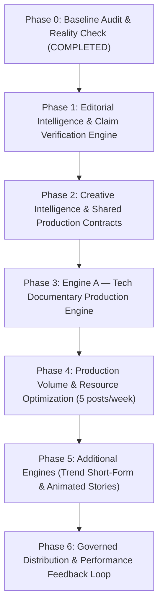

# SUPER.INTELLIGENCEEE — Implementation Roadmap: AI-Native Technology Media Operating System

**Date:** 2026-11-06  
**Architecture Vision:** Transform SUPER.INTELLIGENCEEE from an automated video generator into a full-scale, evidence-grounded AI technology media operating system producing 5 high-quality posts per week under ₹0 operating budget and 8 GB RAM constraints.

---

## 1. Phased Architecture Master Plan

---

## 2. Phase Breakdown and Deliverables

### Phase 0: Baseline Audit & Reality Check (Current)
- **Status:** **COMPLETE**
- **Deliverables Produced:**
  - `reports/CHANNEL_OPERATING_BASELINE.md`
  - `reports/EXISTING_PIPELINE_MAP.md`
  - `reports/RESOURCE_INTEGRATION_MATRIX.md`
  - `reports/CRITICAL_RISK_REGISTER.md`
  - `reports/IMPLEMENTATION_ROADMAP.md`
- **Key Findings:** Empirical identification of 14 specific risks, confirmation of zero-budget operation, and validation of 101/101 baseline tests passing.

---

### Phase 1: Editorial Intelligence & Claim Verification Engine
- **Implementation Priority:** **NEXT IMMEDIATE PHASE**
- **Key Objectives:**
  1. **Topic Discovery & Multi-Channel Harvesting:** Connect to official announcements, research preprints (arXiv/bioRxiv), GitHub repositories, and credible publications.
  2. **100-Point Transparent Opportunity Scoring Matrix:**
     - Information Value: 25 pts
     - Originality: 20 pts
     - Evidence Quality: 20 pts
     - Audience Relevance: 15 pts
     - Visual Potential: 10 pts
     - Timeliness: 10 pts
     - Scoring thresholds: 80–100 (High Priority), 65–79 (Consider), 50–64 (Research Further), <50 (Reject).
  3. **Structured Research Dossier (`ResearchDossier`):**
     - Contains topic ID, primary & supporting source URLs, publication timestamps, extracted factual claims, technical explanation, uncertainties, limitations, and visual opportunities.
  4. **True Claim-Level Fact Verification:**
     - Evaluates script statements against raw source documents and citations rather than internal SQLite summaries.
     - Enforces independent separation: script writer cannot mark its own claims verified.
     - Unsupported statements marked `UNVERIFIED`. Insufficient research triggers `RESEARCH_BLOCKED`.
     - Zero tolerance for synthetic boilerplate (eliminate generic phrases in `fallback_templates.py`).
  5. **State Machine Expansion:**
     - Formal states: `DISCOVERED` -> `SCORING` -> `RESEARCHING` -> `RESEARCH_VERIFIED` -> `BRIEF_APPROVED` -> `SCRIPT_READY`.
- **Target Files:**
  - `core/schemas.py` (Add `ResearchDossier`, `ScoredTopic`, `ClaimVerificationRecord`)
  - `research/topic_scorer.py` (Implement 100-point transparent matrix)
  - `research/source_verifier.py` (Implement deep source text fetching & citation matching)
  - `content/fact_checker.py` (Upgrade to verify against `ResearchDossier`)
  - `intelligence/fallback_templates.py` (Remove generic synthetic claims)
  - `tests/test_v2_editorial_intelligence.py` (Comprehensive test suite)

---

### Phase 2: Creative Intelligence & Shared Production Contracts
- **Implementation Priority:** Secondary
- **Key Objectives:**
  1. **Unified Data Contracts:**
     - Standardize `Topic`, `Source`, `ResearchDossier`, `Claim`, `ContentBrief`, `Script`, `Scene`, `Asset`, `ProductionJob`, `QAReport`, `Approval`, `PublishingPackage`.
  2. **Decoupled Dynamic Story Planning:**
     - Break free from the rigid 7-scene lock. Allow dynamic scene counts ($N \in [3, 12]$) based on story structure (e.g. 3-scene fast alert vs 9-scene deep technical documentary).
  3. **Creative Direction Workflow:**
     - Follow workflow: `Topic -> Research -> Editorial Angle -> Story Structure -> Script -> Creative Direction -> Scene Plan -> Production`.
     - Every brief specifies intended audience, learning objective, central question, and visual/audio treatment.

---

### Phase 3: Engine A — Tech Documentary Production Engine
- **Implementation Priority:** First Creative Engine to Complete
- **Key Objectives:**
  1. **Dedicated Module Structure:**
     - Build under `creative/tech_documentary/`.
  2. **Visual Production Capabilities:**
     - Real software demos and screen captures.
     - Cinematic technical B-roll and animated architectural diagrams.
     - Kinetic typography with scene-specific color palettes and typography hierarchy.
     - Dynamic transitions and visual callouts (depth/camera movements via FFmpeg/HyperFrames).
     - Full synchronization between Jarvis British RP male narration, sound effects, and music.
  3. **Rendering Stack Unification:**
     - Deprecate legacy V1 card renderer (`rendering/video_renderer.py`). Route all rendering through the unified V2 HyperFrames/FFmpeg pipeline.
  4. **Strict Asset Management:**
     - File hash, source URL, license type, retrieval date, and usage restriction tracking. No asset registration failures swallowed.

---

### Phase 4: Production Volume & Resource Optimization (5 Posts / Week)
- **Key Objectives:**
  1. **Batching Workflows:** Batch topic research, audio synthesis, and visual rendering sequentially.
  2. **Memory & Concurrency Governance:** Strict sequential execution keeping peak RAM usage below 4.5 GB on an 8 GB workstation.
  3. **Automated Storage Management:** Automated cleanup rotating intermediate WAV/PNG/MP4 draft buffers older than 7 days while permanently preserving approved reels.
  4. **Production Cadence Ramping:** Validate 3 posts/week, stabilize at 4 posts/week, achieve target 5 posts/week.

---

### Phase 5: Additional Creative Engines
- **Key Objectives:**
  1. **Engine B — Trend-Driven Short-Form (`creative/trend_shortform/`):**
     - Fast opening hooks, rapid context, vital technical data, concise conclusion.
  2. **Engine C — Animated Storytelling (`creative/animated_storytelling/`):**
     - Conceptual explanations, original non-copyrighted characters, scene-to-scene visual continuity.

---

### Phase 6: Governed Distribution & Performance Feedback Loop
- **Key Objectives:**
  1. **Publishing Security Hardening:**
     - Call `kill_switch.assert_not_active()` in `InstagramIntegration` and `YouTubeIntegration`.
     - Prevent duplicate queue insertions in `publishing/queue.py`.
     - Require explicit authorized reviewer validation against `owner_config.py`.
  2. **Performance Analytics Feedback Loop:**
     - Ingest real audience metrics (views, retention, completion rate, shares, saves) into SQLite.
     - Connect `AnalyticsAgent` into orchestrator reporting to empirically guide future topic scoring and hook design.

