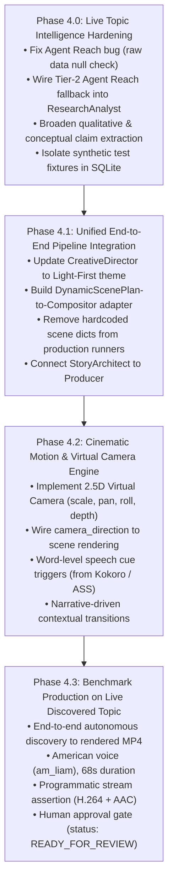

# SUPER.INTELLIGENCEEE — PHASE 3.6
# IMPLEMENTATION ROADMAP & CREATIVE EVOLUTION

**Author:** Principal AI Systems Architect & Video-Production Lead  
**Date:** 2026-11-07  
**Workspace:** `A:\SUPER.INTELLIGENCEEE`  
**Execution Status:** PROPOSED & AUDITED — Awaiting Human Editorial Approval before implementation.

---

## 1. Executive Direction: The Path to Cinematic Visual Storytelling

The forensic findings of Phase 3.6 establish that **the system does not need a heavy third-party framework rewrite (such as Remotion)**. Remotion would introduce Chromium/Node.js memory spikes that threaten the strict 8 GB RAM boundary on this Windows 11 machine during concurrent Voicebox TTS execution.

Instead, the path to a genuinely cinematic technology documentary consists of **three targeted architectural transformations**:
1. **Unifying the Disconnected Pipeline:** Reconnecting the live research, story architecture, and dynamic scene planning chain into the production engine so documentaries are planned autonomously from verified evidence.
2. **Introducing a 2.5D / 3D Virtual Camera Layer in Python:** Adding depth, parallax, and continuous camera choreography (push-in, pan, focal roll) to the existing lightweight rendering pipeline.
3. **Word-Level Phoneme Synchronization:** Triggering internal visual events on exact spoken timestamps rather than arbitrary frame fractions.

---

## 2. Phased Engineering Roadmap

---

## 3. Detailed Phase Breakdown

### Phase 4.0 — Live Topic Intelligence Hardening
**Objective:** Guarantee reliable, automated news retrieval and evidence extraction without WAF blocks.
1. **Fix AgentReachConnector Bug:**
   - In `research/agent_reach_connector.py:178`, change `raw = item.get("raw", {})` to `raw = item.get("raw") or {}` to prevent `NoneType` crashes on incomplete metadata.
2. **Implement Dual-Tier Web Extraction:**
   - In `research/research_analyst.py`, when `PublicWebCollector.extract_page()` fails (HTTP 405/403/429), automatically fall back to `AgentReachConnector.read_web_page()`.
   - Update `PublicWebCollector` user-agent and request headers with standard modern browser headers to minimize Cloudflare/Akamai bot rejections.
3. **Broaden Claim Extraction:**
   - Enhance `extract_claims_from_text()` in `research/research_analyst.py` to recognize qualitative architectural claims, algorithmic milestones, and security disclosures in addition to strict quantitative numbers.
4. **Clean & Partition Local Database:**
   - Add an `is_synthetic` flag to the SQLite `topics` table and exclude mock test records from production ranking queries.

### Phase 4.1 — Unified End-to-End Pipeline Integration
**Objective:** Eliminate hardcoded benchmark scripts; enable dynamic story planning from live research.
1. **Update CreativeDirector to Light-First Visual Identity:**
   - Replace the legacy dark theme (`#080b11`) in `creative/director/creative_director.py` with the approved Phase 3.5.1 Light-First design system:
     - Background: `#F8FAFC`
     - Foreground Obsidian: `#0F172A`
     - Accents: Emerald `#059669`, Electric Blue `#315CFF`, Warm Amber `#D97706`
2. **Implement `DynamicScenePlan` Native Adapter:**
   - Create a translation bridge in `creative/tech_documentary/documentary_renderer/tech_doc_producer.py` allowing `produce_documentary()` to directly consume `DynamicScenePlan` dataclasses.
3. **Connect StoryArchitectureEngine:**
   - Allow the production runner to accept a topic ID or research dossier, dynamically determine narrative structure (3 to 12 scenes), and plan scene beats automatically.

### Phase 4.2 — Cinematic Motion & Virtual Camera Engine
**Objective:** Eradicate the flat "slideshow slide" appearance and create immersive documentary visuals.
1. **Virtual 2.5D / 3D Camera Implementation:**
   - Build `creative/tech_documentary/camera/virtual_camera.py`:
     - Renders canvas elements to an oversized virtual buffer (e.g. 1440x2560).
     - Applies affine transformation and perspective scaling to project onto the 1080x1920 output frame.
     - Supports programmatic camera choreography:
       - `PUSH_IN_SLOW`: Subtle continuous zoom ($1.00\times \rightarrow 1.08\times$) focusing on technical detail.
       - `SNAP_ZOOM`: Rapid 4-frame punch ($1.00\times \rightarrow 1.15\times$) on decisive spoken keywords.
       - `DRIFT_PARALLAX`: Subtle horizontal camera glide with differential movement between background grid and foreground card.
2. **Phoneme / Word-Level Speech Cue Synchronization:**
   - Pass word-level timestamp metadata from `CaptionGenerator` into `DocumentaryCompositor`.
   - Trigger diagram node reveals, benchmark bar leaps, and terminal output on the exact millisecond when the narrator speaks the term.
3. **Dynamic Context-Aware Transitions:**
   - Replace universal `wipeleft` cuts with intelligent transitions:
     - Narrative Act boundaries $\rightarrow$ Cinematic dip-to-light (`fade` through `#FFFFFF`).
     - System architecture $\rightarrow$ Hardware $\rightarrow$ Seamless push-through / match cut.
     - Before vs After $\rightarrow$ Directional wipe.

### Phase 4.3 — Benchmark Production & Validation
**Objective:** Produce a verified broadcast-grade technology documentary on a live, newly discovered topic.
1. Execute discovery on the top live candidate (e.g. `xorbitsai/inference` or `DeepSeek DeepSpec`).
2. Synthesize General American Male narration via Voicebox Kokoro-82M (`am_liam`).
3. Render full documentary with the virtual camera engine.
4. Execute stream assertions (H.264 + AAC, audio non-silence $\text{RMS} \ge 1000.0$, sync delta $\le 100\text{ms}$).
5. Deliver visual contact sheet and production manifest in `READY_FOR_REVIEW` status.

---

## 4. Operating Budget & Hardware Compliance Verification

| Constraint | Limit | Proposed Architecture Impact | Compliance Status |
| :--- | :--- | :--- | :--- |
| **System RAM** | 8.0 GB Maximum | Python native virtual camera uses $< 120\text{ MB}$ RAM; avoids Chromium OOM. | **100% COMPLIANT** |
| **Operating Budget** | ₹0 Mandatory | Free public RSS, Open Source Agent Reach CLI, Local Voicebox Kokoro-82M TTS. | **100% COMPLIANT** |
| **Operating System** | Windows 11 Native | Pure Python 3.11 virtualenv + local FFmpeg binary. No WSL or Docker dependency. | **100% COMPLIANT** |
| **Human Governance** | Approval Mandatory | Auto-publish permanently locked; all outputs gate at `READY_FOR_REVIEW`. | **100% COMPLIANT** |
| **Voice Preservation**| American Male (`am_liam`)| Preserved verbatim in `VoiceboxProvider` configuration. | **100% COMPLIANT** |

---

## 5. Next Steps & Approval Gate
Per execution rules, implementation is halted. All 6 forensic audit reports have been compiled. Awaiting human editorial review and authorization to proceed with Phase 4.0 and 4.1 implementation.

