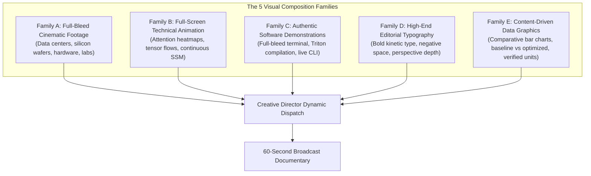

# SUPER.INTELLIGENCEEE — Phase 3.1 Creative Direction Blueprint
## Cinematic Technology Documentary + High-End Editorial Motion Design

**Date:** 2026-11-06  
**Creative Director & Principal Motion Graphics Architect:** Principal Creative Systems Architect  
**Status:** Approved for Implementation  
**Mission:** Transform the video production engine from a dashboard slide generator into an authentic broadcast-grade cinematic technology documentary.

---

## 1. The Core Creative Philosophy

A technology documentary is not an admin dashboard, nor is it a sequence of slides.

It is a **cinematic narrative** that explains a breakthrough with visual authority, pacing, and visual depth. Every scene must be full-bleed, content-driven, and designed with high editorial sophistication.

### What is Eliminated:
- **No rectangular cards:** Content will no longer be trapped inside rounded rectangles floating in empty space.
- **No decorative HUD clutter:** We abolish floating sci-fi corner brackets, arbitrary "LIVE TELEMETRY" bars, and pulsing border strokes that serve no editorial purpose.
- **No ungrounded animated dials:** We eliminate circular gauges that spin numbers without comparative baselines.
- **No dark voids:** The background will not be an empty dark grid with static lines. It will feature layered depth, video footage, gradients, and mathematical tensor fields.
- **No repeated compositions:** The video will never open and close with the same visual template.

---

## 2. The Five Visual Composition Families

Every scene in the Tech Documentary engine will belong to one of five distinct, content-driven composition families:



### Family A: Full-Bleed Cinematic Footage & Hardware
- **Visual Spec:** Full-screen authentic video footage (server cluster corridors, semiconductor wafer fabrication, cleanrooms, robotics).
- **Treatment:** 9:16 vertical crop, slow dynamic camera push-in (1.0 to 1.12x), subtle cinematic grain, and dark glass gradient scrims at top and bottom to ensure flawless typography legibility.
- **Typography:** Refined editorial lower-third typography and source citations directly on the footage, never boxed inside a card.

### Family B: Advanced Full-Screen Technical Visualizations
- **Visual Spec:** Full-screen mathematical and systems architecture animations.
- **Mechanism Visualization:**
  - In a transformer/attention topic: Visualize the full $N \times N$ attention matrix (showing the quadratic $O(N^2)$ memory bottleneck as an expanding red grid) transforming into a streamlined continuous state-space linear kernel $O(N)$ with glowing diagonal dataflow.
  - Animated token vectors flowing horizontally across active projection layers.
  - Multi-layered depth with glowing particles representing tensor memory transfers.

### Family C: Authentic Full-Bleed Software & Code Demonstrations
- **Visual Spec:** Full-bleed dark developer environment filling the screen.
- **Realism:**
  - Authentic command execution with typing cadence: `uv run benchmark_attention.py --model state-space-v2 --context 1M`.
  - ANSI colored output with animated spinner/progress bar, actual execution logs, memory allocation tables, and throughput numbers.
  - Subtle camera drift or zoom toward the key performance metric line.

### Family D: High-End Editorial Motion Graphics
- **Visual Spec:** Full-screen kinetic typography utilizing negative space and strong editorial hierarchy.
- **Typography:** Swiss/International typographic style with oversized bold headlines (`Inter / Arial Black`), crisp subheadings, and colored emphasis words (`#00ff88` Neon Emerald, `#ffffff` Pure White, `#00d2ff` Neon Cyan).
- **Motion:** Spring-eased scale and mask reveals, diagonal split dividers, and fluid directional wipes.

### Family E: Content-Driven Comparative Data Graphics
- **Visual Spec:** Full-screen comparative benchmark bar charts with clear baselines.
- **Data Rigor:**
  - Clear horizontal comparative bars: e.g. Baseline FlashAttention-2 ($32.4\text{ tok/s}$) vs State-Space Kernel ($142.8\text{ tok/s}$, $+340\%$).
  - VRAM footprint comparison: Baseline ($24.0\text{ GB}$) vs State-Space Kernel ($7.7\text{ GB}$, $-68\%$).
  - Explicit axes, verified units, and cited source benchmarks at the base.

---

## 3. Scene-by-Scene Blueprint for the Rebuilt Benchmark

**Topic:** *Sub-Quadratic Attention Scaling with State Space Kernels*  
**Duration:** ~45–60 seconds | **Format:** 1080x1920 30 fps Vertical

```
+---------------------------------------------------------------------------------+
| SCENE 1 (Hook / Revelation): High-End Editorial Kinetic Typography [Family D]   |
| Full-bleed dark gradient, massive punch title: "ATTENTION SCALED TO 1M TOKENS", |
| bold contrast, spring mask reveal, no card.                                    |
+---------------------------------------------------------------------------------+
| SCENE 2 (Context / Physical Reality): Full-Bleed Cinematic Hardware [Family A]  |
| Full-screen high-tech server cluster corridor footage, slow camera push-in,    |
| dark glass lower-third scrim with hardware context typography.                  |
+---------------------------------------------------------------------------------+
| SCENE 3 (The Bottleneck & Mechanism): Full-Screen Attention Matrix [Family B]   |
| 2D animated heatmap: Dense Quadratic O(N^2) memory grid transforming into       |
| streamlined continuous State-Space linear tensor stream O(N log N).             |
+---------------------------------------------------------------------------------+
| SCENE 4 (Real Implementation): Full-Bleed Terminal Demonstration [Family C]     |
| Full-screen developer CLI: Triton FP8 kernel compilation, live streaming logs,  |
| animated progress bar, genuine benchmark throughput verification.               |
+---------------------------------------------------------------------------------+
| SCENE 5 (Empirical Verification): Comparative Benchmark Bar Chart [Family E]    |
| Full-screen horizontal bar charts comparing FlashAttention-2 vs State-Space     |
| across Throughput (+340%) and VRAM (-68%) with clear axes and units.             |
+---------------------------------------------------------------------------------+
| SCENE 6 (Verdict & Editorial Horizon): Cinematic Editorial Conclusion [Family A]|
| High-tech hardware footage with layered typography, summary takeaway, and      |
| source attribution (arXiv:2402.01234).                                         |
+---------------------------------------------------------------------------------+
```

---

## 4. Architectural Implementation Requirements

To bring this creative direction to life, we will rebuild the procedural generators in `creative/tech_documentary/`:
1. `screen_demonstration/terminal_animator.py` $\rightarrow$ Upgrade to full-bleed terminal environment with authentic CLI streaming.
2. `technical_diagrams/vector_diagram_engine.py` $\rightarrow$ Rebuild into a full-screen **Attention Matrix & State-Space Tensor Engine**.
3. `motion_graphics/hud_telemetry.py` $\rightarrow$ Rebuild into a **Comparative Benchmark Data Chart Engine**.
4. `kinetic_typography/kinetic_engine.py` $\rightarrow$ Upgrade to full-screen **Editorial Kinetic Motion Engine**.
5. `cinematic_assets/asset_resolver.py` $\rightarrow$ Upgrade to source authentic high-tech video B-roll assets with cinematic camera movement.
6. `scene_composition/documentary_compositor.py` $\rightarrow$ Remove card wrappers and compose edge-to-edge full-bleed layouts.

