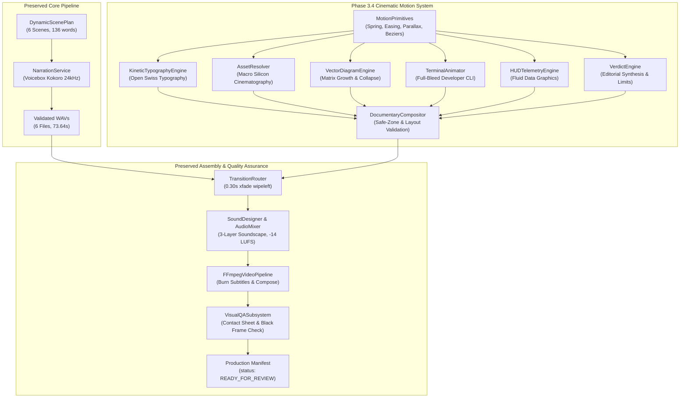

# SUPER.INTELLIGENCEEE — Phase 3.4 Architecture Specification
## Cinematic Motion Graphics System, Motion Primitives & Non-Destructive Integration

**System Workspace:** `A:\SUPER.INTELLIGENCEEE`  
**Execution Environment:** Windows 11, Python 3.11 (`.venv`), Python 3.12 (`external/voicebox/backend/venv`)  
**Target Resolution:** 1080x1920 (9:16 Vertical Video)  
**Budget / Compute Constraints:** ₹0 operating cost, offline local compute, $< 2$ GB RAM under 8 GB ceiling  

---

## 1. System Integration Overview

Phase 3.4 maintains the existing working production pipeline while completely replacing the visual presentation layer. The core orchestration, TTS narration, audio mastering, subtitle formatting, and publishing governance remain 100% intact.

---

## 2. Reusable Motion Primitives Engine (`motion_primitives.py`)

A new, centralized motion mathematics module will be established at `creative/tech_documentary/motion_primitives.py` providing tested, hardware-accelerated procedural animations:

### 2.1 Easing Functions
- **Harmonic Spring Oscillator:**
  $$f(t) = 1.0 - e^{-\zeta \omega t} \cos(\omega \sqrt{1 - \zeta^2} t)$$
  Produces natural, elastic physical settles for hero stats and graphic arrivals.
- **Cubic Ease-Out:**
  $$f(t) = 1.0 - (1.0 - t)^3$$
  Provides smooth deceleration for data bars and camera tracking.
- **Smooth Step:**
  $$f(t) = 3t^2 - 2t^3$$
  Used for coordinate thresholding and opacity fades.

### 2.2 Camera Motion & Sub-Pixel Interpolation
- **Continuous Camera Push/Pan:**
  Calculates sub-pixel focal center $(x_c, y_c)$ and zoom factor $z(t)$ across frame sequences, avoiding stepped or jerky raster scaling.
- **Multiplane Parallax:**
  Computes background, midground, and foreground translation offsets at differential speed ratios ($0.25x : 0.65x : 1.0x$) to establish visual depth.

### 2.3 Procedural Vector Morphing
- **Dynamic Matrix Expansion:**
  Interpolates grid dimension $D(t) \in [4, 8]$ and cell opacity to show physical growth of memory allocation.
- **Diagonal Metamorphosis:**
  Calculates continuous transformation vector from 2D matrix coordinate $(x_i, y_j)$ to linear projection coordinate $(x_i', y_0)$.
- **Bezier Signal Pulses:**
  Evaluates cubic bezier trajectories with traveling wave packets $P_k(t) = \text{bezier}(p_0, p_1, p_2, p_3, (t + \phi_k) \pmod 1)$.

---

## 3. Visual Generator Refactoring Plan

| Generator Module | Current Phase 3.3 State | Phase 3.4 Refactored State |
| :--- | :--- | :--- |
| `kinetic_engine.py` | 5 nested rectangular boxes with drop shadows | Open Swiss typography, mask wipes, dynamic scaling, zero card boxes |
| `asset_resolver.py` | Flat diagrammatic silicon box + lower-third card | Macro silicon cinematography, camera push, optical traces, 128 KB SRAM glowing bus |
| `vector_diagram_engine.py` | 2 massive white cards enclosing static grid & text | Dynamic matrix growth ($4 \times 4 \to 8 \times 8$), physical diagonal collapse, bezier flow stream |
| `terminal_animator.py` | Floating centered card on ivory canvas | Full-bleed developer console, authentic buffer margins, live line streaming, progress sweep |
| `hud_telemetry.py` | 2 stacked card widgets with static bars | Open fluid data graphics, dynamic axis scales, surge collision against 24 GB barrier |
| `verdict_engine.py` | 3 stacked cards repeating Scene 1 | Single editorial plate: Core Finding, Explicit Limitation (hybrid pattern), Stamped Seal |

---

## 4. Typography & Spacing Safety Protocol

To eliminate text clipping and overlapping elements:
1. **Global Safe Zone:**
   - $X_{\text{min}} = 80\text{px}$, $X_{\text{max}} = 1000\text{px}$ (Width $= 920\text{px}$).
   - $Y_{\text{min}} = 140\text{px}$, $Y_{\text{max}} = 1780\text{px}$ (Height $= 1640\text{px}$).
   - Bottom $140\text{px}$ reserved for subtitle display and platform UI overlays.
2. **Pre-Rendered Bounding Box Validation:**
   - Every text element calculates `draw.textbbox((x, y), text, font=font)`.
   - Layout engine checks for intersection with existing elements. If collision is detected, vertical spacing is automatically offset.
3. **Type Scale Hierarchy:**
   - Hero Stats: 110–130pt
   - Major Headlines: 56–72pt
   - Section Headers: 32–42pt
   - Body & Code: 24–28pt
   - Telemetry Labels: 20–22pt

---

## 5. Architectural Invariants

- **Sequential Pipeline Execution:** Rendering proceeds scene-by-scene via FFmpeg rawvideo pipes to maintain RAM usage $< 1.8$ GB under the 8 GB ceiling.
- **Offline Integrity:** Zero cloud API dependencies; ₹0 mandatory operating budget.
- **Fail-Safe Audio:** Voicebox Kokoro 24 kHz primary, with Piper Neural (`jarvis-high`) as logged, verified fallback.
- **Human Approval:** Manifest output status permanently set to `READY_FOR_REVIEW`. Publishing kill switch active.

