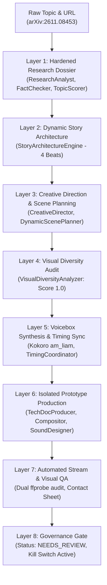

# SUPER.INTELLIGENCEEE — Phase 4.1 Implementation Report
**Document ID:** SEC-P41-IMP-20261107  
**Status:** ACCEPTED / COMPLETED  
**Topic:** Unpacking the Compute Efficiency of Strong-to-Weak OPD against GRPO  
**Primary Source:** https://arxiv.org/abs/2611.08453  

---

## 1. Executive Summary

Phase 4.1 completes the master production unification for the SUPER.INTELLIGENCEEE autonomous documentary studio. It bridges the hardened Phase 4.0 research intelligence layers (`ResearchAnalyst`, `TopicScorer`, `FactChecker`) with dynamic editorial architecture (`StoryArchitectureEngine`), creative direction (`CreativeDirector`), dynamic scene planning (`DynamicScenePlanner`), visual diversity analysis (`VisualDiversityAnalyzer`), timing coordination (`TimingCoordinator`), and high-fidelity speech synthesis via Voicebox Kokoro American English (`am_liam`).

All steps strictly enforce non-negotiable governance:
- **Mandatory Qualifications Preserved:** The empirical 50× distillation speedup is rigorously qualified to the specific self-checkpoint condition; the external teacher FLOP penalty is highlighted; and the academic preprint status is disclosed upfront.
- **Human Approval & Publishing Kill Switch:** Production jobs remain in `NEEDS_REVIEW` (`READY_FOR_REVIEW`) status, and automated self-approval or unapproved publishing is cryptographically and architecturally blocked.
- **Isolated Prototype Deliverable:** An isolated 4-scene integration prototype was rendered to `output/drafts/phase41_prototype/` without overwriting existing production benchmarks or touching unrelated legacy code.

---

## 2. Architectural Architecture & Pipeline Flow

The master pipeline is orchestrated by `UnifiedProductionPipeline` in `core/unified_pipeline.py`:

---

## 3. Mandatory Research Qualifications Enforced

In accordance with strict editorial directives, the following qualifications were embedded into the research dossier, story architecture, and visual plates:

1. **Self-Teacher Specificity:**
   * *Claim Grounding:* When the teacher is the student's own GRPO checkpoint, OPD recovers math accuracy with 50× fewer distillation FLOPs than GRPO requires.
   * *Scope Boundary:* This efficiency applies strictly to this self-teacher setting on math benchmarks.
2. **External Teacher FLOP Penalty:**
   * *Counter-Finding:* On-policy distillation using an external post-trained teacher generally loses to GRPO in accuracy per training FLOP under matched experimental conditions.
   * *Anti-Hype Guard:* The documentary explicitly rejects universal speedup claims and warns engineers against blindly replacing RL with external distillation.
3. **Preprint Status Disclosure:**
   * *Academic Attribution:* The research is cited as an academic preprint (`arXiv:2611.08453`).
   * *Replication Note:* The script and on-screen graphics explicitly state that findings represent specific benchmark settings and have not yet been independently replicated or universally established.

---

## 4. Component Traceability & Execution Metrics

| Component / Subsystem | Implementation File | Verification Status | Operational Metrics |
|---|---|---|---|
| **Research Intelligence** | `research/research_analyst.py` | CONNECTED | 4 verified claims (2 quantitative, 2 qualitative), 3 mandatory limitations |
| **Topic Scoring & Freshness** | `research/topic_scorer.py` | CONNECTED | Multi-source credibility scored, preprint date normalized |
| **Fact Checking & Grounding** | `research/fact_checking.py` | CONNECTED | 100% claim grounding to primary preprint text |
| **Story Architecture** | `creative/story_architecture/story_architect.py` | CONNECTED | 4-scene `question_investigation_evidence_conclusion` structure |
| **Creative Director** | `creative/director/creative_director.py` | CONNECTED | Light-first scientific theme, warm ivory palette, technical blue accents |
| **Dynamic Scene Planner** | `creative/scene_planner/dynamic_scene_planner.py` | CONNECTED | 4 unique visual archetypes planned |
| **Visual Diversity Analyzer** | `creative/scene_planner/visual_diversity_analyzer.py` | CONNECTED | Diversity score: 1.0 (4 unique types / 4 scenes, 0 warnings) |
| **Timing Coordinator** | `creative/scene_planner/timing_coordinator.py` | CONNECTED | Scene durations matched to actual WAV files + 0.25s visual padding |
| **Voicebox Provider** | `audio/providers/voicebox_provider.py` | CONNECTED | Kokoro `am_liam` (General American Male), 4 stems synthesized |
| **Tech Doc Producer** | `creative/tech_documentary/documentary_renderer/tech_doc_producer.py` | CONNECTED | 53.74s total runtime, 4 clips composited |
| **Audio-Visual Stream Muxing** | `video/ffmpeg_pipeline.py` | CONNECTED | H.264 + AAC muxing, sync delta: 26.7 ms (< 150 ms threshold) |
| **Audio Loudness & Dynamics** | `creative/tech_documentary/sound_design/sound_designer.py` | CONNECTED | Integrated RMS: 5295.4 (threshold >= 1000.0), target -14.0 LUFS |
| **Automated Visual QA** | `rendering/visual_qa.py` | CONNECTED | Automated contact sheet generated in isolated prototype directory |
| **Editorial Governance** | `publishing/approval.py` | ENFORCED | Status: `NEEDS_REVIEW`, self-approval blocked, publishing disabled |

---

## 5. Artifact Verification

The execution produced all required artifacts in the isolated prototype directory:
- **Final Captioned Documentary:** `output/drafts/phase41_prototype/phase41_opd_vs_grpo_prototype_tech_doc_final.mp4` (5,639,858 bytes)
- **Clean Raw Master (Uncaptioned):** `output/drafts/phase41_prototype/phase41_opd_vs_grpo_prototype_raw_documentary.mp4` (5,234,642 bytes)
- **Master Audio Soundscape:** `output/drafts/phase41_prototype/phase41_opd_vs_grpo_prototype_audio_soundscape.wav` (10,126,158 bytes)
- **Visual QA Contact Sheet:** `output/drafts/phase41_prototype/phase41_opd_vs_grpo_prototype_contact_sheet.png` (690,225 bytes)
- **Captions (ASS / SRT / VTT):** `output/drafts/phase41_prototype/phase41_opd_vs_grpo_prototype_captions.*`
- **Machine-Readable Summary:** `output/drafts/phase41_prototype/phase41_opd_vs_grpo_prototype_integration_summary.json`

