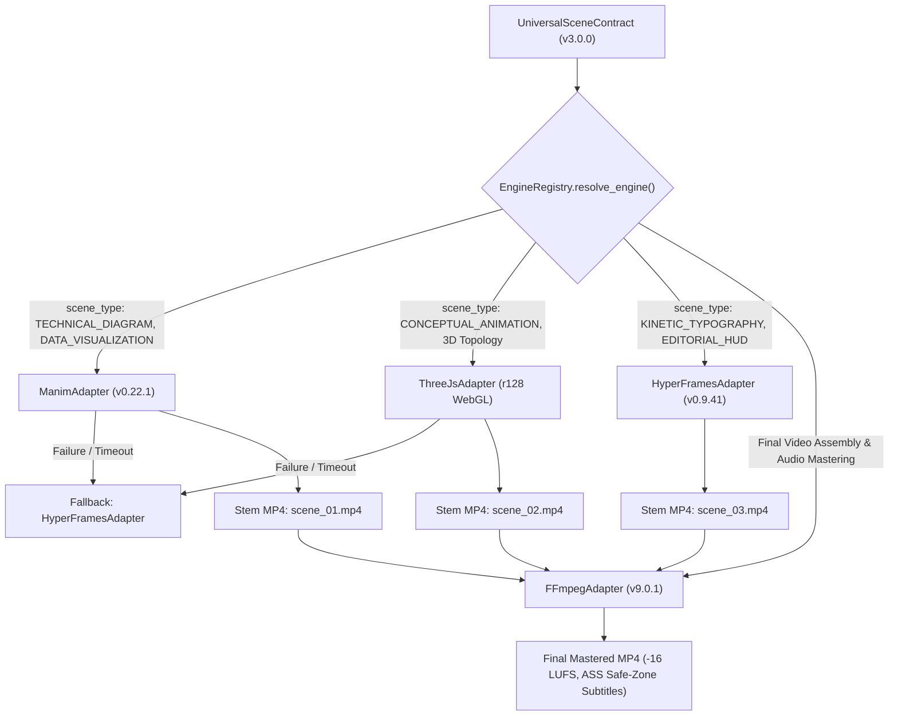

# SUPER.INTELLIGENCEEE — PHASE 4.3.2B
# PRE-IMPLEMENTATION AUDIT: MULTI-ENGINE RENDERING DISPATCHER & ADAPTER ARCHITECTURE

**Date:** November 13, 2026  
**Auditor:** Principal Software Architect, Motion Graphics Engineer & Systems Dispatcher  
**Workspace:** `A:\SUPER.INTELLIGENCEEE`  
**Host Platform:** Windows 11 Home 64-bit | Intel Core i5-1135G7 (4C/8T) | 8 GB RAM | Intel Iris Xe Graphics  
**Operating Budget:** ₹0 mandatory operating cost  
**3D Modeling Prohibition:** Blender is strictly prohibited  

---

## 1. PURPOSE & OBJECTIVES

Before implementing the Multi-Engine Rendering Dispatcher (`rendering/engine_dispatcher.py`) and its engine adapter layer (`rendering/adapters/`), this audit inspects the exact runtimes, executables, environment configurations, and invocation mechanics on the host system.

The Multi-Engine Rendering Dispatcher is responsible for:
1. Ingesting validated `UniversalSceneContract` (v3.0.0) and `VideoStoryboardContract` objects.
2. Routing each scene to its optimal rendering engine:
   - **Manim:** Mathematical formulas, equation derivations, coordinate systems, scaling curves ($O(N^2) \to O(N)$), vector typography.
   - **Three.js:** Procedural 3D/2.5D accelerator topologies, network graphs, spatial depth, camera journeys (zero Blender dependency).
   - **HyperFrames:** Timeline composition, editorial HUDs, kinetic typography, multi-scene layout assembly.
   - **FFmpeg:** Stem concatenation, broadcast loudness normalization (-16 LUFS), safe-zone ASS subtitles burn, audio-video synchronization, final mastering.
3. Enforcing single-process sequential rendering discipline with `ResourceGuard` on an 8 GB RAM host.
4. Handling fallback degradation gracefully when an engine fails or preflight thresholds are breached.

---

## 2. FORENSIC RUNTIME & EXECUTABLE AUDIT

| Engine | Canonical Executable Path | Version | Invocation Command | Verified Status |
| :--- | :--- | :--- | :--- | :--- |
| **Python Runtimes** | `A:\SUPER.INTELLIGENCEEE\.venv\Scripts\python.exe` | Python 3.11.15 | `A:\SUPER.INTELLIGENCEEE\.venv\Scripts\python.exe` | **READY** (Virtualenv with Manim & Pydantic) |
| **System Python** | `C:\Users\bavik\AppData\Local\Python\bin\python.exe` | Python 3.14.0a2 | *Must NOT be used* (Missing Manim/Pydantic) | **EXCLUDED** |
| **Manim Community** | `A:\SUPER.INTELLIGENCEEE\.venv\Scripts\manim.exe` | v0.22.1 | `& "$venv_py" -m manim -ql --media_dir $dir -o $out $script $class` | **VERIFIED** |
| **Node.js / npm** | `C:\Program Files\nodejs\node.exe` | v20.19.5 (npm v10.8.2) | `node` | **VERIFIED** |
| **HyperFrames** | `C:\Program Files\nodejs\npx.cmd` | v0.9.41 | `npx.cmd hyperframes render renderer -c $comp -o $out` | **VERIFIED** |
| **Three.js** | CDN / Local Bundle (`three.min.js`) | r128 | WebGL via HyperFrames Headless Chromium ANGLE Direct3D11 | **VERIFIED** (Zero Blender) |
| **FFmpeg** | `C:\Users\bavik\AppData\Local\Microsoft\WinGet\Links\ffmpeg.exe` | v9.0.1-full_build | `ffmpeg -y ...` | **VERIFIED** |
| **FFprobe** | `C:\Users\bavik\AppData\Local\Microsoft\WinGet\Links\ffprobe.exe` | v9.0.1-full_build | `ffprobe -v error -show_entries ... -of json` | **VERIFIED** |

### Storage & Scratch Directory Constraints
- **Drive A: (Workspace Root):** 6.56 GB free space.
- **Drive G: (Secondary Drive):** 1.58 GB free space (*Severe storage constraint*).
- **Enforced Scratch Policy:** All render caches, extracted frames, intermediate stems, and log files MUST reside strictly inside `A:\SUPER.INTELLIGENCEEE\.temp` (`TEMP`, `TMP`, `HYPERFRAMES_EXTRACT_CACHE_DIR`).

---

## 3. ENGINE ROUTING TOPOLOGY & CAPABILITIES

Each `UniversalSceneContract` declares a `preferred_engine` (`RenderingEngine`), an optional `fallback_engine` (`RenderingEngine`), and an `engine_specific_config` dict.



### 3.1 Manim Adapter Specification
- **Engine Name:** `RenderingEngine.MANIM` (`"manim"`)
- **Primary Scenarios:** Equations, coordinate axes, loss curves, token scaling graphs, vector algebra.
- **Script Generation:** Generates standalone Python script subclassing `Scene` with `config.pixel_width = 1080`, `config.pixel_height = 1920`, `config.frame_rate = 30`.
- **Command:** `[venv_py, "-m", "manim", "-ql", "--media_dir", media_dir, "-o", stem_filename, script_path, scene_class_name]`
- **Preflight Check:** Confirms virtual environment python has `manim` module importable.
- **Artifact Verification:** Checks generated MP4 with `ffprobe` for 1080x1920, 30fps, non-zero file size, valid duration.
- **Fallback:** `RenderingEngine.HYPERFRAMES`.

### 3.2 Three.js Adapter Specification
- **Engine Name:** `RenderingEngine.THREEJS` (`"threejs"`)
- **Primary Scenarios:** Procedural 3D hardware nodes, neural lattices, compute clusters, depth-based camera flights.
- **Composition Generation:** Generates deterministic HTML composition embedding Three.js r128 with `window.addEventListener('hf-seek', e => renderAt(e.detail.time))` hook.
- **Command:** `["npx.cmd", "hyperframes", "render", "renderer", "-c", relative_comp_path, "-o", stem_mp4_path]`
- **Preflight Check:** Checks `npx.cmd hyperframes` availability and template validity.
- **Artifact Verification:** Checks generated MP4 with `ffprobe` for 1080x1920, 30fps, non-zero file size.
- **Fallback:** `RenderingEngine.HYPERFRAMES`.

### 3.3 HyperFrames Adapter Specification
- **Engine Name:** `RenderingEngine.HYPERFRAMES` (`"hyperframes"`)
- **Primary Scenarios:** Timeline synchronization, kinetic text, editorial HUD overlays, slide transitions.
- **Composition Generation:** Generates HTML with GSAP timeline contract (`window.__timelines = { main: tl }`).
- **Command:** `["npx.cmd", "hyperframes", "render", "renderer", "-c", relative_comp_path, "-o", stem_mp4_path]`
- **Preflight Check:** Node.js v20.x, npx, HyperFrames CLI.
- **Artifact Verification:** `ffprobe` format inspection.
- **Fallback:** None (terminal visual fallback).

### 3.4 FFmpeg Adapter Specification
- **Engine Name:** `RenderingEngine.FFMPEG` (`"ffmpeg"`)
- **Primary Scenarios:** Concat demuxer assembly, audio mixing/ducking, broadcast loudness (-16.0 LUFS via `loudnorm`), ASS subtitle burning with mobile safe margins (bottom >= 320px).
- **Command Filter Complex:**
  - `[0:v]subtitles='subtitles.ass'[vout]`
  - `[1:a]loudnorm=I=-16:TP=-1.5:LRA=11[aout]`
- **Preflight Check:** `ffmpeg.exe` and `ffprobe.exe` executable verification.
- **Artifact Verification:** Validates video stream (1080x1920, 30fps, H.264), audio stream (AAC, 48kHz/96kHz), loudness profile, container integrity.

---

## 4. HARDWARE DISCIPLINE & RESOURCE GUARD PROTOCOL

On Windows 11 with 8 GB RAM and no dedicated GPU:
1. **Single Sequential Execution Lock (`threading.Lock`):** Parallel rendering processes are strictly forbidden. Only one engine may render at any given moment.
2. **Preflight Memory & Disk Headroom:**
   - Free RAM threshold: >= 450 MB (automatic `gc.collect()` before process spawn).
   - Free Disk threshold on `A:\`: >= 2.0 GB.
3. **Execution Isolation:** All subprocesses execute under `ResourceGuard.execute_isolated_render()`, capturing stdout/stderr into dedicated log files and enforcing timeout monitoring.
4. **Clean Process Tree Termination:** If timeout is exceeded (default: 180s), `ResourceGuard._terminate_process_tree()` guarantees clean termination of all child processes (including Chrome headless worker procs) using `taskkill /F /T /PID`.
5. **Cache Purge:** Scratch frame extractions in `.temp` are cleared after artifact verification.

---

## 5. PLANNED MODULE TOPOLOGY

The dispatcher and adapter system will be built with clean modular separation in `rendering/`:

```
rendering/
├── engine_errors.py          # Custom error hierarchy
├── render_artifact.py        # Pydantic RenderArtifact model with SHA-256 and ffprobe metadata
├── execution_context.py      # Per-scene isolated temp dir and environment manager
├── adapters/
│   ├── __init__.py
│   ├── base_adapter.py       # Abstract BaseEngineAdapter
│   ├── manim_adapter.py      # Manim Community v0.22.1 adapter
│   ├── threejs_adapter.py    # Procedural Three.js r128 via HyperFrames
│   ├── hyperframes_adapter.py# GSAP/HTML/CSS HyperFrames adapter
│   └── ffmpeg_adapter.py     # FFmpeg stem assembly & audio mastering
├── engine_registry.py        # Adapter discovery and route resolver
├── engine_dispatcher.py      # Master EngineDispatcher with sequential lock & fallback
└── resource_guard.py         # Existing hardware protection module (preserved)
```

---

## 6. PRE-IMPLEMENTATION VERDICT

- **Audit Status:** Complete and verified against physical host binaries.
- **Dependencies:** All 4 rendering frameworks verified locally with zero cost.
- **Blender Check:** Strictly prohibited; zero references or binaries.
- **Compositor Integrity:** `core/compositor.py` preserved without modification.
- **Authorization:** Full authorization to proceed with Phase 4.3.2B implementation.
