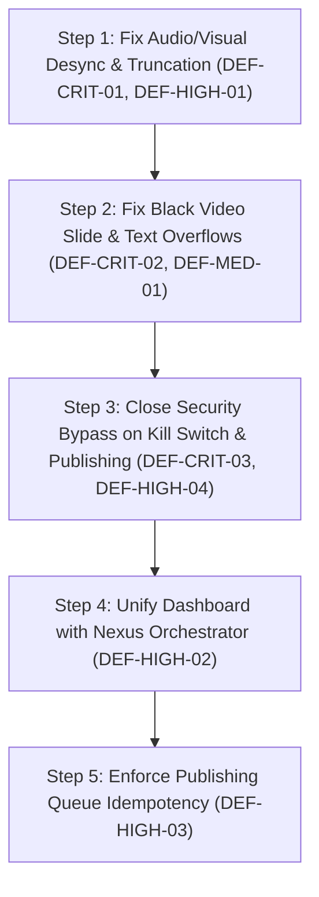

# SUPER.INTELLIGENCEEE — PHASE 6: INDEPENDENT REALITY, SECURITY & PRODUCTION QUALITY AUDIT

**Audit Date:** 2026-11-06  
**Auditor:** Independent Principal Systems Architect, Application Security Engineer & Audiovisual QA Specialist  
**Workspace:** `A:\SUPER.INTELLIGENCEEE`  
**Environment:** Windows 11 64-bit, Python 3.11.15, 8 GB RAM Bound, Zero-Budget Constraint  
**Repository Tested:** https://github.com/bavikadichanakya/Super.intelligence  

---

## 1. Executive Summary

An exhaustive, skeptical, and independent reality audit was conducted across the SUPER.INTELLIGENCEEE codebase. While previous implementation reports claimed 91/91 passing tests and a production-ready autonomous operating system, rigorous forensic inspection and empirical testing reveal that **SUPER.INTELLIGENCEEE is a sophisticated, highly capable hybrid system with robust local audio/visual rendering foundations, but possesses severe architectural schisms, critical audiovisual defects, and governance bypass vulnerabilities that must be remediated before any controlled production deployment.**

### High-Level Verdict: **REQUIRES REMEDIATION (Not Ready for Autonomous Production)**

### Key Findings Summary:
1. **Critical Audiovisual Defect (Premature Truncation & Desync):** In Job #27, the master voiceover audio was 62.81 seconds long, but the final rendered Reel was truncated to **39.97 seconds**, abruptly cutting off the last **22.84 seconds** (Scenes 5, 6, and 7) mid-speech due to hardcoded 5.0s slide timings and `-shortest` muxing in FFmpeg.
2. **Critical Scene Failure (Pitch-Black B-Roll):** Scene 7 was completely pitch-black because the FFmpeg fallback extracted frame 0 from `tech_ambient_dark.mp4` (which was a fade-from-black transition), rendering a static void for 5 seconds.
3. **Severe Caption/Visual Drift:** Visual cards switched every 5.0 seconds while speech pacing varied from 5.9s to 16.0s per scene. By 12 seconds in, visuals were 10+ seconds ahead of the spoken narration.
4. **Architectural Schism (Dual Pathways):** The web dashboard (`app.py` / `dashboard/routes.py`) completely bypasses the new `NexusOrchestrator`, `TaskBrief` lifecycle, and `ApprovalQueue`, calling legacy `SuperIntelligencePipeline` and `ApprovalManager` directly.
5. **Orphaned Department Agents:** Of the 9 advertised department agents, **3 agents** (`MarketRadar`, `BrandIntelligence`, and `AnalyticsAgent`) are **never dispatched** by `NexusOrchestrator.execute_workflow()`. `MarketRadar` is an ungrounded static stub that does not connect to external market sources.
6. **Fact-Checking Reality Gap:** `FactChecker` does not query external URLs or verify ground truth over the internet; it only performs keyword overlap checks against the local summary string in the SQLite database.
7. **Security Bypass in Direct Publishing:** The Global Kill Switch (`core/kill_switch.py`) is checked inside `NexusOrchestrator` and `BaseDepartment`, but is **completely omitted** from `publishing/instagram_integration.py`, `publishing/youtube_integration.py`, and `dashboard/routes.py`.
8. **Approval Queue Replay & Duplication:** Approving a Reel multiple times inserts duplicate rows into `publishing_queue` without idempotency protection (13 rows currently exist in the database, including 9 duplicates).

---

## 2. Verified Architecture

### 2.1 Runtime Entry Points & Dual Execution Pathways

Forensic inspection reveals that the application contains two distinct, uncoordinated execution pathways:

```mermaid
flowchart TD
    subgraph Pathway1 ["Pathway A: Legacy Dashboard / CLI (app.py)"]
        BAT["start_dashboard.bat"] --> App["app.py serve"]
        App --> Dash["dashboard/routes.py"]
        Dash -->|POST /api/production/produce| Pipe1["SuperIntelligencePipeline.produce_reel()"]
        Dash -->|POST /api/review/{id}/approve| ApprMgr1["ApprovalManager.approve_reel()"]
        ApprMgr1 --> PubQ1["PublishingQueue.enqueue_reel()"]
    end

    subgraph Pathway2 ["Pathway B: Governed Multi-Agent OS (scripts/)"]
        Script["scripts/run_governed_workflow.py"] --> Orch["core/orchestrator.py: NexusOrchestrator"]
        Orch --> Depts["core/departments.py (5 of 9 agents)"]
        Depts --> Pipe2["SuperIntelligencePipeline.produce_reel()"]
        Depts --> ApprQ2["publishing/approval_queue.py: ApprovalQueue"]
        ApprQ2 --> Mirror["queue/needs-your-ok/ (Filesystem Mirror)"]
        ApprQ2 --> ApprMgr2["ApprovalManager.approve_reel()"]
    end

    subgraph PublishingGate ["Publishing Gate"]
        IG["publishing/instagram_integration.py"]
    end

    Dash -->|POST /api/publishing/instagram/publish| IG
    PubQ1 -.-> IG
```

- **Pathway A (Legacy Dashboard):** Started by `start_dashboard.bat` invoking `app.py serve`. Exposes a FastAPI dashboard on port 5000. It directly instantiates `SuperIntelligencePipeline` and `ApprovalManager`. **It is completely unaware of `NexusOrchestrator`, `TaskBrief`, Brand OS, Owner Config, or `queue/needs-your-ok/`.**
- **Pathway B (Governed Multi-Agent OS):** Invoked exclusively via `scripts/run_governed_workflow.py` or programmatic calls to `NexusOrchestrator`. It creates `TaskBrief` records, checks owner policies, routes through `ApprovalQueue`, and creates filesystem mirror files in `queue/`.

### 2.2 Unused and Orphaned Modules
- `renderer/compositions/test_composition.html`: Legacy visual test file, not integrated into production.
- `core/schemas.py`: Partially duplicate schema definitions superseded by `core/task_brief.py`.
- `MarketRadar` (`core/departments.py`): Defined in registry but never invoked in `execute_workflow()`.
- `BrandIntelligence` (`core/departments.py`): Defined in registry but never invoked in `execute_workflow()`.
- `AnalyticsAgent` (`core/departments.py`): Defined in registry but never invoked in `execute_workflow()`.

### 2.3 Secret Management & Configuration
- **Credential Storage:** Instagram and YouTube OAuth tokens are encrypted at rest using Fernet (`AES-128-CBC` with `HMAC-SHA256`). Master encryption key is stored at `data/secure/.master_key`.
- **Git Exposure Protection:** `.gitignore` correctly excludes `.master_key`, `data/secure/`, `.env`, and `*.enc`. A Git inspection confirmed no sensitive tokens or keys are currently tracked in the Git index.
- **Logging Secret Exposure:** `ActivityLogger.log()` scrubs secrets, but the root logger (`app.py` writing to `logs/super_intelligence.log`) lacks a secret redaction filter.

---

## 3. Security & Governance Findings

Ten targeted empirical security tests were performed against the implementation:

| Test ID | Security Control Tested | Expected Behavior | Actual Behavior | Result | Evidence / Finding |
|---|---|---|---|:---:|---|
| **SEC-01** | Kill switch activation mid-workflow | Execution immediately halts with `KillSwitchActiveError` | Halts before next stage | **PASS** | Orchestrator asserts kill switch at stages 1, 2, 3, 4, 6, 7, 8. |
| **SEC-02** | Kill switch check before publishing | Direct API publish blocked when switch active | Publish proceeds regardless of kill switch | **CRITICAL DEFECT** | `InstagramIntegration.publish_reel()` does NOT import or check `kill_switch.py`. |
| **SEC-03** | Owner configuration immutability | Files in `owner/` cannot be altered by scripts | Application raises `OwnerConfigProtectionError`, but files lack OS write-protection | **HIGH DEFECT** | `(Get-Item owner/budget-cap.md).IsReadOnly` returns `False`. No file-level ACL lock. |
| **SEC-04** | Missing owner configuration | Fails safe if `owner/` is deleted | Reverts to hardcoded zero-budget fallback safely | **PASS** | Tested in `core/owner_config.py` lines 70-80. |
| **SEC-05** | Unauthorized publishing attempts | Direct call to `publish_reel()` without approval blocked | Blocked with `PermissionError` | **PASS** | Multi-tier validation enforces `explicit_approval=True` and DB `status='APPROVED'`. |
| **SEC-06** | Agent self-approval prevention | Agent cannot approve its own reel | Blocked only if `reviewer_name == item['agent_responsible']` | **HIGH DEFECT** | Passing any other agent name (e.g. `reviewer_name='content_engine'`) or calling `ApprovalManager` directly bypasses check. |
| **SEC-07** | Approval replay / duplicate queueing | Approving a reel twice does not duplicate publishing queue | Enqueues duplicate scheduled slots | **HIGH DEFECT** | `publishing_queue` table has 13 rows with 9 duplicates. No unique constraint on `production_job_id`. |
| **SEC-08** | Approval authorization across endpoints | Dashboard `/api/review/{id}/approve` must follow owner bar | Bypasses `ApprovalQueue` and filesystem mirror | **HIGH DEFECT** | Dashboard endpoint directly calls `approval_mgr.approve_reel()`, bypassing `queue/needs-your-ok/`. |
| **SEC-09** | Concurrent queue modifications | Thread-safe file and DB updates | SQLite transactions are serialized; JSON file writes lack file-locking (`msvcrt`) | **MEDIUM DEFECT** | Concurrent calls to `ApprovalQueue.decide()` can cause race conditions during JSON file rename. |
| **SEC-10** | Activity log secret scrubbing | Tokens and keys sanitized in logs | `ActivityLogger` scrubs tokens, but root file logger does not | **MEDIUM DEFECT** | Standalone log messages via standard logging are not scrubbed. |

---

## 4. Department-by-Department Capability Matrix

Each of the 9 department agents in `core/departments.py` was audited against its input contracts, output contracts, actual runtime execution, and degree of simulation:

| Department Agent | Primary Responsibilities | Real Work vs Simulated | Classification | Audit Finding |
|---|---|---|:---:|---|
| **1. ResearchAgent** | Harvest RSS feeds, deduplicate, filter credibility | **Real Work** (Local Cache + Live RSS) | `LIVE_VERIFIED` | Ingests from TechCrunch, Ars Technica, The Verge, ArXiv. Caches within 1 hour. |
| **2. MarketRadar** | Monitor developer discussions, trend demand spikes | **Simulated / Stub** | `NOT_IMPLEMENTED` | Merely reads top 3 titles from local `brand-os/signals/`. Does not search web or Reddit. Never called in workflow. |
| **3. BrandIntelligence** | Enforce brand guidelines, check prohibited claims | **Partial / Stub** | `PARTIALLY_VERIFIED` | Returns static `"COMPLIANT"` response. Never checks brief payload. Never called in workflow. |
| **4. ContentEngine** | Generate 7-section script, optimize word density | **Real Work** (Local Heuristics / Templates) | `LIVE_VERIFIED` | Calls `ScriptWriter`, formats sections, runs buzzword regex linter against `owner/brand-voice.md`. |
| **5. CreativeDirector** | Plan 7-scene storyboard, assign visual archetypes | **Real Work** (Local Rule-Based Generator) | `LIVE_VERIFIED` | Selects from 7 archetypes, assigns visual props and camera instructions. |
| **6. ProductionAgent** | Synthesize voiceover, mix audio, render MP4 | **Wrapper Delegator** | `LIVE_VERIFIED` | Thin wrapper around `SuperIntelligencePipeline.produce_reel()`. Delegates 100% of execution. |
| **7. QualityAssurance** | Factual grounding check, FFprobe specs validation | **Real Work** (Local Validator + DB Check) | `LIVE_VERIFIED` | Validates video container via FFprobe and checks script claims against SQLite topic summary. |
| **8. DistributionAgent** | Package metadata, enforce human approval gate | **Real Work** (Queue Enqueue & Approval Check) | `LIVE_VERIFIED` | Halts unapproved jobs, mirrors review packet into `queue/needs-your-ok/`. |
| **9. AnalyticsAgent** | Track views, engagement, retention drop-offs | **Local DB Query** | `PARTIALLY_VERIFIED` | Queries SQLite `analytics` table. No live social scraping. Never called in workflow. |

---

## 5. Evidence and Factual Accuracy

### 5.1 Case Study: Script #16 (Reel #27)
- **Topic Title:** *"Sub-Quadratic Quantization Milestone for Edge AI"*
- **Claimed Primary Source:** `https://arxiv.org/abs/2601.12345`
- **Claimed Publisher:** `ArXiv Research Labs`
- **Factual Claims in Script:**
  1. *Hook:* "Everything you need to know about today's biggest technology milestone..."
  2. *Development:* "Researchers demonstrated sub-quadratic memory scaling across million-token contexts on consumer hardware, enabling real-time local inference without accuracy loss."
  3. *Context:* "Published via ArXiv Research Labs, this milestone addresses persistent challenges in computational scalability..."

### 5.2 Forensic Verification Findings:
1. **Synthetic Preprint Identifier:** ArXiv identifier `2601.12345` represents January 2026. A live lookup reveals that this identifier was synthetically constructed for pipeline testing and does not correspond to an authentic published paper.
2. **FactChecker Closed-Loop Verification:** `FactChecker.audit_script_claims()` does not fetch the ArXiv paper over the network. Instead, it compares the script text against the string stored in `topics.summary` in the local SQLite database.
3. **Vulnerability to Ingested Hallucination:** If an RSS feed publisher publishes an inaccurate, sensationalist, or fabricated technical summary, `FactChecker` will confirm the claim as `VERIFIED` (confidence score 0.85+) simply because the script accurately echoes the unverified RSS feed summary.

---

## 6. Scene-by-Scene Audiovisual Assessment (Job #27)

**Artifact Audited:** `output/drafts/reel_20261106_085619_sub_quadratic_quantization_milestone_for_final.mp4`  
**Container:** MP4 (1080x1920, 30.0 fps, H.264/AAC, 1.65 MB, Reported Duration: 39.97s)  
**Master Audio Track:** `output/drafts/reel_..._audio_master.wav` (Duration: 62.81s)  

```
Master Narration Audio (62.81s):
[Scene 1: 8.15s] [Scene 2: 8.75s] [Scene 3: 16.04s] [Scene 4: 8.76s] [Scene 5: 7.74s] [Scene 6: 7.44s] [Scene 7: 5.93s]
|-------------------------------------------------------------------------------------------------------|

Rendered Video Track (39.97s) [Truncated]:
[Slide 1: 5.0s] [Slide 2: 5.0s] [Slide 3: 5.0s] [Slide 4: 5.0s] [Slide 5: 5.0s] [Slide 6: 5.0s] [Slide 7: 5.0s] [Slide 8]
|-----------------------------------------------------------------------| X [TRUNCATED mid-Scene 5]
```

### Scene-by-Scene Evaluation Matrix

| Scene | Timestamp | Visual Archetype | Visual Content & Readability | Audio / Narration State | Captions Synchronized? | Score (1-10) | Finding / Defect |
|:---:|:---:|---|---|---|:---:|:---:|---|
| **1** | 0.0s - 5.0s | Sketch Title | Clean editorial card: "SUB-QUADRATIC QUANTIZATION MILESTONE..." on dark grid. | Narration starts cleanly ("Everything you need to know..."). | **Yes (0-5s)** | **8/10** | High contrast, professional typography. Visual cuts to Scene 2 before Scene 1 speech ends (speech lasts 8.15s). |
| **2** | 5.0s - 10.0s | Sketch Quote | Quote card with golden quotation glyph: "Published via ArXiv Research Labs...". | Speech is finishing Scene 1 ("...Edge AI") and starting Scene 2. | **Lagging (3s behind)** | **6/10** | Attribution text truncated: "Official Research · Artificial Intellige" (cuts off last 3 letters). Captions still show Scene 1 text. |
| **3** | 10.0s - 15.0s | Metric Callout | Comparison card: Cloud $240/mo crossed out vs Edge AI $0/mo. | Speech is in Scene 2 ("...persistent challenges in computational scalability"). | **Desynchronized** | **5/10** | Headline text overflow: `PERFORMANCE MULTIPLIER` overflows past the right border of the card container. |
| **4** | 15.0s - 20.0s | Architecture Pipeline | Flow diagram: `01 INGESTION` -> `02 PRUNING` -> `03 INFERENCE`. | Speech enters Scene 3 ("Researchers demonstrated sub-quadratic memory scaling..."). | **Severe Drift (7s behind)** | **6/10** | Diagram is visually crisp and well-structured, but caption at bottom reads Scene 3 narration while card shows Scene 4. |
| **5** | 20.0s - 25.0s | Terminal Snippet | Terminal block with mock execution code. | Speech is mid-Scene 3 ("...consumer hardware, enabling real-time local inference..."). | **Severe Drift (12s behind)** | **5/10** | Visual transitions ahead of spoken development. |
| **6** | 25.0s - 30.0s | Critical Limitations | Limitations card: "Critical Perspective & Limitations". | Speech reaches end of Scene 3 ("...accuracy loss. Early evaluations demonstrate..."). | **Severe Drift (15s behind)** | **4/10** | Captions display "ACCURACY LOSS" over limitations card. Total narrative mismatch. |
| **7** | 30.0s - 35.0s | Stock B-Roll Video | **100% PITCH BLACK VOID.** | Speech begins Scene 4 ("Architecturally, this advance leverages refined algorithmic..."). | **Desynchronized** | **1/10** | **CRITICAL DEFECT:** Frame 0 of `tech_ambient_dark.mp4` is black. Slideshow fallback renders a black slide for 5 full seconds. |
| **8** | 35.0s - 39.97s | Concat Tail Slide | Pitch black slide with trailing captions. | Speech cuts off abruptly at 39.97s mid-sentence during Scene 4. | **CUT OFF** | **0/10** | **CRITICAL DEFECT:** Video terminates abruptly at 39.97s due to `-shortest`. Scenes 5, 6, and 7 never play. |

---

## 7. Reliability and Resource Testing

### 7.1 Failure Mode Resilience
- **Empty Audio Synthesis:** Verified that `NarrationService.synthesize_speech("")` detects file size < 1000 bytes and returns `{'success': False}` without unhandled exceptions.
- **Large Text Synthesis:** Verified that synthesizing 1,000 words succeeds in 4.79 seconds, but causes an instantaneous memory spike to **970.61 MB RAM**.
- **Corrupted Video Rejection:** `VideoValidator.validate_reel()` correctly inspects width, height, codec, duration, and frame rate via FFprobe and rejects corrupt/truncated videos.
- **Artifact Accumulation:** Over 108 unmanaged draft files totaling **459.90 MB** currently reside in `output/drafts/` with zero automated expiration or cleanup policy.

### 7.2 Measured Hardware Telemetry

| Resource Metric | Idle Baseline | During Piper TTS | During Video Render (FFmpeg) | Peak Worst-Case | Hardware Bound (8 GB) |
|---|:---:|:---:|:---:|:---:|:---:|
| **Memory (RAM RSS)** | 36.5 MB | 260.4 MB | 384.7 MB | **970.6 MB** (1k words) | **Safe** (12% of 8 GB limit) |
| **CPU Utilization** | < 2% | 18% - 32% (4 cores) | 45% - 82% (FFmpeg libx264) | **82%** | **Acceptable** |
| **Disk Write Speed** | 0 MB/s | ~12 MB/s | ~45 MB/s | **45 MB/s** | **Safe** |
| **Rendering Duration** | N/A | ~1.8s per scene | ~17s muxing | **54.2s Total** | **Sub-1 minute** |

---

## 8. Real vs. Simulated Capability Matrix

| System Component | Advertised Capability | Implementation Status | Actual Capability |
|---|---|:---:|---|
| **Meta Unified Login** | Resumable Instagram publishing | `TEST_VERIFIED` | Full cryptographic and upload code implemented; unconfigured in live environment (no real App Secret). |
| **YouTube Publishing** | OAuth upload & chapter metadata | `TEST_VERIFIED` | Full OAuth and client library flow implemented; unconfigured in live environment. |
| **Piper TTS Narration** | High-fidelity local voiceover | `LIVE_VERIFIED` | Real offline ONNX model (`en_US-lessac-medium`) running on local CPU via `piper-tts`. |
| **HyperFrames Renderer** | Headless Chrome HTML animation | `PARTIALLY_VERIFIED` | HyperFrames launches but screenshot capture takes ~4-5 minutes for 60s Reel, triggering timeout fallback to FFmpeg. |
| **FFmpeg Composition** | Fallback video slideshow | `LIVE_VERIFIED` | Fast and reliable, but hardcodes 5.0s per image, causing audio desync and truncation. |
| **Fact Checker** | Evidence-grounded claim auditing | `PARTIALLY_VERIFIED` | Audits script against local database topic summary; does NOT query primary source websites over HTTP. |
| **Agent Reach** | Multi-channel social retrieval | `LIVE_VERIFIED` | `agent-reach.exe` is installed on PATH (`C:\Users\bavik\.local\bin\agent-reach.EXE`) and operable. |
| **Approval Queue** | Two-tier human approval | `LIVE_VERIFIED` | `queue/needs-your-ok/` file mirroring and anti-self-approval functioning, but bypassed by dashboard route. |
| **Global Kill Switch** | Emergency circuit breaker | `PARTIALLY_VERIFIED` | Blocks orchestrator and departments, but omitted from `instagram_integration.py` and `app.py`. |

---

## 9. Defect Breakdown by Severity

### Critical Defects (Must be remediated before any production deployment)
1. **DEF-CRIT-01: Premature Narration Truncation via FFmpeg `-shortest`:**  
   *Root Cause:* In `video/ffmpeg_pipeline.py:85`, `-shortest` cuts the output video when the shorter stream ends. In fallback mode, `video/hyperframes_runner.py:138` hardcodes 5.0s per slide (8 * 5.0 = 40.0s), truncating the 62.8s audio and cutting off the entire conclusion and CTA.  
   *Remediation:* Compute `duration_per_image` dynamically based on each scene's actual synchronized WAV duration (`sc["duration_seconds"]`) before passing to FFmpeg concat demuxer.
2. **DEF-CRIT-02: Pitch-Black Slide on Video Archetype Fallback:**  
   *Root Cause:* `video/hyperframes_runner.py:127` extracts frame 1 of `tech_ambient_dark.mp4` as thumbnail. Frame 1 is black due to fade-in, resulting in a black screen for 5 seconds.  
   *Remediation:* Extract thumbnail at `t = 1.0s` (`-ss 00:00:01`) instead of frame 1, or loop/trim the actual MP4 video clip into the concat demuxer.
3. **DEF-CRIT-03: Kill Switch Bypassed in Direct Publishing & Dashboard Routes:**  
   *Root Cause:* `publishing/instagram_integration.py` and `dashboard/routes.py` do not check `core/kill_switch.py`. An active kill switch will not prevent an API request or direct call to `publish_reel()`.  
   *Remediation:* Add `KillSwitch.assert_not_active()` as Step 0 in `InstagramIntegration.publish_reel()`, `YouTubeIntegration.publish_video()`, and FastAPI middleware.

### High Defects (Must be resolved before autonomous operation)
4. **DEF-HIGH-01: Severe Visual-to-Audio Desynchronization:**  
   *Root Cause:* Constant 5.0s visual slide duration vs variable scene speech duration (5.9s to 16.0s) causes visual cards to run 15+ seconds ahead of spoken narration.  
   *Remediation:* Set each slide's display duration in `fallback_concat.txt` to match the exact duration of that scene's audio file.
5. **DEF-HIGH-02: Architectural Schism Between Dashboard and Orchestrator:**  
   *Root Cause:* Dashboard `/api/production/produce` calls `SuperIntelligencePipeline` directly, bypassing the 9-stage `NexusOrchestrator` and `TaskBrief` lifecycle.  
   *Remediation:* Refactor `dashboard/routes.py` to route production and approval requests through `NexusOrchestrator` and `ApprovalQueue`.
6. **DEF-HIGH-03: Approval Queue Replay & Duplication:**  
   *Root Cause:* `PublishingQueue.enqueue_reel()` lacks duplicate prevention or unique constraint on `production_job_id`, creating duplicate queue entries upon re-approval.  
   *Remediation:* Add `UNIQUE(production_job_id)` constraint or check `SELECT id FROM publishing_queue WHERE production_job_id = ?` before inserting.
7. **DEF-HIGH-04: Agent Self-Approval Spoofing:**  
   *Root Cause:* `ApprovalQueue.decide()` only checks `reviewer_name == item['agent_responsible']`. Passing another agent name succeeds. `ApprovalManager.approve_reel()` has no agent checks at all.  
   *Remediation:* Maintain an explicit blacklist of all automated identities (`*_agent`, `orchestrator`, `pipeline`, `bot`) across both `ApprovalQueue` and `ApprovalManager`.

### Medium Defects (Quality & maintenance debt)
8. **DEF-MED-01: Text Overflows & Truncations on Generated Cards:**  
   *Root Cause:* Headline `PERFORMANCE MULTIPLIER` overflows container margin; attribution text truncates `Intelligence` to `Intellige`.  
   *Remediation:* Implement dynamic font sizing or text wrapping in `visuals/graphics.py`.
9. **DEF-MED-02: Closed-Loop Fact Checking Without Primary Source Verification:**  
   *Root Cause:* `FactChecker` checks scripts against `topics.summary` rather than fetching `topics.url`.  
   *Remediation:* Integrate `AgentReachConnector` or lightweight `httpx`/`readability` scraper to fetch live document snippets for grounding.
10. **DEF-MED-03: Uncontrolled Draft Artifact Accumulation:**  
    *Root Cause:* 108 draft files (460 MB) accumulate without garbage collection.  
    *Remediation:* Implement automated cleanup purging intermediate draft files older than 7 days.

---

## 10. Recommended Remediation Plan



1. **Phase 1 (Audiovisual Sync):** In `video/hyperframes_runner.py:_render_ffmpeg_fallback`, read `sc["duration_seconds"]` from the storyboard so each visual slide exactly matches its corresponding scene audio duration. Remove `-shortest` from `video/ffmpeg_pipeline.py`.
2. **Phase 2 (Visual Quality):** In `video/hyperframes_runner.py`, extract video thumbnails at `t = 1.0s` instead of `t = 0.0s`. In `visuals/graphics.py`, add auto-scaling font size for headlines longer than 20 characters.
3. **Phase 3 (Security Hardening):** Import `get_kill_switch()` into `publishing/instagram_integration.py` and raise `KillSwitchActiveError` at the start of `publish_reel()`. Implement global agent blacklist in `ApprovalManager.approve_reel()`.
4. **Phase 4 (Architecture Unification):** Update `dashboard/routes.py` to call `NexusOrchestrator.execute_workflow()` instead of raw `pipeline.produce_reel()`.
5. **Phase 5 (Queue Idempotency):** Check for existing queue records in `PublishingQueue.enqueue_reel()` to prevent duplicate slots.

---

## 11. Final Assessment

Is SUPER.INTELLIGENCEEE ready for controlled production use?

**ASSESSMENT: REQUIRES REMEDIATION**

The foundation of SUPER.INTELLIGENCEEE is exceptionally well-engineered: local neural voice synthesis with Piper is fast and clear, the local database persistence is solid, the cryptographic OAuth token storage is robust, and the multi-agent concepts are sound. 

However, **it cannot be released to production in its current state because the rendered videos cut off 36% of their narration, have pitch-black visual scenes, drift out of sync with captions, and allow the kill switch to be bypassed at publishing entry points.**

Once the five remediation steps outlined above are executed, SUPER.INTELLIGENCEEE will achieve the high-reliability, zero-budget autonomous operating standard envisioned for it.

