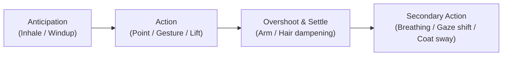

# SUPER.INTELLIGENCEEE — Brand Creative Bible
## The Definitive Creative & Visual Standard for Character-Led Tech Education

**Brand:** SUPER.INTELLIGENCEEE  
**Motto:** Understand What's Next.  
**Version:** 2.0 (Strategic Reset Edition)  
**Date:** 2026-11-18  

---

## 1. Brand Identity & Vision

### Brand Purpose
SUPER.INTELLIGENCEEE exists to transform the most complex, abstract, and intimidating concepts in modern computer science, artificial intelligence, and hardware engineering into intuitive, deeply engaging, and beautifully animated educational entertainment.

### The Brand Voice
- **Authoritative without Arrogance:** We know the engineering deeply, down to the register transfers and electron gates, but we never speak down to the audience.
- **Relentlessly Curious:** We are fascinated by how things work under the hood. Every video is an investigation into an engineering miracle.
- **Naturally Humorous:** We celebrate the absurdities, extreme numbers, and clever hacks that make modern technology possible.
- **Cinematic & Tactile:** We reject cold, sterile corporate dashboards. We ground technology in physical mechanisms, warm lighting, tangible materials, and expressive character acting.

---

## 2. Character Specification: Kavi

Kavi is the recurring host, protagonist, and chief technical investigator of SUPER.INTELLIGENCEEE.

```
[Character Identity Profile]
Name:                   Kavi (Canonical Host & Investigator)
Role:                   The Engineering Builder / Curious Investigator
Voice Persona:          Kokoro-82M 'am_liam' (General American, articulate, energetic)
Silhouette:             Voluminous curly black hair, thick dark rectangular glasses, trimmed beard & moustache
Wardrobe:               Matte Charcoal Technical Field Jacket (#2C2F33) with Safety Orange piping (#FF6B00)
Signature Props:        Spiral-bound Technical Field Notebook (left hand) & Drafting Pencil (right hand)
```

### Personality Pillars
1. **Intellectually Fearless, Physically Relatable:** He tackles 8-million-calculation problems with enthusiasm, but when an avalanche of data hits him, he genuinely sweats and braces for impact.
2. **The Wry Observer:** When an engineering choice is comically mismatched (like making a single CPU core render 4K ray tracing), he breaks the fourth wall with a knowing, sarcastic smirk.
3. **The Enthusiastic Demystifier:** He feels genuine joy when an elegant solution is revealed (like SIMT lockstep execution), beaming with an infectious "aha!" discovery smile.
4. **The Audience's Ally:** He never lectures from an ivory tower. He stands on the silicon die, walks along the memory bus, and inspects the logic gates alongside the viewer.

---

## 3. Character Animation Language & Acting Principles

To transition from a stiff cardboard cutout to a memorable animated personality, Kavi's performance adheres to classic character animation principles:



1. **Anticipation & Settle:**
   - Before Kavi points at a diagram or lifts a prop, he anticipates: a slight breath inward, a subtle shoulder dip ($100\text{ ms}$), followed by the gesture, an overshoot of $2\text{--}3^\circ$, and an elastic settle into the pose.
2. **Eye Dart & Gaze Hierarchy:**
   - Eyes never stare blankly into space. The gaze moves intentionally:
     - *Eye Dart:* Shifts to the subject $60\text{ ms}$ before the head turns.
     - *Micro-Blinks:* Occur naturally during head turns or topic transitions ($150\text{ ms}$ duration).
     - *Catchlights:* Large white ocular highlights that convey alertness and soul.
3. **Continuous Respiration & Life:**
   - Idle is never static. A smooth $0.35\text{ Hz}$ breathing cycle modulates the spine, collar, and jacket shoulders ($3\text{--}5\text{ px}$ amplitude). Hair locks have subtle secondary spring physics.
4. **Prop Kinematics:**
   - Props have weight. When Kavi balances a stack of task blocks, his arms tremble with dynamic micro-oscillation. When he holds an illuminated ALU core, his fingers curl around the edges, and the light from the core illuminates his palms and face.

---

## 4. Humour Principles: The Art of Intelligent Comedy

Humour in SUPER.INTELLIGENCEEE is strictly an educational catalyst. It serves to highlight engineering tradeoffs and make extreme numbers tangible.

### Core Humour Techniques
1. **The Extreme Scale Contrast:**
   - Numbers in computer science are too large for human intuition (e.g. 500 million operations/second). We visualize the human consequence of that scale: an engineer buried under an avalanche of glowing pixel cubes.
2. **The Mismatched Tool:**
   - The comedy of using the wrong architecture for the job. Portraying the CPU as an overcaffeinated, monocle-wearing math professor furiously scribbling on a chalkboard while an analog clock spins out of control.
3. **The Wry Fourth-Wall Break:**
   - Kavi pausing, glancing at the camera with an asymmetrical smirk, and acknowledging the absurdity of software bugs or hardware bottlenecks.
4. **The Understated Punchline:**
   - Delivering a technical revelation with calm conversational irony: *"Hilarious for chess, pure torture for graphics."*

### What is Strictly Forbidden
- ❌ No juvenile meme sound effects (vine booms, screaming goat, slide whistles).
- ❌ No irrelevant internet memes or pop-culture parodies that age poorly.
- ❌ No childish cartoon physics (eyes popping out of sockets, anvil drops).
- ❌ No comedy that distorts or obscures the real scientific mechanism.

---

## 5. Visual Comparison Engine: Metaphor Standards

Every complex technology must have a physical counterpart that grounds the concept:

| Abstract Concept | Physical Metaphor | The Visual Execution | The Scientific Boundary |
| :--- | :--- | :--- | :--- |
| **CPU vs. GPU** | Olympic Genius vs. 1,024 Paint Workers | Split screen: Sweating professor with chalk vs. disciplined stadium of mini-bots painting in unison. | Explicitly note: GPUs are simple ALUs with shared memory, not conscious painters. |
| **RAM vs. SSD** | Active Workbench vs. Basement Filing Cabinet | Desk holding active blueprints within reach vs. walking down stairs to unlock a metal cabinet. | Explicitly note: Nanosecond bus latency vs. microsecond NVMe I/O operations. |
| **Instruction Pipeline** | Michelin Master Chef | Head chef shouting orders to prep, grill, and plating stations in parallel. | Explains branch prediction stalls as burned dishes that force a line restart. |
| **Latency vs. Bandwidth** | Sports Car vs. Cargo Train | Ferrari carrying 1 flash drive fast vs. mile-long freight train carrying petabytes slowly. | Explains ping time ($ms$) vs. throughput ($Gbps$). |

---

## 6. Cinematic Visual Language

### A. Composition & Staging
- **Rule of Thirds & Golden Ratio:** The host occupies the left or right third during explanatory beats, leaving the hero space for the 3D model or physical metaphor.
- **Depth Layering:** Every frame consists of 4 distinct visual planes:
  1. *Foreground Accent:* Subtle out-of-focus elements (desk lamp edge, cable, chalkboard edge).
  2. *Character Layer:* Kavi with directional rim lighting and grounding drop shadow.
  3. *Subject Hero Layer:* The active 3D visualization (silicon die, comparison arena, code).
  4. *Atmospheric Background:* Warm studio bokeh, workshop gradient, or silicon substrate.

### B. Camera Movement & Cinematography
- **Purposeful Motion Only:** Camera moves must reveal information, not disguise lack of content.
- **Cinematic Moves:**
  - *Slow Push-In:* Drives focus during an important explanation ($1\text{--}2\%$ zoom over $5\text{ s}$).
  - *Orbital Track:* 3D camera sweeps $20^\circ$ around the silicon die to establish physical volume.
  - *Rack Focus:* Smooth depth-of-field transition shifting viewer attention from Kavi to the 3D prop in his hand.

### C. Lighting Philosophy
- **Three-Point Studio Lighting:**
  - *Key Light:* Warm directional amber/tungsten ($3200\text{ K}$, $45^\circ$ angle), providing flattering face modeling.
  - *Fill Light:* Soft cool slate ($5600\text{ K}$, $30\%$ intensity), lifting harsh shadows.
  - *Rim / Kicker Light:* High-contrast crisp cyan/orange rim along the shoulders, curly hair locks, and glasses frame, separating the character from the background.
- **Emissive Prop Lighting:** Props (like the ALU core) act as physical point lights, casting dynamic colored light onto the character's clothing and hands.

### D. Colour Direction
- **Primary Substrate:** Deep Obsidian (`#0A0E16`), Dark Slate (`#10141E`), Warm Charcoal (`#18161C`).
- **Signature Brand Accent:** Safety / Warm Orange (`#FF6B00`) — used on character piping, title underlines, and hardware highlights.
- **Compute Accents:**
  - Emerald Green (`#10B981`) — Execution success, GPU parallel cores, SIMT wave.
  - Warm Amber (`#F59E0B`) — Warp schedulers, warnings, CPU strategy.
  - Electric Cyan (`#00E5FF`) — Memory buses, clock signals, telemetry.
- **Contrast Rule:** All text and critical UI elements must maintain $\ge 7:1$ contrast ratio against backgrounds.

### E. Typography
- **Headlines:** Clean modernist geometric sans-serif (Segoe UI Bold / Inter / Arial Bold), tracking $-0.02\text{ em}$, high optical weight.
- **Technical Readouts:** Monospace (Consolas / JetBrains Mono), clean grid alignment, restrained sizing.
- **Subtitles:** Clean lower safe zone ($y \in [1660, 1780]$), rounded dark slate container, white primary text with amber keywords.

---

## 7. Sound Design & Foley Direction

Sound brings animation to life. A silent visual is an incomplete visual:
1. **Tactile Foley:**
   - Physical props make authentic sounds: crisp paper turns for the notebook, graphite scratching for the pencil, mechanical relay clicks for hardware gates, and soft chalkboard squeaks.
2. **Silicon & Data Hum:**
   - Microarchitectures emit a subtle, clean electronic resonance (a low $60\text{ Hz}$ warmth with musical harmonics) rather than abrasive sci-fi zaps.
3. **Musical Score:**
   - Understated, sophisticated hybrid electronic-orchestral score (warm cello pads, rhythmic analog arpeggiators, subtle sub-bass pulses) that swells during narrative payoffs and pulls back during speech.

---

## 8. The Gold Standard of Quality

A SUPER.INTELLIGENCEEE production is only complete when:
- The character feels like a living, thinking person rather than a puppet.
- A viewer with zero technical background can explain the core concept to a friend after watching.
- A senior staff engineer watches the video and respects the technical precision of the explanation.
- The visual pacing makes 45 seconds feel like 15 seconds.
