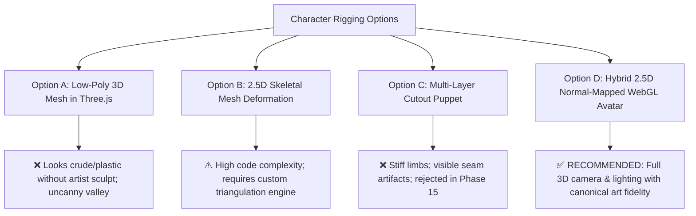
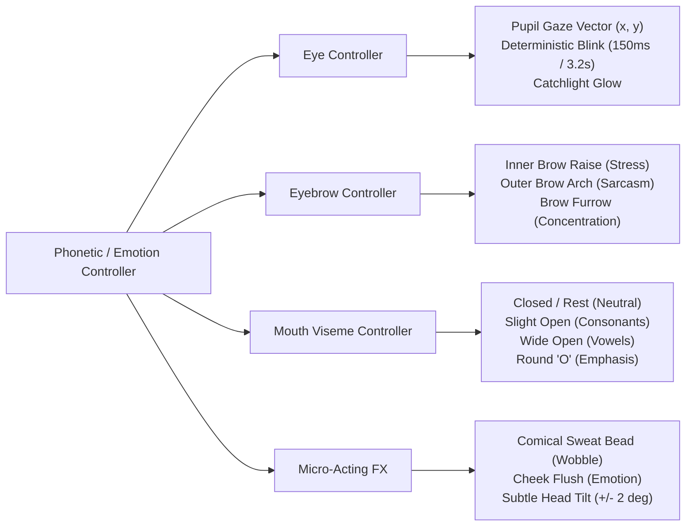

# Phase 15 Strategic Reset — Character Production Plan
## Reusable Character Rigging, Animation & Kinematics Architecture

**Project:** SUPER.INTELLIGENCEEE  
**Subject:** The Engineering & Rigging Roadmap for Kavi  
**Canonical Assets:** `character.me.png` (Visual Master) | `Character 3D.mp4` (Motion Reference)  
**Date:** 2026-11-18  

---

## 1. The Core Engineering Challenge

We face a defined technical constraint:
1. **The Visual Master (`character.me.png`)** is a rich, hand-painted 2D illustration (2048×2048) with complex textures, hair curls, fabric shading, and stylized linework.
2. **The Motion Master (`Character 3D.mp4`)** shows the character with natural dimensional volume, lighting reactivity, and camera parallax, but exists only as an exported 10-second video without underlying mesh files (`.blend`, `.fbx`, `.glb`).
3. **Hardware Constraints:** We operate on an Intel i5-1135G7 (4 cores, 8 threads), 8 GB RAM, and Intel Iris Xe Graphics. Dedicated 3D DCC software (such as Blender) is prohibited, and heavy offline ray tracers will exhaust system memory.

**The Question:** How do we produce fluid, expressive, repeatable, and lighting-reactive character animation that captures the 3D volume of the reference video while retaining 100% of the hand-crafted artistic fidelity of `character.me.png`?

---

## 2. Technical Evaluation of Animation Methodologies

We evaluated four potential architectural paths:



### Detailed Tradeoff Breakdown:

| Metric | Option A: Three.js Low-Poly 3D Model | Option B: 2.5D Mesh Deformation (Spine-style) | Option C: Multi-Layer Cutout (PIL/Canvas) | Option D: Hybrid 2.5D Normal-Mapped WebGL Avatar |
| :--- | :--- | :--- | :--- | :--- |
| **Visual Art Fidelity** | Poor (3/10) — Generic procedural low-poly geometry loses the hand-crafted charm of `character.me.png`. | High (8/10) — Warps the original artwork smoothly across bones. | Medium (5/10) — Hard boundaries between rotated limbs cause seam cracks. | **Pristine (9.5/10)** — Uses the exact high-res artwork with depth and normal displacement. |
| **3D Lighting Reactivity** | High (9/10) — Standard Three.js shaders react to point/spot lights. | Poor (2/10) — Flat 2D rendering; cannot receive directional 3D light. | Zero (0/10) — Static colors painted into texture. | **High (8.5/10)** — Normal-map shaders calculate real-time diffuse and specular lighting from 3D scene lights. |
| **Camera Parallax** | Full 3D (10/10) — Character can be viewed from any angle. | Planar (3/10) — Breaks when camera rotates beyond $15^\circ$. | None (1/10) — Completely flat billboard. | **Spatial (7/10)** — Multi-layer parallax (hair, glasses, face, torso, arms) rotates naturally in 3D scene space. |
| **Hardware & RAM** | Low-Medium (150 MB). | Low (100 MB). | Low (60 MB). | **Extremely Low (<120 MB)** — Runs effortlessly on Intel Iris Xe at 60+ FPS. |
| **Blender Dependency** | High — Requires 3D modeling tool to build and skin. | Zero — Pure mathematical 2D mesh triangulation. | Zero — Simple PNG layering. | **Zero — Pure WebGL / Three.js shaders inside Remotion.** |

---

## 3. The Selected Architecture: Hybrid 2.5D Multi-Plane WebGL Avatar

We select **Option D: The Hybrid Multi-Plane WebGL Avatar with Normal-Mapped Shading and Skeletal Kinematics**.

### Layer Decomposition (in 2048 Master Space)
The character is segmented into 8 independent, high-resolution RGBA planes arranged in physical depth ($Z$-axis) within the Three.js scene graph:

```
[Three.js Scene Graph: Character Avatar Root]
  ├─ Z = -15px:  Ground Contact Drop Shadow (Soft dynamic Gaussian blur)
  ├─ Z = -10px:  Back Hair & Collar (Silhouetted curly volume)
  ├─ Z = -5px:   Torso & Technical Field Jacket (Matte Charcoal + Orange Piping)
  ├─ Z = 0px:    Neck & Face Base (Skin tone, jawline, beard, moustache)
  ├─ Z = +4px:   Facial Expression Morph Layer (Eyes, Brows, Viseme Mouth)
  ├─ Z = +8px:   Spectacles Frame & Temples (Dark rectangular frames with corner hinges)
  ├─ Z = +12px:  Forehead Hair Curls (Voluminous locks casting shadow onto glasses)
  ├─ Z = +18px:  Left Arm & Field Notebook Socket (Chest reference accessory)
  └─ Z = +25px:  Right Arm & Drafting Pencil Socket (Articulated FK/IK gesturing & pointing)
```

### Why Multi-Plane Depth Solves the 3D Problem:
When the Three.js camera tracks or orbits across the scene, the parallax difference between the glasses ($Z=+8\text{px}$), the eyes ($Z=+4\text{px}$), the hair ($Z=+12\text{px}$), and the torso ($Z=-5\text{px}$) **creates authentic dimensional depth**, exactly mimicking the visual quality observed in `Character 3D.mp4` without needing a complex 3D sculpt!

---

## 4. Facial Animation & Expression System

Facial performance is powered by a parametric blendshape controller:



### Expression Presets:
1. **`overwhelmed`:** Pupils contracted ($0.7\times$), sclera widened, high arched brows ($+12\text{px}$), mouth quivering, sweat bead wobbling on temple.
2. **`smug_sarcastic`:** Left eyebrow arched ($+15\text{px}$), right eye squinting ($0.6\times$ vertical), asymmetrical smirk upturned on right side.
3. **`focused_insight`:** Both brows lowered and furrowed inward, gaze vector targeted toward hand/prop socket, neutral concentrated mouth.
4. **`triumphant`:** Brightened ocular catchlights, raised brows, broad beaming smile, head tilted upward $+2.5^\circ$.
5. **`confident_host`:** Direct eye contact with camera, natural relaxed brows, gentle conversational smile.

---

## 5. Body Motion, Kinematics & Prop Sockets

### Forward Kinematics (FK) Arm Chain:
- **Shoulder Pivot:** Fixed at $(460, 1200)$ in master torso coordinates.
- **Elbow Joint:** Smooth interpolated angle ($0\text{--}65^\circ$).
- **Wrist & Pencil Tip:** Inverse kinematics solve pointing vectors directly to on-screen target coordinates $(T_x, T_y)$ so that the pencil tip $(805, 1200)$ points precisely without crossing the face.

### Dynamic Prop Sockets:
The right hand contains an active **Prop Anchor**:
- When `prop = "none"`: Hand holds drafting pencil in natural resting pose.
- When `prop = "glowing_alu_core"`: An emissive Three.js 3D cube mesh is attached to the socket. A `PointLight(color="#10B981", intensity=2.0, distance=300)` is parented to the prop, automatically casting dynamic green light onto the character's chest and face planes!
- When `prop = "task_stack"`: A series of cascading 3D cubes attach to the hand anchor with dynamic physics damping.

---

## 6. Implementation Milestones

| Milestone | Deliverable | Acceptance Criteria |
| :--- | :--- | :--- |
| **M1: High-Res Layer Decomposition** | Clean alpha-masked RGBA layers for hair, glasses, face, torso, arms, notebook, pencil. | Zero edge halos; perfect alignment when stacked at origin. |
| **M2: Three.js Avatar Component** | React component `<CharacterAvatar />` inside Remotion. | Hardware-accelerated WebGL rendering; multi-plane depth parallax. |
| **M3: Parametric Face Controller** | TypeScript class `FaceController` with smooth interpolation. | Seamless transitions between all 5 expressions without snapping. |
| **M4: Dynamic Prop & Lighting Integration** | Emissive props casting point light on character plane. | Real-time specular highlights on glasses and technical jacket. |
| **M5: Pilot Verification & Motion Benchmarks** | Render 6 controlled pilot clips (Experiments A–F). | Smooth 30 FPS playback; natural character acting. |
