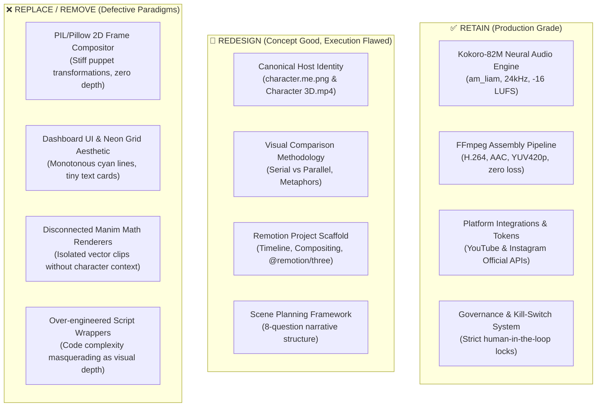

# Strategic Reset — Comprehensive Creative & Technical Audit

**Project:** SUPER.INTELLIGENCEEE  
**Scope:** Repository-wide audit of all creative assets, rendering engines, character systems, and video outputs  
**Date:** 2026-11-18  
**Status:** PUBLICATION OFFICIALLY POSTPONED // PRODUCTION PAUSED FOR STRATEGIC RESET  

---

## 1. Executive Summary: Why We Are Resetting

Over recent iterations, the SUPER.INTELLIGENCEEE project achieved significant engineering milestones: local neural text-to-speech with Kokoro-82M, automated scene planning, multi-platform OAuth integrations, and FFmpeg assembly pipelines.

However, **implementation activity was mistaken for creative progress**.

The rendered video outputs failed to achieve the creative and visual standards required for a premier animated educational brand:
- Videos felt like dry, sequenced slide presentations or generic dashboards.
- The recurring character was treated as an afterthought—pasted onto the corner of the frame like a static 2D sticker.
- Metaphors were either rushed or rendered as crude geometric boxes.
- The visuals lacked organic warmth, cinematic depth, fluid character acting, and cohesive art direction.

Continuing to generate full episodes on top of a compromised visual foundation only produces more discarded renders. We are pausing production to conduct an unsparing audit of what works, what is broken, and what must be rebuilt.

---

## 2. In-Depth Audit of Existing Systems

---

### A. Existing Character References & Rigging
1. **`character.me.png` (Canonical 2D Reference):**
   - *Strengths:* High-quality, distinctive visual identity. The character (Kavi) possesses strong recognizability: curly black hair with volume, prominent rectangular glasses, trimmed beard and moustache, technical charcoal jacket with orange piping, and signature notebook and pencil.
   - *Weaknesses:* It is a single flattened raster illustration. It was never layered for articulation. Attempting to cut out arms, eyes, and mouths using manual coordinate boxes resulted in stiff, robotic 2.5D planar slicing.
2. **`Character 3D.mp4` (Canonical 3D Reference):**
   - *Strengths:* 10-second proof of concept demonstrating full 3D lighting, dimensional volume, realistic hair geometry, expressive camera motion, and natural head sway.
   - *Weaknesses:* The workspace contains **zero source 3D files** (`.blend`, `.fbx`, `.glb`, or rig files). The MP4 is a pre-rendered video file. Treating it as a source of 3D meshes was a category error. To achieve this quality procedurally, we must either construct a lightweight WebGL/Three.js character rig or build a professional layered 2.5D skeletal mesh rig.

---

### B. Audit of Rejected Video Prototypes

1. **Phase 14 Prototype (`browser_use_autonomous_agent_master.mp4`):**
   - *Diagnosis:* Complete failure of art direction. Regressed into a monotonous "dashboard video" with repetitive dark cyan grids (`#141E30`), floating metric boxes, unreadable micro-typography, and a host sprite placed passively in the lower corner with a laser line crossing his cheek.
   - *Verdict:* Completely rejected. All dashboard card templates deprecated.
2. **Phase 14.1 Cinematic Master (`browser_use_cinematic_documentary_master.mp4`):**
   - *Diagnosis:* Improved editorial structure (6 clear scenes) and removed neon grids, introducing realistic IDE and browser viewports. However, it remained an animated infographic. The host character was static for entire scenes and appeared disconnected from the environments.
   - *Verdict:* Rejected as production standard; narrative pacing retained as reference.
3. **Phase 15 Prototype (`gpu_educational_entertainment_prototype.mp4`):**
   - *Diagnosis:* Strong conceptual breakthrough in storytelling (Serial CPU Olympic genius vs. 1,024-worker GPU army; falling pixel blocks; glowing ALU core). However, **the execution was severely throttled by the PIL rendering architecture**. Drawing 1,381 frames with Python Pillow cannot produce fluid organic movement, dynamic lighting shaders, or natural character acting. The character looked like a cardboard cutout moving on a 2D plane.
   - *Verdict:* Narrative concept and script approved; visual rendering pipeline rejected.

---

### C. Evaluation of Rendering Frameworks

| Framework | Current State in Repository | Strengths | Critical Weaknesses | Strategic Decision |
| :--- | :--- | :--- | :--- | :--- |
| **Pillow / PIL (Python)** | Used for Phase 14, 14.1, 15 frame generation. | Simple, zero dependencies, fast 2D raster drawing. | **No 3D spatial depth, no bone skinning, no shader lighting, rigid planar motion, high CPU raster overhead.** | **REPLACE as primary animator.** Demote to utility image processing only. |
| **Remotion (React/TS)** | Scaffolded in `rendering/remotion/`. Has `@remotion/three` and `three` installed. | Deterministic frame rendering, React component hierarchy, excellent timeline control, native audio sync. | Currently underutilized. Only had a single CSS-transform component (`CharacterHost.tsx`). | **RETAIN & PROMOTE to primary composition engine.** |
| **Three.js / WebGL** | Installed in Remotion; isolated scripts in `rendering/`. | Hardware accelerated via Intel Iris Xe GPU, real 3D camera orbits, PBR lighting, mesh deformation, low RAM footprint. | Needs structured scene templates and reusable asset loaders rather than ad-hoc inline scripts. | **RETAIN & INTEGRATE directly into Remotion canvas layers.** |
| **Manim Community** | Installed in Python venv; test scripts in `rendering/physical_explainer_engine/`. | Flawless mathematical vector graphics, LaTeX typesetting, precise coordinate transformations. | Isolated from character storytelling. Slow render times for full scenes. | **RETAIN as specialized insert renderer** for complex scientific/formula cutaways only. |
| **FFmpeg Pipeline** | Established in Python scripts and `core/`. | Rock-solid, extremely fast, perfect audio sync, multi-track mix, zero dropped frames. | None. Operates flawlessly. | **RETAIN as master encoding and audio muxing pipeline.** |
| **Kokoro-82M TTS** | Isolated in `external/voicebox/backend/venv`. | Pristine General American voice (`am_liam`), 24 kHz, 100% offline, zero network latency. | Spawning a new Python process per sentence was slow; solved by batch execution. | **RETAIN as authoritative voice identity.** |

---

## 3. Retain / Redesign / Replace / Remove Matrix

### What We Are RETAINING:
- **Kokoro-82M Neural Audio Engine (`am_liam`):** Authoritative voice persona of Kavi.
- **FFmpeg Master Encoding Engine:** Reliable, standard H.264 / AAC / YUV420p output.
- **Social Media API Integrations:** YouTube Shorts and Meta Instagram Graph API v21.0 tokens and database auth are 100% operational and must be preserved with armed kill switch.
- **The Core Topic Vision:** Complex technology explained through character-led storytelling, physical metaphors, and humor.

### What We Are REDESIGNING:
- **The Character System:** Moving away from slicing a 2D PNG into stiff parts. Developing a true reusable character engine with expressive morph targets, skeletal articulation, and authentic depth.
- **The Scene Planner:** Simplifying from hundreds of lines of abstract JSON metadata into a focused 8-question narrative blueprint that directly drives visual staging.
- **Visual Metaphors:** Ensuring every metaphor has tactile, rich art direction rather than colored geometric rectangles.

### What We Are REPLACING:
- **PIL-based Animation Renderer:** Deprecated for character and environment animation. Replaced with Remotion + Three.js WebGL rendering.
- **Ad-hoc Video Scripts:** Replaced with a unified Remotion project architecture.

### What We Are REMOVING:
- **All Dashboard UI Templates:** Banned permanently. No more dark cyan grids, floating tech metric panels, or generic futuristic particle overlays.
- **Disconnected Sub-pipelines:** Eradicate redundant experimental scripts that clutter the workspace without contributing to production quality.

---

## 4. Key Takeaways for the Strategic Reset

1. **Stop Rushing to Output:** Generating a full 45-second video when the character looks stiff and the lighting is flat produces negative value.
2. **Focus on the Character as an Actor:** If the audience does not connect with Kavi as an expressive, charming, and relatable guide, no amount of technical accuracy will make the video succeed.
3. **Hardware Realism:** Our Intel i5-1135G7 with 8 GB RAM cannot run heavy ray tracing or offline Blender renders. However, **Three.js WebGL running hardware-accelerated in Chromium via Remotion** is lightweight, blazingly fast, and produces stunning real-time 3D lighting, camera movement, and character acting within our exact hardware budget.
