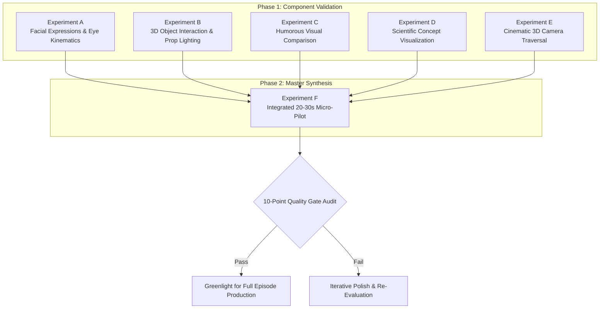

# Phase 15 Strategic Reset — Pilot Acceptance Criteria & Quality Gate
## Experimental Benchmark Suite & Uncompromising Production Standards

**Project:** SUPER.INTELLIGENCEEE  
**Scope:** Controlled Pilot Testing Protocol & Objective Quality Acceptance Gates  
**Date:** 2026-11-18  

---

## 1. The Controlled Pilot Experiment Plan (Experiments A–F)

Rather than immediately attempting another full 45-second episode, the production system will execute **six targeted, isolated animation experiments**. 

Each experiment isolates and validates a specific creative or technical capability before full integration:

---

### Detailed Experiment Specifications:

#### Experiment A: Character Expressions & Eye Kinematics (5–8s)
- **Objective:** Prove that Kavi can perform fluid, lifelike facial expressions without uncanny stiffness or seam cracks.
- **Criteria:**
  - Demonstrate smooth, non-snapping transitions between all 5 states: `overwhelmed`, `smug_sarcastic`, `focused_insight`, `triumphant`, and `confident_host`.
  - Natural deterministic eyelid blinking ($150\text{ ms} / 3.2\text{ s}$) with micro-jitter.
  - Realistic pupil gaze shifts and bright ocular catchlights.
  - Speech viseme synchronisation driven by Kokoro audio.

#### Experiment B: 3D Object Interaction & Dynamic Lighting (6–8s)
- **Objective:** Prove that the character can physically interact with a 3D object in 3D space with authentic lighting reactivity.
- **Criteria:**
  - Kavi holds an illuminated 3D ALU compute core in his hand.
  - The prop emits active point light that dynamically illuminates his fingers, jacket collar, and face in real-time WebGL.
  - Arm kinematics maintain natural shoulder pivot $(460, 1200)$ and elbow flexion without visual tearing.

#### Experiment C: Humorous Visual Comparison (8–10s)
- **Objective:** Prove that a physical comparison can deliver immediate intuition and intelligent humor.
- **Criteria:**
  - Split-screen comparison arena: The sweating "CPU Professor" at a chalkboard vs. the synchronized GPU worker brigade.
  - Comedic timing: Analog clock spins frantically; chalk dust flies; Kavi glances at the camera with an amused smirk.
  - Instant visual comprehension within the first 2 seconds.

#### Experiment D: Scientific Concept Visualization (6–8s)
- **Objective:** Prove that microarchitecture and mathematical concepts are depicted with technical accuracy and beauty.
- **Criteria:**
  - 3D exploded view of a Streaming Multiprocessor (SM).
  - Single Instruction, Multiple Threads (SIMT) broadcast wave washing across execution lanes in lockstep.
  - Zero fabricated benchmarks or hand-waving abstractions.

#### Experiment E: Cinematic 3D Environment Traversal (6–8s)
- **Objective:** Prove that camera movement, depth layering, and lighting create a cinematic atmosphere.
- **Criteria:**
  - 3D camera performs a smooth orbital track and push-in ($20^\circ$ sweep).
  - Multi-plane depth parallax (hair, glasses, face, jacket, background) proves spatial dimension.
  - Three-point lighting (warm key $3200\text{ K}$, cool rim $5600\text{ K}$, ambient fill) with soft shadows.

#### Experiment F: Integrated 20–30s Micro-Pilot
- **Objective:** Synthesize Experiments A through E into a continuous, broadcast-quality narrative sequence explaining a single concept with beginning, middle, humor, and educational payoff.

---

## 2. The 10-Point Uncompromising Quality Gate

No production video will ever be approved for release based solely on unit tests or successful compilation. It must satisfy every criterion of the **10-Point Quality Gate**:

| Dimension | Standard of Excellence | Failure Conditions (Automatic Rejection) |
| :--- | :--- | :--- |
| **1. Opening Hook** | Grabs attention within the first 3 seconds via an intriguing visual paradox or problem. | Slow title screens, corporate logos, or unmotivated narration in the first 3 seconds. |
| **2. Character Identity** | Kavi is instantly recognizable with consistent canonical features (hair, glasses, beard, jacket). | Inconsistent face styling, missing accessories, or generic anime/stock avatars. |
| **3. Animation Fluidity** | Natural anticipation, breathing, smooth arm arcs, and responsive speech visemes. | Cardboard cutout rotation, stiff limb snapping, or mouth moving out of sync with audio. |
| **4. Visual Depth & Lighting** | Three-dimensional spatial staging, multi-plane parallax, and dynamic light interaction. | Flat 2D canvas, monochromatic cyan grids, or unlit pasted sprites. |
| **5. Metaphor Clarity** | Physical comparison establishes immediate intuitive understanding within 2 seconds. | Overly abstract diagrams, confusing analogies, or metaphors that misrepresent science. |
| **6. Intelligent Humour** | Comedy highlights engineering tradeoffs and human scale without childishness. | Slapstick sounds, screaming audio, irrelevant memes, or comedy that derails the lesson. |
| **7. Technical Accuracy** | 100% compliant with real computer science, hardware architectures, and physics. | Fabricated benchmark figures, hand-waving physics, or misnamed silicon components. |
| **8. Sound Design & Foley** | Tactile sound effects (paper, graphite, relays) with balanced musical score. | Silent visuals, tinny voice, abrasive electronic buzzes, or audio peaking above $-1\text{ dBFS}$. |
| **9. Typography & Safe Zones**| High-contrast typography ($\ge 7:1$), clean hierarchy, subtitles bounded to safe zone. | Text overflowing into platform UI zones, tiny unreadable fonts, or cluttered text cards. |
| **10. Pacing & Retention** | Narrative progression maintains momentum; 45 seconds feels like 15 seconds. | Monotonous repetition, scenes that linger without visual change, or static endings. |

---

## 3. Production Protocol & Safety Locks

To protect the integrity of the channel during this rebuild:
1. **Publishing Kill Switch Remains Permanently Armed:** No automated scripts or background tasks are authorized to publish or schedule uploads to YouTube Shorts or Instagram Reels.
2. **Mandatory Human Sign-Off:** Each pilot experiment (A through F) requires explicit visual inspection and approval before advancing to the next stage.
3. **Hardware Budget Enforcement:** All render processes must execute within the $2.5\text{ GB}$ RAM ceiling and finish without thermal throttling.
