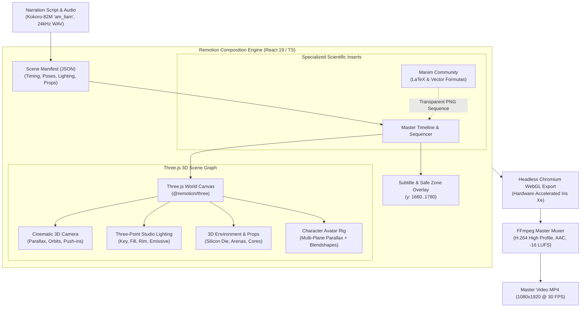

# Architecture Decision Record (ADR-015)
# Hybrid Remotion + Three.js WebGL Cinematic Engine with Dedicated Character Kinematics

**Status:** APPROVED & ADOPTED  
**Date:** 2026-11-18  
**Deciders:** SUPER.INTELLIGENCEEE Creative & Architecture Team  
**Replaces:** Ad-hoc Python PIL Frame Rendering Pipeline  

---

## 1. Context & Problem Statement

Prior production runs (Phases 14, 14.1, 15) attempted to render complete video frames using Python's Pillow (PIL) library. While Pillow successfully produced valid MP4s, it imposed fundamental creative bottlenecks:
1. Flat, planar 2D imagery with zero physical depth.
2. Robotic, segmented character limb rotation with visible joint seams.
3. Inability to calculate dynamic 3D lighting, normal maps, or realistic shadows.
4. Repetitive code-based drawing routines that were difficult to preview, iterate, and art-direct.

We require a modern, hardware-accelerated, and developer-friendly rendering architecture that:
- Runs deterministically within our 8 GB RAM / Intel Iris Xe budget.
- Delivers real-time 3D lighting, camera movement, and depth parallax.
- Enables expressive, multi-layered character acting.
- Provides instant interactive previewing in a browser UI before final render.

---

## 2. Decision: Hybrid Remotion + Three.js Architecture

We officially adopt a **Hybrid React/TypeScript architecture powered by Remotion and Three.js (`@remotion/three`)**, augmented by Kokoro-82M neural TTS and specialized Manim scientific inserts.



---

## 3. Layered Architectural Responsibilities

### Layer 1: Narration & Audio Ingestion (Kokoro-82M)
- **Role:** Generates pristine, uncompressed 24 kHz WAV speech audio files using the authoritative `am_liam` voice persona.
- **Output:** Timestamped WAV files and phoneme alignment markers in `output/audio/`.

### Layer 2: Remotion Master Sequencer (React / TypeScript)
- **Role:** Controls the global timeline, scene cuts, audio volume ducking, and safe-area subtitles.
- **Deterministic Time:** Driven by `useCurrentFrame()` and `useVideoConfig()`, ensuring exact frame-by-frame synchronization between voiceover and visual acting.

### Layer 3: Three.js World Stage (`<ThreeCanvas />`)
- **Role:** Renders the 3D visual universe using WebGL 2.0 accelerated by Intel Iris Xe.
- **Lighting:** Dynamic ambient light, warm directional key light ($3200\text{ K}$), cool rim light ($5600\text{ K}$), and dynamic point lights emitted by props.
- **Camera:** Smooth cubic Bézier camera transitions (pan, orbit, push-in, rack focus).

### Layer 4: Character Kinematics Rig (`<CharacterAvatar />`)
- **Role:** Implements Kavi as a multi-plane 2.5D spatial hierarchy inside the Three.js scene graph.
- **Facial Blendshapes:** Parametric eye pupil gaze, eyelid blink cycle ($150\text{ ms} / 3.2\text{ s}$), eyebrow stress/sarcasm curves, and 4-state mouth visemes.
- **Kinematics:** Sinusoidal respiration, head tilt, and IK-solved arm pointing to on-screen target coordinates.
- **Prop Sockets:** Physical mounting points on the hands for illuminated 3D props (e.g. ALU compute core, task blocks).

### Layer 5: Scientific Vector Inserts (Manim Community)
- **Role:** When an exact mathematical derivation, tensor matrix, or Fourier curve is required, Manim renders an isolated 3–5 second transparent clip that is imported directly into the Remotion sequence.

### Layer 6: Encoding & Compliance (FFmpeg)
- **Role:** Compiles the rendered video and audio into a broadcast-standard MP4 (H.264 High Profile, YUV420p, progressive, AAC 192 kbps, -16 LUFS integrated loudness).

---

## 4. Hardware Optimization & Memory Guardrails

To strictly guarantee stability on our 8 GB RAM workstation:
1. **Headless Chromium Flags:** Remotion renders using:
   ```bash
   --disable-dev-shm-usage --use-gl=angle --use-angle=d3d11 --enable-gpu-rasterization
   ```
2. **Single-Process WebGL Pipeline:** Chromium operates with a maximum memory ceiling of $1.5\text{ GB}$.
3. **Sequential Asset Disposal:** Three.js textures and geometries are explicitly disposed (`geometry.dispose()`, `material.dispose()`) when unmounted between scenes.
4. **Resolution Standards:** Master output is strictly $1080 \times 1920$ (9:16 vertical) at constant $30.0\text{ FPS}$.

---

## 5. Consequences & Tradeoffs

### Positive Consequences:
- **Massive Visual Upgrade:** Real 3D camera orbits, authentic multi-plane parallax depth, and dynamic lighting on the character replace flat 2D cutouts.
- **Interactive Visual Previewing:** Creative directors can run `npm run dev` in `rendering/remotion` to scrub the timeline, inspect animations in real time, and adjust lighting with instant hot-reloading.
- **Zero Financial Cost:** Completely open-source stack; zero cloud subscriptions or paid APIs.

### Negative Consequences / Mitigations:
- **Node.js Build Dependency:** Requires Node.js and TypeScript tooling alongside Python. *Mitigation:* Already installed and validated in `rendering/remotion/`.
- **Learning Curve for Three.js Shaders:** Writing custom normal maps requires mathematical precision. *Mitigation:* Standard Three.js PBR materials (`MeshStandardMaterial`) handle lighting out of the box.
