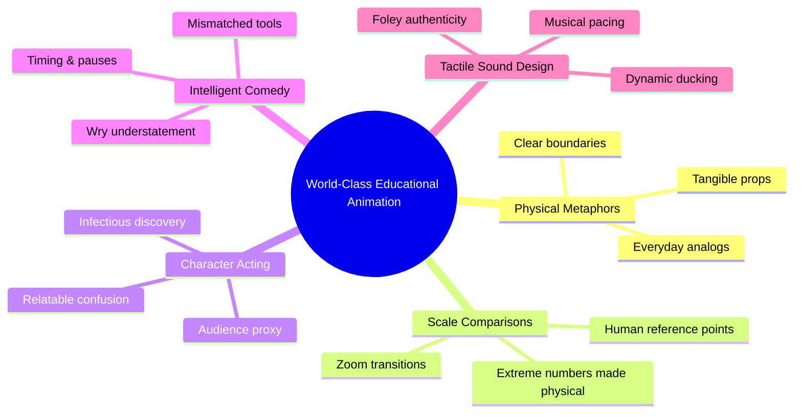

# Phase 15 Strategic Reset — Visual Benchmarks & Creative Deconstruction
## Analysis of World-Class Educational Animation & Original Format Blueprints

**Project:** SUPER.INTELLIGENCEEE  
**Scope:** Creative deconstruction of high-engagement animated educational storytelling  
**Date:** 2026-11-18  

---

## 1. Principles of World-Class Educational Animation

The world's most successful educational channels (e.g. Kurzgesagt, 3Blue1Brown, Veritasium, Vox, Primer) share fundamental visual storytelling techniques that elevate dry information into unforgettable entertainment. 

We analyze these broad creative techniques as inspiration to establish an **original, distinct storytelling universe** for SUPER.INTELLIGENCEEE:

---

## 2. Deconstruction of 6 Core Creative Techniques

### Technique 1: The Tangible Physical Metaphor
- **The Concept:** Abstract digital concepts (bits, cache misses, network packets) have no inherent visual form. Humans understand physical objects with mass, friction, and boundaries.
- **Why It Works:** Translating invisible logic into physical artifacts (e.g. comparing RAM to an active workbench and storage to a distant basement filing cabinet) creates immediate neural grounding.
- **Our Execution:** In SUPER.INTELLIGENCEEE, Kavi physically touches, balances, and manipulates these metaphors. He doesn't just display a filing cabinet; he physically walks over, unlocks it, and waits as a clock ticks to illustrate I/O latency.

---

### Technique 2: The Extreme Scale Comparison
- **The Concept:** Computer science deals with incomprehensible quantities (e.g., 500 million operations/second, 3nm gate widths, petabytes of data). Raw numbers cause cognitive numbness.
- **Why It Works:** Visualizing the numbers through physical volume or time dilation makes the scale visceral.
- **Our Execution:** To explain 4K 60fps rendering, we drop an avalanche of 8,294,400 physical pixel blocks onto Kavi's desk. The visual weight and teetering tower communicate the bottleneck far better than a text bullet point.

---

### Technique 3: The Mismatched Tool Comedy
- **The Concept:** Explaining why specialized architectures exist by showing the comical failure of a general-purpose tool.
- **Why It Works:** Comedy arises from cognitive dissonance. Watching an overqualified tool struggle with a simple, massive task creates a memorable mental anchor.
- **Our Execution:** Depicting the CPU as an Olympic math professor solving basic pixel addition one by one with chalk on a blackboard, sweating furiously while an analog clock spins out of control. It instantly clarifies why GPUs were invented.

---

### Technique 4: The Exploded Component Cutaway
- **The Concept:** Moving from the outer casing to the microscopic heart of a system.
- **Why It Works:** Provides the viewer with a sense of "insider access" and technical mastery.
- **Our Execution:** The comparison arena smoothly deconstructs, peeling back layers of heatsinks and packaging to reveal the raw silicon die, the High-Bandwidth Memory (HBM) bus, and the arrays of Arithmetic Logic Units.

---

### Technique 5: The Character as the Emotional Proxy
- **The Concept:** The viewer needs someone on screen who mirrors their own intellectual journey.
- **Why It Works:** When the presenter is genuinely overwhelmed, curious, skeptical, or delighted, the audience mirrors those emotional states.
- **Our Execution:** Kavi's facial expressions transition from genuine panic/overwhelm when confronting extreme workloads, to wry sarcasm when observing design flaws, to triumphant illumination when the breakthrough is revealed.

---

### Technique 6: Tactile Foley & Kinetic Sound Rhythm
- **The Concept:** Sound design drives 50% of perceived visual quality.
- **Why It Works:** Real-world tactile audio gives weight to digital animations.
- **Our Execution:** Crisp graphite scratches when Kavi writes with his pencil, deep metallic thuds when silicon components snap together, and an intentional musical silence immediately preceding major technical revelations.

---

## 3. Original SUPER.INTELLIGENCEEE Production Formats

To establish repeatable, recognizable formats across our channel, we introduce three signature episodic frameworks:

### Format A: "The Silicon Autopsy"
- **Premise:** Kavi investigates a catastrophic technical failure, system bottleneck, or historic architectural flaw.
- **Structure:**
  1. *The Crime Scene:* A crashed system, dropped frame rate, or thermal throttling incident.
  2. *The Investigation:* Kavi uses his pencil and notebook to dissect the microarchitecture, identifying the exact bottleneck (e.g., the memory wall, cache coherence stall).
  3. *The Breakthrough:* The architectural redesign that solved the crisis.
- **Tone:** Investigative tech thriller with dry humor and deep engineering rigor.

### Format B: "The Impossible Benchmark"
- **Premise:** Pitting intuitive physical mechanics against computational extremes to demonstrate how modern computing defies everyday intuition.
- **Structure:**
  1. *The Challenge:* Can a single person, vehicle, or room perform what a modern chip does in a millisecond?
  2. *The Physical Staging:* Large-scale visual comparison arena testing the analogy to its breaking point.
  3. *The Silicon Reality:* Transitioning from the broken analogy into the exact silicon mechanism (e.g. SIMT, pipelining).
- **Tone:** High-energy, humorous, and visually spectacular.

### Format C: "The Code-to-Metal Journey"
- **Premise:** Tracing a single innocuous line of high-level code (e.g. `x = a + b` or `agent.run()`) all the way down to physical electron gates.
- **Structure:**
  1. *The Surface:* The clean, simple line of Python or TypeScript in an IDE.
  2. *The Descent:* Stepping through compiler bytecode, OS syscalls, PCIe bus transfers, register allocation, and transistor gates.
  3. *The Revelation:* The staggering mechanical complexity that occurs beneath everyday software.
- **Tone:** Awe-inspiring, educational, and deeply technical.
