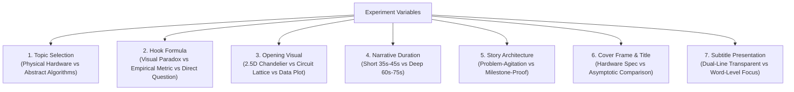

# SUPER.INTELLIGENCEEE // GROWTH EXPERIMENTATION PLAN
**Hypothesis-Driven Growth, Pacing Optimization, and Publishing Cadence**
**Date:** 2026-11-16  
**Cycle:** Initial Production Launch & Iterative Learning  

---

## 1. Scientific Growth Philosophy

SUPER.INTELLIGENCEEE rejects engagement-baiting gimmicks, follow-for-follow schemes, purchased views, and speculative algorithmic "hacks". Long-term, sustainable audience expansion is achieved through **clear explanations of difficult technical subjects, exceptional visual design, and disciplined hypothesis testing**.

Every published video serves as a controlled data point evaluating specific editorial, visual, or structural hypotheses.

---

## 2. The 7-Variable Experimentation Matrix

Performance will be analyzed across seven distinct creative variables:

---

## 3. Structured Hypothesis Backlog (Initial 4 Sprints)

### Sprint 1: Physical Machine vs Abstract Algorithm (Flagship Baseline)
- **Hypothesis:** Explaining physical cryogenic engineering (the dilution refrigerator chandelier) yields $\ge 25\%$ higher Instagram Shares (DM sends) than purely mathematical software topics, because physical hardware creates immediate awe.
- **Test Asset:** `phase10_1_captioned_review_master.mp4` (Google Willow + Golden Chandelier).
- **Control Comparison:** Future Sprint 2 video focusing purely on algorithmic quantization or attention pruning.
- **Success Criteria:**
  - YouTube Shorts Viewed %: $\ge 75\%$
  - Instagram DM Sends: $\ge 15$ per 1k views

### Sprint 2: Hook Construction — Visual Paradox vs Numerical Benchmark
- **Hypothesis:** Opening with an intuitive physical paradox (*"Why do quantum computers look like golden chandeliers?"*) achieves higher 0–3s retention than opening with a quantitative figure (*"105 qubits cooled to 10 millikelvin"*).
- **Measurement:** Compare YouTube Studio retention curves between Second 0.0 and Second 3.0.
- **Acceptance:** Hook drop-off $<20\%$ in the first 3 seconds.

### Sprint 3: Video Length Pacing — 42s vs 64s
- **Hypothesis:** While shorter 40s videos yield higher percentage completion, a 64s video with high informational density drives higher bookmarking (Saves) and subscriber conversion on YouTube.
- **Measurement:** Saves per 1k views on Instagram; Subscribers gained per 1k views on YouTube.

### Sprint 4: Title Strategy — Search-Friendly vs Curiosity-Gap
- **Hypothesis:** On YouTube, pairing a search-optimized title (*"How Google Willow Solved Quantum Error Correction"*) with an curiosity-driven thumbnail text (*"THE THRESHOLD CROSSED"*) maximizes browse and search CTR simultaneously.
- **Target:** Browse CTR $\ge 7.5\%$.

---

## 4. Platform Analytics Telemetry Tracking

For each publication, the [analytics/performance_tracker.py](file:///a:/SUPER.INTELLIGENCEEE/analytics/performance_tracker.py) module logs the following telemetry:

### YouTube Telemetry:
1. `impressions_ctr`: Click-through rate on browse and suggested surfaces.
2. `viewed_percent`: Viewed vs swiped away in Shorts feed.
3. `average_percentage_viewed`: APV indicating loop propensity.
4. `retention_hook_leak`: Drop-off percentage from 0s to 3s.
5. `subscribers_gained`: Direct subscription conversions attributed to the video.
6. `traffic_sources`: Proportion of views from Shorts Feed vs Browse vs Search.

### Instagram Telemetry:
1. `shares_dm_sends`: Number of direct message shares (Primary Algorithm Signal).
2. `non_follower_reach_ratio`: Percent of accounts reached who do not follow the account.
3. `completion_rate`: Percent of viewers watching the full video.
4. `saves_bookmarks`: Indicator of educational and utility value.
5. `profile_visits`: Viewer intent to explore additional channel output.
6. `follows_attributed`: Follower conversion rate.

---

## 5. Sustainable Publishing Cadence

Do not flood social platforms with automated low-effort uploads. Algorithmic distribution rewards high-retention originality over bulk volume.

### Initial Phase Schedule:
- **Frequency:** **1 to 2 flagship documentaries per week**.
- **Timing:** 
  - YouTube: Midday Tuesday & Thursday (11:00 AM – 2:00 PM EST / 4:00 PM – 7:00 PM UTC) to align with peak global engineering active hours.
  - Instagram: Evening slots (6:00 PM – 9:00 PM local) when mobile consumption of short-form educational content peaks.
- **Review Cycle:** Analyze performance metrics 72 hours post-publish before modifying next week's script formulas.
