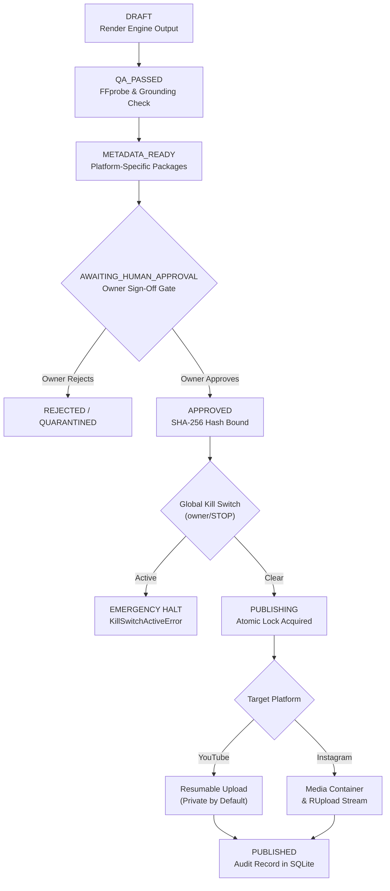

# SUPER.INTELLIGENCEEE // PUBLISHING ARCHITECTURE & GOVERNANCE
**Multi-Platform Social Publishing Architecture & Verification Engine**
**Date:** 2026-11-16  
**Platforms:** YouTube Shorts & Instagram Reels  
**Runtime:** FastAPI 2.0 / Uvicorn on Windows 11 (`http://127.0.0.1:5000`)  

---

## 1. Architectural Blueprint & Lifecycle

The publishing subsystem transforms research-backed video masters into platform-optimized, cryptographically guarded social publications. It enforces an unbypassable, unidirectional state machine:

---

## 2. Platform Publishing Engines

### 2.1 YouTube Data API v3 Engine ([publishing/youtube_integration.py](file:///a:/SUPER.INTELLIGENCEEE/publishing/youtube_integration.py))
- **OAuth Protocol:** Google OAuth 2.0 Authorization Code Flow with offline access (`access_type=offline`, `prompt=consent`).
- **CSRF Defense:** State parameter formatted as `nonce.timestamp.signature` with HMAC-SHA256 signing, stored in SQLite `oauth_states` table with 600-second TTL and single-use atomic consumption.
- **Credential Storage:** Authenticated Fernet (AES-128-CBC + HMAC-SHA256) encryption at rest in `data/secure/youtube_token.enc` with automatic master key provisioning in `data/secure/.master_key`.
- **Channel Identity Verification:** Queries `channels.list(part="snippet,contentDetails,statistics", mine=true)` upon token exchange to retrieve authenticated channel ID, channel title, description, thumbnail, and subscriber count.
- **Upload Protocol:**
  - Initiates resumable upload session (`POST https://www.googleapis.com/upload/youtube/v3/videos?uploadType=resumable&part=snippet,status`).
  - Streams binary video chunks with exponential backoff and retry handling.
  - Hardcodes **`privacyStatus: "private"`** as the mandatory initial upload state.
  - Automatically declares synthetic AI media flag (`containsSyntheticMedia: true`).
- **Idempotency & Duplicate Block:** Computes SHA-256 digest of video artifact before upload; blocks duplicate publication if identical hash exists in `youtube_publications`.

### 2.2 Meta Instagram API Engine ([publishing/instagram_integration.py](file:///a:/SUPER.INTELLIGENCEEE/publishing/instagram_integration.py))
- **Unified Login Setup:** Configured for Meta Unified Login / Facebook Login for Business with Configuration ID `1681040066712391` (App ID `995939360234396`, Business ID `1765114544578811`).
- **Permissions:** Restricted to `instagram_basic`, `instagram_content_publish`, `instagram_manage_insights`, and `instagram_manage_comments` (zero unnecessary advertising scopes).
- **Asynchronous 4-Step Media Container Lifecycle:**
  1. `POST /{ig_user_id}/media` (Initializes container with `media_type="REELS"`, `upload_type="resumable"`, and `caption`).
  2. Resumable binary upload via `rupload.facebook.com` with offset verification.
  3. Status polling (`GET /{container_id}?fields=status_code,status`) until `status_code == "FINISHED"`.
  4. Publish trigger (`POST /{ig_user_id}/media_publish?creation_id={container_id}`).
- **Zero-Budget Manual Export Fallback:** Generates self-contained publish bundle (`reel.mp4`, `cover.jpg`, `caption.txt`, `metadata.json`, and `PUBLISH_CHECKLIST.md`) for zero-cost mobile posting.

---

## 3. Human Approval Gate & Governance Enforcement

1. **Anti-Self-Approval Mechanism:** The approval manager ([publishing/approval.py](file:///a:/SUPER.INTELLIGENCEEE/publishing/approval.py)) enforces that reviewer names matching automated agents (`"production_agent"`, `"content_engine"`, `"bot"`, `"pipeline"`) are rejected with `PermissionError`. Only an explicit human operator can approve videos.
2. **SHA-256 Integrity Binding:** Every approved video has its SHA-256 digest calculated and recorded. If the file on disk is modified, re-rendered, or substituted after approval, the upload is immediately blocked.
3. **Application Kill Switch:** [core/kill_switch.py](file:///a:/SUPER.INTELLIGENCEEE/core/kill_switch.py) monitors `owner/STOP`. When engaged, any invocation of `upload_video()` or `publish_reel()` throws `KillSwitchActiveError` before any network packets are transmitted.

---

## 4. API Endpoint Specification

The web dashboard routes are mounted at `http://127.0.0.1:5000` via [dashboard/routes.py](file:///a:/SUPER.INTELLIGENCEEE/dashboard/routes.py):

| Endpoint | Method | Purpose | Security Gate |
| :--- | :---: | :--- | :--- |
| `/auth/youtube/connect` | `GET` | Initiates Google OAuth 2.0 flow | Generates HMAC-signed state nonce |
| `/auth/youtube/callback` | `GET` | Receives authorization code from Google | Consumes state nonce atomically (CSRF check) |
| `/auth/youtube/status` | `GET` | Returns connection status, channel name, ID | Safe metadata only (zero secrets exposed) |
| `/auth/youtube/disconnect` | `POST` | Revokes credentials and wipes `youtube_token.enc` | Secure deletion on disk |
| `/api/youtube/publish/{id}` | `POST` | Resumable upload of approved video to YouTube | Mandatory `explicit_approval=True` payload |
| `/oauth/instagram/connect` | `GET` | Initiates Meta Unified Login flow | Generates signed state nonce with Config ID |
| `/oauth/instagram/callback` | `GET` | Receives authorization code from Meta | Consumes state nonce atomically |
| `/api/instagram/status` | `GET` | Returns Instagram professional account status | Safe metadata only |
| `/api/instagram/disconnect` | `POST` | Wipes encrypted Instagram token | Secure deletion on disk |
| `/api/instagram/publish/{id}` | `POST` | Publishes approved Reel to Instagram | Mandatory `explicit_approval=True` payload |
| `/api/publishing/status` | `GET` | Unified status payload for both platforms | Real-time connection diagnostics |
