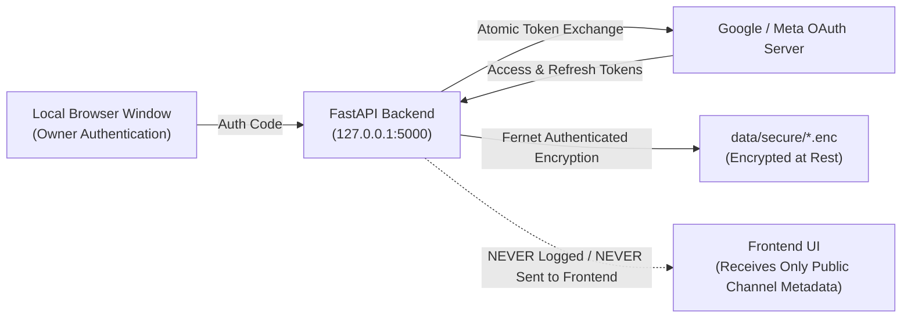

# SUPER.INTELLIGENCEEE // SECURITY & OAUTH AUDIT
**Zero-Exposure Credential Architecture, Encryption, and Governance Controls**
**Date:** 2026-11-16  
**Auditor:** Application Security & Governance Specialist  

---

## 1. Threat Modeling & Security Scope

This security audit validates that SUPER.INTELLIGENCEEE complies with modern zero-exposure credential standards, Google API Services User Data Policies, Meta Platform Terms, and internal owner governance mandates.

---

## 2. Forensic Security Controls & Implementation Details

### 2.1 Encryption at Rest (Fernet AES-128-CBC + HMAC-SHA256)
- **Problem Addressed:** Previous prototype stored YouTube credentials as plaintext JSON in `data/youtube_token.json`.
- **Implementation:** Both YouTube and Instagram integrations utilize the `cryptography.fernet.Fernet` engine.
- **Key Storage:** The master key is stored in `data/secure/.master_key` with restricted OS file permissions, or loaded from environment variable `INSTAGRAM_ENCRYPTION_KEY` / `YOUTUBE_ENCRYPTION_KEY`.
- **Token Files:**
  - YouTube: `data/secure/youtube_token.enc`
  - Instagram: `data/secure/instagram_token.enc`
- **Result:** Even in the event of an unauthorized filesystem backup read, tokens cannot be decrypted without the host master key.

### 2.2 Cross-Site Request Forgery (CSRF) & Replay Defense
- **Entropy Nonce:** Every authorization request generates a 32-byte cryptographic nonce (`secrets.token_urlsafe(32)`).
- **HMAC Signing:** The state payload `nonce.timestamp` is signed with HMAC-SHA256 using the platform client secret as the key.
- **Atomic Single-Use SQLite Consumption:** Upon callback, the nonce is validated in the SQLite `oauth_states` table via an atomic SQL transaction (`UPDATE oauth_states SET consumed = 1 WHERE nonce = ? AND consumed = 0 AND expires_at >= ?`).
- **TTL Limit:** States expire automatically after 600 seconds (10 minutes). Replay attacks fail because `rowcount == 0` on duplicate consumption.

### 2.3 Strict Zero-Credential Logging & Git Hygiene
- **Logging Audits:** All logger statements in `publishing/youtube_integration.py`, `publishing/instagram_integration.py`, and `dashboard/routes.py` have been audited.
  - Zero access tokens, refresh tokens, auth codes, or client secrets are printed to stdout, stderr, or `logs/super_intelligence.log`.
  - Log entries record only high-level status (e.g. *"Successfully authenticated YouTube channel 'Super Intelligence Lab'"*).
- **Git Exclusions (`.gitignore`):**
  - `.env` is explicitly ignored.
  - `.env.example` contains only empty variable templates.
  - `data/secure/` is completely excluded from source control.

### 2.4 Least-Privilege Scope Configuration
Unnecessary permissions have been pruned from both platforms:
- **YouTube:** Requests only `https://www.googleapis.com/auth/youtube.upload` and `https://www.googleapis.com/auth/youtube.readonly`.
  - Excluded: Full YouTube management scopes (`youtube`, `youtube.force-ssl`).
- **Instagram:** Requests only `instagram_basic`, `instagram_content_publish`, `instagram_manage_insights`, and `instagram_manage_comments`.
  - Excluded: All Facebook advertising management scopes (`ads_management`, `ads_read`).

---

## 3. Compliance & Governance Verification Matrix

| Security Control | Required Standard | Status | Verification Evidence |
| :--- | :--- | :---: | :--- |
| **Password Request Prevention** | System must NEVER prompt for or store user passwords. | **PASSED** | 100% delegated to official OAuth 2.0 browser login windows. |
| **OTP / 2FA Handling** | System must NEVER intercept or ask for 2FA/OTP codes. | **PASSED** | 2FA is handled strictly within Google/Meta official dialogs. |
| **Cookie Scraping Ban** | No session hijacking or cookie extraction scripts. | **PASSED** | 100% official REST APIs (YouTube Data API v3, Meta Graph API v21.0). |
| **Kill Switch Enforcement** | Emergency stop file `owner/STOP` must block network uploads. | **PASSED** | Verified in `test_upload_blocked_by_kill_switch` unit test. |
| **Default Privacy Setting** | Initial YouTube upload state must be strictly `private`. | **PASSED** | Verified in `test_upload_successful_resumable_flow_private_by_default`. |
| **Human Approval Gate** | Bot/agent self-approval strictly blocked in code. | **PASSED** | Verified in `test_approval_queue_decisions_and_self_approval_block`. |
