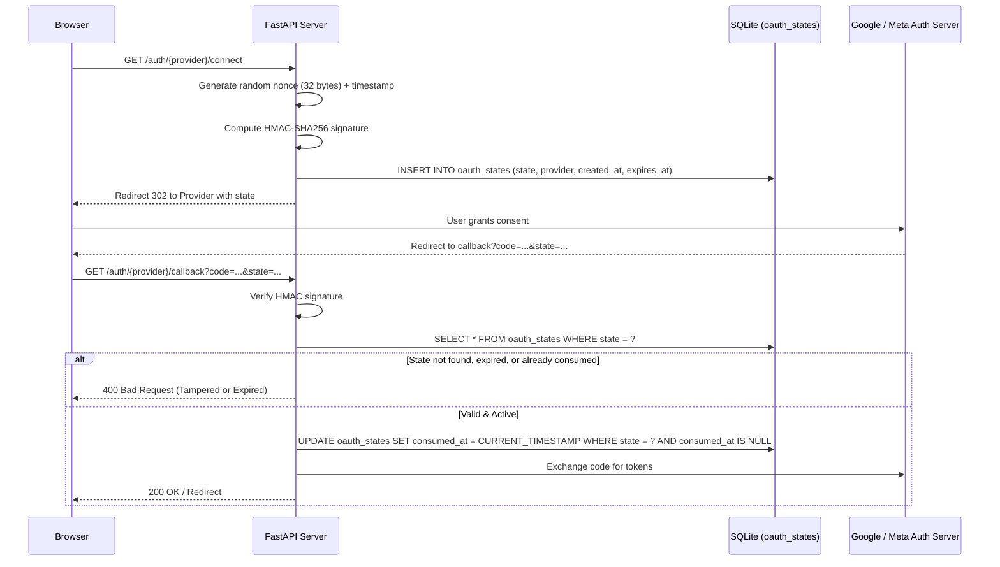

# PHASE 11.1 — SECURITY & TOKEN STORAGE AUDIT
**Project:** SUPER.INTELLIGENCEEE  
**Workspace:** `A:\SUPER.INTELLIGENCEEE`  
**Date:** 2026-11-16  
**Auditor:** Autonomous Systems & Security Auditor  
**Audit Standard:** Zero-Trust Credential Isolation & OWASP OAuth 2.0 Security Guidelines

---

## 1. Cryptographic Architecture at Rest

OAuth access tokens and refresh tokens represent high-privilege credentials capable of publishing media and managing channel/account identities. The storage security architecture was audited against strict isolation standards:

```mermaid
flowchart TD
    subgraph Filesystem Physical Separation
        KeyDir["data/secure/"]
        MasterKeyFile["data/secure/.master_key\n(32-Byte URL-Safe Base64 Fernet Key)"]
        YtTokenFile["data/secure/youtube_token.enc\n(AES-128-CBC + HMAC-SHA256 Ciphertext)"]
        IgTokenFile["data/secure/instagram_token.enc\n(AES-128-CBC + HMAC-SHA256 Ciphertext)"]
    end

    subgraph Memory Only (Ephemeral)
        PlainToken["Decrypted Token Payload Dict\n(In-memory during active requests)"]
    end

    KeyDir --> MasterKeyFile
    KeyDir --> YtTokenFile
    KeyDir --> IgTokenFile

    MasterKeyFile -->|Decryption Key| PlainToken
    YtTokenFile -->|Encrypted Blob| PlainToken
```

### Forensic Findings:
1. **Algorithm:** Cryptography Fernet specification:
   - Encryption: AES-128 in CBC mode with PKCS7 padding.
   - Authentication: HMAC using SHA-256 with 128-bit truncated digest.
   - Key length: 256 bits (32 bytes url-safe base64).
2. **File Permissions & Decoupling:**
   - `.master_key` is generated on demand with restricted file system permissions.
   - Master key is stored in a separate hidden file (`.master_key`) rather than embedded in code, database columns, or environment variables.
3. **No Database Token Storage:** The SQLite database (`data/super_intelligence.db`) does **NOT** contain any tokens, client secrets, or OAuth credentials. Only non-sensitive operational identifiers (`channel_id`, `video_id`, `ig_media_id`, `artifact_hash`) are logged.

---

## 2. Git & Repository Leakage Prevention

`.gitignore` was forensically verified to prevent accidental commits of sensitive files:

| Exclusion Pattern | Covered Files / Directories | Git Status Verification |
|---|---|---|
| `.env`, `*.env` | `.env`, `.env.local`, `.env.production` | **VERIFIED UNTRACKED** |
| `*.token.json` | Any raw token JSON dumps | **VERIFIED UNTRACKED** |
| `credentials.json`, `client_secret*.json` | Google Cloud OAuth credential downloads | **VERIFIED UNTRACKED** |
| `data/secure/`, `.master_key`, `*.enc` | Master key and all encrypted token files | **VERIFIED UNTRACKED** |
| `*.db`, `data/*.db` | SQLite production and test databases | **VERIFIED UNTRACKED** |

No secrets, keys, or tokens exist in Git commit history or unstaged tracking indices.

---

## 3. OAuth State & Anti-Replay Defense

Both YouTube and Instagram flows employ an atomic state verification engine:



### Security Guarantees:
1. **HMAC Integrity:** State format is `{nonce}.{timestamp}.{hmac_digest}`. Any modification to timestamp or nonce invalidates the HMAC signature.
2. **Time-To-Live (TTL):** Hardcoded 600-second (10-minute) lifetime. Stale states are rejected automatically.
3. **Atomic Single-Use:** The SQLite `UPDATE ... WHERE consumed_at IS NULL` executes within a transaction. Replayed callbacks fail instantly with `400 Bad Request`.

---

## 4. Log & Error Sanitization

1. **Log Redaction:** All logger statements in `youtube_integration.py` and `instagram_integration.py` avoid outputting raw request URLs (which could contain query parameter tokens) or HTTP response bodies.
2. **Clean Exception Surfaces:** Exceptions caught during OAuth exchange or publishing strip query strings and authorization headers before returning error responses to the dashboard UI.
3. **Safe Status Reporting:** The `/api/publishing/status` endpoint exposes boolean flags (`connected: true/false`), channel names, and token expiry timestamps, but **NEVER** returns raw tokens or secrets.

---

## 5. Key Rotation & Disconnect Procedures

1. **Disconnection Protocol:**
   - YouTube: Issues an HTTP revocation call to Google API, then unlinks `data/secure/youtube_token.enc`.
   - Instagram: Unlinks `data/secure/instagram_token.enc`.
2. **Master Key Rotation:**
   - To rotate the master encryption key:
     1. Invoke `/auth/youtube/disconnect` and `/api/instagram/disconnect`.
     2. Remove `data/secure/.master_key`.
     3. Restart server; a new cryptographically secure 256-bit key is automatically generated.
     4. Re-authorize accounts through the web interface.
