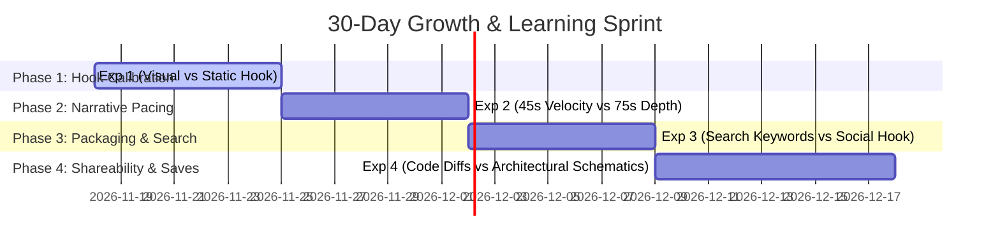

# 30-Day Growth & Experimentation Plan: SUPER.INTELLIGENCEEE

**Date:** 2026-11-17  
**Operational Period:** Days 1 through 30  
**Target Cadence:** 20 Highly Engineered Short-Form Videos (~4 to 5 per week)  
**Distribution Platforms:** YouTube Shorts & Instagram Reels  
**Document Ref:** `reports/phase12/30_DAY_EXPERIMENT_PLAN.md`  

---

## 1. Executive Strategy & Objectives

The primary goal of the next 30 days is **not** to chase random, low-probability virality through high-volume content flooding. Instead, the objective is to execute a **disciplined, scientific learning operation** that systematically isolates creative and technical variables, establishes reliable audience retention baselines, and validates the SUPER.INTELLIGENCEEE distribution engine.



### Quantitative Target Benchmarks
| Metric | Historical Baseline (Job #69) | Day 15 Checkpoint | Day 30 Target |
| :--- | :--- | :--- | :--- |
| **Instagram 3s Skip Rate** | 70.5% | < 45.0% | **< 35.0%** |
| **YouTube Shorts VVSA** | N/A (Private upload) | > 60.0% | **> 70.0%** |
| **Average Percentage Viewed (APV)** | 6.2% | > 50.0% | **> 75.0%** |
| **Organic Direct Message (DM) Shares** | 0 | > 5 per video | **> 20 per video** |
| **30-Day Cumulative Follower Growth** | Baseline (0) | +250 | **+1,000 across platforms** |

---

## 2. Core Controlled Experiments (A/B Hypotheses)

### Experiment 1: The First-Frame Kinetic Shockwave (Days 1–7)
* **Hypothesis:** Replacing a static card or title slide with an active kinetic diagram (First-Frame Shockwave) and keeping spoken hooks under 10 words will reduce Instagram 3-second skip rate from 70.5% to under 38%.
* **Variable Tested:** Frame 0 Visual (Static Card vs Kinetic Benchmark Motion).
* **Sample Size:** 4 Videos (2 Control with standard titles, 2 Treatment with immediate kinetic motion).
* **Target Metric:** `reels_skip_rate` on Instagram; `viewed_rate` on YouTube Shorts.

### Experiment 2: Duration Compression & Narrative Velocity (Days 8–15)
* **Hypothesis:** Compressing video length from 75 seconds to a high-density 42–48 seconds with audio pace >150 WPM will increase Average Percentage Viewed (APV) from <25% to >75%.
* **Variable Tested:** Total duration (45s vs 75s) while holding the core topic constant.
* **Sample Size:** 4 Videos.
* **Target Metric:** `ig_reels_avg_watch_time` / duration and YouTube Shorts relative audience retention.

### Experiment 3: Title Keyword Optimization vs Social Curiosity (Days 16–22)
* **Hypothesis:** On YouTube Shorts, titles front-loaded with specific technical entities (*"DeepSeek R1 GRPO:..."*) will generate 3.5x higher 30-day views than purely curiosity-driven social titles (*"The Reason AI Labs Are Terrified"*).
* **Variable Tested:** Title Metadata Structure (Search-Optimized vs Curiosity-Social).
* **Sample Size:** 4 Videos.
* **Target Metric:** YouTube Search impressions and evergreen view velocity after 72 hours.

### Experiment 4: Shareability Triggers: Code Diffs vs High-Level Schematics (Days 23–30)
* **Hypothesis:** Concluding the technical mechanism stage with a concrete, syntax-highlighted code diff (or config snippet) will yield 4x higher DM shares and saves than abstract high-level schematics.
* **Variable Tested:** Visual evidence artifact (Actionable Code Diff vs Abstract Architecture Diagram).
* **Sample Size:** 4 Videos.
* **Target Metric:** Instagram `saved` and `shares` count.

---

## 3. 30-Day Editorial & Publishing Calendar (20 Videos)

```
Week 1 (Days 1-7): Pillar 1 & 2 Focus (Hook Calibration Sprint)
- Video 01 [Open Frontier]: DeepSeek R1: The Pure RL Architecture (GRPO vs PPO)
- Video 02 [Autonomous Systems]: Why Single-Prompt Agents Crash After Step 5
- Video 03 [Hardware Physics]: The Memory Bandwidth Wall: Why HBM3e Dictates AI Speed
- Video 04 [Systems Security]: Prompt Injection via Image Metadata: The Hidden Exploit
- Video 05 [Open Frontier]: Quantization Breakdown: How 1-Bit LLMs Eliminate Floating Point

Week 2 (Days 8-14): Pacing & Duration Sprint (45s Compression)
- Video 06 [Autonomous Systems]: MCP Explained: How Anthropic Replaced Custom APIs
- Video 07 [Open Frontier]: Multi-Head Latent Attention: The 90% KV Cache Reducer
- Video 08 [Hardware Physics]: FlashAttention 3: How IO-Aware Tiling Cheats Memory Limits
- Video 09 [Systems Security]: Jailbreaking with Ascii Art: Visual Token Vulnerabilities
- Video 10 [Autonomous Systems]: Self-Healing Code Loops: How Agents Fix Their Own Tracebacks

Week 3 (Days 15-21): Packaging & Search Optimization Sprint
- Video 11 [Open Frontier]: Qwen 2.5 Coder: Dissecting the Best Open-Source Coding Weights
- Video 12 [Hardware Physics]: Nvidia Blackwell NVLink: 1.8 TB/s All-Reduce Interconnect
- Video 13 [Autonomous Systems]: Multi-Agent Consensus: Voting Protocols in Production Swarms
- Video 14 [Systems Security]: Probing Neural Activations: Mechanistic Interpretability in Practice
- Video 15 [Open Frontier]: Speculative Decoding: How Small Draft Models Accelerate 70B Giants

Week 4 (Days 22-30): Shareability & Conversion Sprint
- Video 16 [Hardware Physics]: Thermal Throttling in AI Clusters: Liquid Cooling vs Air
- Video 17 [Autonomous Systems]: Long-Horizon Planning: Tree-of-Thought Search in Real-Time
- Video 18 [Open Frontier]: Synthetic Data Generation: Rejection Sampling at Scale
- Video 19 [Systems Security]: Token Smuggling: Bypassing Safety Classifiers in Production
- Video 20 [Open Frontier]: Local AI Rig Setup: Running 32B Reasoning Models on Consumer Hardware
```

---

## 4. Weekly Iteration & Governance Rituals

1. **Every Sunday at 18:00 UTC (Telemetry Ingestion & Review):**
   - The autonomous telemetry collector pulls fresh metrics from Meta Graph API and YouTube Data API.
   - Database snapshots are recorded in `content_performance_snapshots`.
   - The algorithmic diagnostic classifier scans all uploads from the past 7 days for failure modes.
2. **Experiment Gate Review:**
   - Any experiment reaching the required sample size is reviewed.
   - The status is updated to `VALIDATED`, `INCONCLUSIVE`, or `REFUTED` in `content_experiments`.
   - Findings are automatically ingested by `ideation_engine.py` to tune weights for future script generation.
3. **Safety & Editorial Guardrail:**
   - Zero content is published without human sign-off on the generated video preview and script.
   - Zero paid ads, engagement pods, or bot services will ever be utilized; all growth remains 100% organic and meritocratic.
