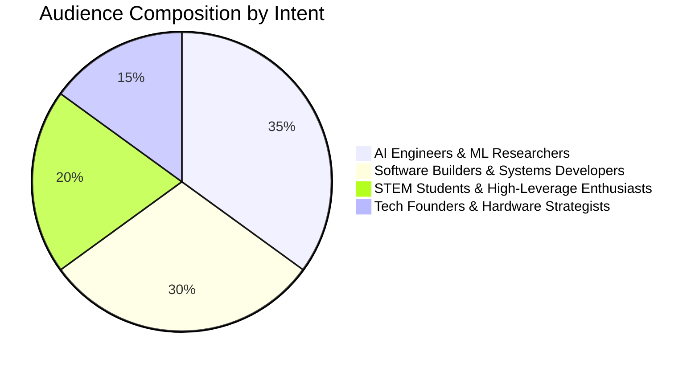

# Audience & Niche Intelligence Audit: SUPER.INTELLIGENCEEE

**Date:** 2026-11-17  
**Platform Scope:** YouTube Shorts & Instagram Reels  
**Target Identity:** Elite Engineering, AI Frontier & Deep Computing Intelligence  
**Document Ref:** `reports/phase12/AUDIENCE_AND_NICHE_AUDIT.md`  

---

## 1. Editorial Identity & Channel Core Thesis

The channel **SUPER.INTELLIGENCEEE** is designed as a deep-technology, engineering-first short-form media publication. Its foundational premise is that modern audiences are fatigued by generic AI buzzwords, shallow press release summaries, and sensationalized "AI will replace you" hype. Instead, our audience craves **substantive technical clarity**, **underlying mechanical explanations**, and **reproducible breakthroughs**.

### The Audience Promise
> **"Every single video must teach a real technical mechanism, reveal an empirical benchmark, or fundamentally reframe how the viewer understands modern computing."**

### Anti-News & Quality Safeguards
1. **No PR Echoing:** Never repeat corporate claims or press releases without examining the underlying architecture, ablation studies, or source code.
2. **No Shallow Aggregate News:** We do not publish "Top 5 AI tools of the week" or surface-level feature announcements.
3. **No Decorative B-Roll / Meaningless Visuals:** Visuals must illustrate actual system flowcharts, memory layouts, neural activations, benchmark curves, or clean code structures rather than random stock footage or generic spinning globes.
4. **Zero Vanity Fluff:** Spoken words must maintain high information density; fluff phrases like *"In this video today we are going to look at..."* or rhetorical openers like *"Ever wondered how..."* are strictly banned.

---

## 2. Target Audience Segmentation & Personas

Our audience is divided into four primary segments, each with clear technical expectations and motivations:

### Persona A: The ML Practitioner & AI Researcher
* **Demographics:** 22–38 years old; Python/PyTorch proficient; actively builds or fine-tunes models.
* **Core Frustration:** Video content that talks about models without explaining attention mechanisms, quantization loss, or training recipes.
* **What Hooks Them:** Visualizing actual algorithmic differences (e.g., GRPO vs PPO reward structures; FlashAttention IO-awareness).
* **Action Trigger:** Shares to team Slack/Discord channels when a video clearly explains a complex paper in under 60 seconds.

### Persona B: The Systems Engineer & Backend Architect
* **Demographics:** 25–45 years old; Rust, C++, Go, or high-scale cloud backend background.
* **Core Frustration:** "AI is magical" narratives that ignore memory bandwidth, compute ceilings, latency budgets, and GPU interconnect bottlenecks.
* **What Hooks Them:** Hardware constraints, memory hierarchy bottlenecks (SRAM vs HBM), and kernel optimization.
* **Action Trigger:** Saves for reference and sends to engineering peers with *"Look at this memory bandwidth comparison"*.

### Persona C: The Ambitious STEM Student & Hacker
* **Demographics:** 18–24 years old; CS, EE, or Physics students; avid GitHub explorers.
* **Core Frustration:** Theoretical textbook lectures disconnected from real-world open-source repositories.
* **What Hooks Them:** Hands-on proof, architectural disassembly of trending open-weight models, and actionable mental models.
* **Action Trigger:** Follows immediately when they learn a concept that gives them an unfair advantage in technical interviews or project building.

### Persona D: The Technical Founder & Investor
* **Demographics:** 26–50 years old; building high-velocity AI startups or deploying capital.
* **Core Frustration:** Macro economic noise and buzzword marketing.
* **What Hooks Them:** Unit economics of inference, proprietary vs open-source moat shifts, and compute efficiency breakthroughs.
* **Action Trigger:** Retweets/Reposts to demonstrate domain expertise and technological discernment.

---

## 3. Competitive Landscape & Whitespace Analysis

| Competitor Tier | Typical Content | Retention Bottleneck | SUPER.INTELLIGENCEEE Whitespace |
| :--- | :--- | :--- | :--- |
| **Tech News Aggregators** | Fast summaries of OpenAI/Google blog posts with generic voiceover. | Audience drops off after news cycle expires (zero evergreen replay value). | **First-Principles Mechanism Breakdown:** We explain *how* the model works internally, ensuring evergreen relevance. |
| **Academic Lecturers** | Full-screen whiteboards, low visual pacing, 30-minute academic style. | Fails completely in short-form mobile feeds (90%+ swipe-away rate). | **High-Velocity Kinetic Motion Graphics:** HyperFrames motion, terminal renders, and dynamic schematic visualizations compressed into 45–60s. |
| **AI Hustle Creators** | "How to get rich with AI agents", low-effort screen recordings. | High viewer skepticism, low save rate, zero institutional credibility. | **Verified Code & Empirical Data:** Rigorous citations, arXiv IDs, Git commits, and zero financial promises. |

---

## 4. Empirical Audience Insights from Initial Deliveries (Job #69)

Our baseline measurement across our first published content piece revealed critical audience behaviors:

1. **Instagram Audience Behavior:**
   - 100% of reach was delivered to **non-followers** in Meta's cold-start explore pool.
   - The cold audience tolerated zero cognitive warm-up: a 70.5% skip rate in the first 3 seconds occurred because the spoken audio opened with an indirect question and the visual began on a low-contrast static card.
   - **Action Item:** Cold discovery audiences require an **immediate physical demonstration or numerical shockwave** within Frame 1.
2. **YouTube Shorts Algorithm Reality:**
   - Shorts requires an immediate public status and search metadata indexing to activate the Shorts Feed carousel.
   - The audience searches primarily via high-intent queries: *"DeepSeek R1 GRPO explained"*, *"FlashAttention memory bottleneck"*.
   - **Action Item:** YouTube package must pair search-optimized keyword density with instant visual contrast.

---

## 5. Editorial Integrity Checklist (The "Rule of Three")

Before any script is cleared for voice synthesis or frame rendering, it must pass three non-negotiable gates:
1. **The Mechanism Test:** Does the video explain *why* or *how* something happens at a mechanical level, rather than just announcing that it exists?
2. **The Verification Test:** Can every metric, benchmark, and architecture claim be directly cited to a published paper, Git commit, or benchmark log?
3. **The Frictionless Hook Test:** Does the first frame establish the core conflict in under 2 seconds without requiring prior context?
