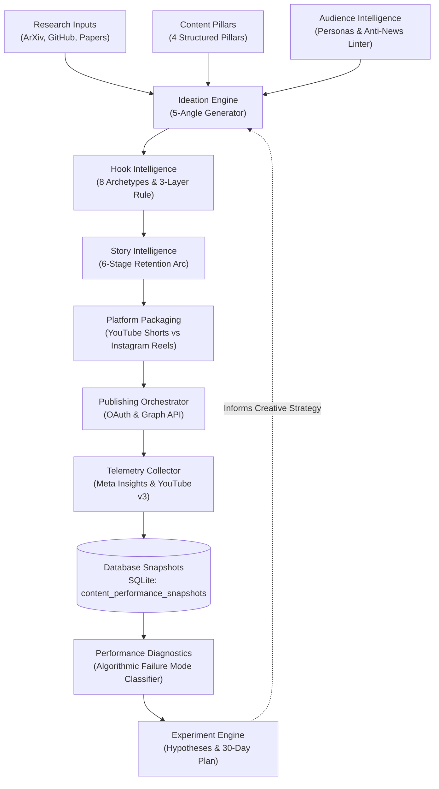

# Content Intelligence Architecture Specification

**Date:** 2026-11-17  
**Module Location:** `core/content_intelligence/`  
**System Scope:** End-to-End Content Generation, Packaging, Telemetry & Diagnostics  
**Document Ref:** `reports/phase12/CONTENT_INTELLIGENCE_ARCHITECTURE.md`  

---

## 1. System Architecture Overview

The **Content Intelligence Engine** is the algorithmic and creative brain of the SUPER.INTELLIGENCEEE autonomous publishing pipeline. It bridges raw engineering breakthroughs and research papers into highly-retentive, platform-native short-form video packages, while continuously diagnosing distribution telemetry to feed an empirical experimentation loop.



---

## 2. Core Python Submodules

### 1. `audience_intelligence.py`
* **Role:** Enforces brand identity, audience persona mapping, and anti-news linting.
* **Key Classes:** `AudienceIntelligence`, `AudiencePersona`, `ChannelPromise`.
* **Functions:**
  - `evaluate_content_fit(topic, mechanism)`: Computes an alignment score (0.0–1.0) and verifies that the candidate topic teaches a real mechanism rather than repeating generic news.
  - `detect_anti_news_violations(text)`: Scans for prohibited buzzwords, clickbait tropes, and PR echoing.

### 2. `content_pillars.py`
* **Role:** Defines and manages the 4 strategic channel pillars (`OPEN_FRONTIER`, `AUTONOMOUS_SYSTEMS`, `HARDWARE_PHYSICS`, `SYSTEMS_SECURITY`).
* **Key Classes:** `ContentPillar`, `ContentPillarManager`.
* **Functions:**
  - `get_pillar(pillar_id)`: Retrieves target audience, preferred visual formats, example hooks, and shareability factors.
  - `suggest_pillar(topic_keywords)`: Classifies incoming research topics into the most suitable pillar.

### 3. `ideation_engine.py`
* **Role:** Transforms raw research items into 5 distinct editorial angles with time-to-live (TTL) expiration dates.
* **Key Classes:** `IdeationEngine`, `ContentAngle`, `CandidateIdea`.
* **Functions:**
  - `generate_5_angles(topic, core_insight)`: Outputs 5 unique conceptual angles (Mechanistic Breakdown, Contrarian Reversal, Benchmark Showdown, Builder Practical, and Physical Constraint).
  - `rank_backlog()`: Scores candidate ideas based on audience interest, visual feasibility, and evergreen longevity.

### 4. `hook_intelligence.py`
* **Role:** Generates and validates the crucial first 3 seconds across 8 distinct psychological archetypes adhering strictly to the **3-Layer Standard**.
* **Key Classes:** `HookIntelligence`, `HookConcept`, `HookArchetype`.
* **The 3-Layer Standard:**
  1. **Visual Hook:** Concrete description of first frame animation/graphic (no generic cards).
  2. **Spoken Hook:** High-density voiceover strictly **< 12 words** (averaging 7–10 words).
  3. **On-Screen Text:** Punchy title card strictly **< 7 words** (providing visual context).
* **Anti-Pattern Linter:** Rejects rhetorical openers (*"Ever wondered..."*), slow introductory greetings (*"Welcome back..."*), and unsubstantiated claims.

### 5. `story_intelligence.py`
* **Role:** Enforces a 6-stage narrative retention escalation curve to ensure high Average Percentage Viewed (APV).
* **Key Classes:** `StoryIntelligence`, `StoryArc`, `RetentionStage`.
* **The 6 Stages:**
  - `Stage 1: Instant Hook` (0s–3s): Disruptive demonstration or numerical revelation.
  - `Stage 2: Problem Escalation` (3s–12s): Why conventional methods fail; stakes of the problem.
  - `Stage 3: Technical Mechanism` (12s–30s): The architectural secret; visual flowcharts and code diffs.
  - `Stage 4: Empirical Evidence` (30s–42s): Live benchmark or reproducible terminal proof.
  - `Stage 5: Conceptual Payoff` (42s–50s): Resolving the curiosity gap; the mental model.
  - `Stage 6: Frictionless Call-to-Action` (50s–55s): Direct, value-driven next step (no generic "like and subscribe").

### 6. `platform_packaging.py`
* **Role:** Tailors the visual assets and metadata for each platform's distinct distribution algorithm.
* **Key Classes:** `PlatformPackagingEngine`, `InstagramReelPackage`, `YouTubeShortPackage`.
* **Packaging Rules:**
  - **YouTube Shorts:** 50–65 character search-optimized titles; rich keyword-dense descriptions; 3 targeted hashtags (`#Shorts`, `#AI`, `#MachineLearning`); zero clickbait thumbnail overlays.
  - **Instagram Reels:** Conversational opening caption; formatted markdown explanation; clean spacing; strictly 3–5 targeted niche hashtags; cover image selected from high-contrast peak frame.

### 7. `performance_diagnostics.py`
* **Role:** Mathematically analyzes raw platform telemetry against empirical failure modes.
* **Key Classes:** `PerformanceDiagnosticsEngine`, `FailureMode`, `DiagnosticResult`.
* **Failure Modes Detected:**
  - `HOOK_CLIFF` (> 45% drop in first 3s): Visual or spoken opening failed to capture attention.
  - `ESCALATION_DRAG` (Steady decline during middle 15–30s): Narrative pacing slowed down or explanation was too dense.
  - `DISTRIBUTION_CHOKE` (High retention but zero reach): Algorithmic indexing or privacy status blocked distribution.
  - `AUDIENCE_MISMATCH` (High reach, zero follows or saves): Hook promised something the video did not deliver.

### 8. `experiment_engine.py`
* **Role:** Manages hypothesis-driven A/B testing across published content.
* **Key Classes:** `ExperimentEngine`, `ContentExperiment`, `ExperimentStatus`.
* **Capabilities:** Tracks hypothesis formulation, control vs treatment variables, minimum sample thresholds, and automated outcome classification (`VALIDATED`, `INCONCLUSIVE`, `REFUTED`).

---

## 3. Database Schema & Persistence Integration

The engine persists all telemetry and experiment states in `data/super_intelligence.db` via two specialized tables:

```sql
CREATE TABLE IF NOT EXISTS content_performance_snapshots (
    id INTEGER PRIMARY KEY AUTOINCREMENT,
    job_id INTEGER,
    platform TEXT NOT NULL,
    external_media_id TEXT,
    views INTEGER DEFAULT 0,
    reach INTEGER DEFAULT 0,
    likes INTEGER DEFAULT 0,
    comments INTEGER DEFAULT 0,
    shares INTEGER DEFAULT 0,
    saves INTEGER DEFAULT 0,
    skip_rate REAL,
    avg_watch_time REAL,
    avg_percentage_viewed REAL,
    raw_telemetry TEXT,
    captured_at TIMESTAMP DEFAULT CURRENT_TIMESTAMP
);

CREATE TABLE IF NOT EXISTS content_experiments (
    id INTEGER PRIMARY KEY AUTOINCREMENT,
    experiment_name TEXT NOT NULL,
    hypothesis TEXT NOT NULL,
    target_metric TEXT NOT NULL,
    status TEXT DEFAULT 'PLANNED',
    control_job_id INTEGER,
    treatment_job_id INTEGER,
    baseline_value REAL,
    achieved_value REAL,
    conclusion TEXT,
    created_at TIMESTAMP DEFAULT CURRENT_TIMESTAMP,
    updated_at TIMESTAMP DEFAULT CURRENT_TIMESTAMP
);
```

---

## 4. REST API Integration (`dashboard/routes.py`)

The engine surfaces high-performance asynchronous REST endpoints:
- `GET /api/content-intelligence/overview`: Returns aggregate benchmarks, active experiments, and recent diagnostics.
- `GET /api/content-intelligence/snapshots`: Returns historical telemetry snapshots recorded across YouTube and Meta.
- `GET /api/content-intelligence/pillars`: Returns metadata and configuration for all 4 content pillars.
- `POST /api/content-intelligence/generate-hooks`: Generates an 8-archetype hook suite for a given topic and mechanism.
- `POST /api/content-intelligence/diagnose`: Runs the automated failure mode classifier on arbitrary or live telemetry metrics.
