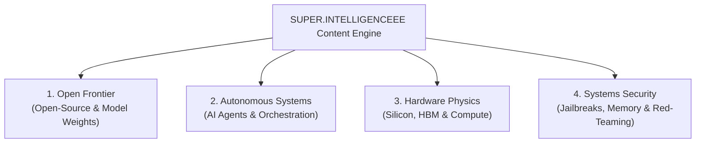

# Strategic Content Pillars: SUPER.INTELLIGENCEEE

**Date:** 2026-11-17  
**Platform Scope:** YouTube Shorts & Instagram Reels  
**Target Identity:** 4-Pillar Engineering Architecture  
**Document Ref:** `reports/phase12/CONTENT_PILLARS.md`  

---

## 1. Overview of the 4-Pillar Architecture

To prevent SUPER.INTELLIGENCEEE from becoming a disjointed, chaotic feed of random tech topics, all content creation is constrained to four structural pillars. Each pillar addresses a specific audience curiosity, enforces a distinct visual language, and targets measurable viral and educational outcomes.

---

## Pillar 1: Open Frontier (Open Weights & Model Architecture)

### 1. Focus & Philosophy
Demystifying open-source frontier models, dissecting novel model weights, and highlighting breakthroughs that decentralize AI power away from closed corporate monopolies.

* **Target Audience:** ML Engineers, Open-Source Contributors, University Researchers, AI Startups.
* **Core Audience Problem:** Closed-source labs claim monopolies on reasoning, leaving engineers wondering how to reproduce frontier performance locally or at fractional costs.
* **Key Subtopics:**
  - Mixture of Experts (MoE) routing algorithms and load balancing.
  - Multi-Head Latent Attention (MLA) and KV-cache compression.
  - Pure Reinforcement Learning (RL) without supervised fine-tuning (GRPO vs PPO).
  - Open-weight reasoning models (DeepSeek, Qwen, LLaMA, Mistral).
* **Preferred Visual Formats:**
  - Dynamic neural routing diagrams showing active vs inactive expert weights.
  - Side-by-side terminal inference benchmarks (Tokens/Sec & VRAM footprint).
  - Code architecture diffs (PyTorch module vs optimized CUDA kernel).
* **Example Hooks:**
  - *"DeepSeek replaced 90% of their KV cache with this single matrix trick."*
  - *"Researchers trained an o1-level reasoning model with zero human demonstrations."*
  - *"This open-weight model runs on a single consumer GPU, beating 70B models."*
* **Shareability & Save Factor:** Extremely high save-rate for developers bookmarking architectural blueprints and GitHub repository links.

---

## Pillar 2: Autonomous Systems (AI Agents & Tool Orchestration)

### 1. Focus & Philosophy
Deconstructing how autonomous agents perceive, plan, call tools, coordinate in swarms, and recover from real-world execution failures.

* **Target Audience:** Full-Stack Engineers, Automation Architects, DevOps Specialists, Technical Founders.
* **Core Audience Problem:** 90% of commercial "agents" fail in production due to looping, context degradation, and fragile prompt chaining. Builders need robust orchestration patterns.
* **Key Subtopics:**
  - Multi-agent coordination protocols and state-machine swarms.
  - Model Context Protocol (MCP) tool integration and schema design.
  - Autonomous self-healing code execution and iterative debugging loops.
  - Long-horizon planning and tree-of-thought search algorithms.
* **Preferred Visual Formats:**
  - Multi-agent state charts and message-passing sequence diagrams.
  - Live split-screen showing agent terminal logs alongside UI execution.
  - Error-recovery flowcharts demonstrating automatic backtracking.
* **Example Hooks:**
  - *"Why single-prompt AI agents always fail in production after step 5."*
  - *"Watch this multi-agent swarm write, test, and debug a full backend in 40 seconds."*
  - *"The Model Context Protocol just eliminated custom API wrappers forever."*
* **Shareability & Save Factor:** High forward/DM rate among tech teams solving production reliability bottlenecks.

---

## Pillar 3: Hardware Physics (Silicon, HBM & Compute Architecture)

### 1. Focus & Philosophy
Unpacking the physical constraints of computing: memory bandwidth, thermal dissipation, wafer-scale fabrication, optical interconnects, and quantization mathematics.

* **Target Audience:** Systems Programmers, Hardware Engineers, Semiconductor Enthusiasts, GPU Cluster Admins.
* **Core Audience Problem:** Software developers treat compute as an infinite abstract cloud, ignoring memory walls and thermal limits that dictate modern AI costs.
* **Key Subtopics:**
  - Memory Bandwidth Wall (HBM3e vs SRAM interconnects).
  - FlashAttention and IO-aware tiling algorithms.
  - Low-bit quantization mechanics (FP8, INT4, AWQ, BitNet 1.58b).
  - Wafer-scale engines, TPU v5p topologies, and photonic computing.
* **Preferred Visual Formats:**
  - Microscopic silicon die microphotographs and floorplan annotations.
  - High-contrast 3D memory hierarchy pyramids (Registers -> L1/L2 -> SRAM -> HBM).
  - Kinetic heatmaps illustrating thermal throttle points during matrix multiplication.
* **Example Hooks:**
  - *"Your GPU spends 80% of its time doing nothing while waiting for memory."*
  - *"How a 1-bit neural network eliminates floating-point math entirely."*
  - *"The physical limit preventing Nvidia from making chips any larger."*
* **Shareability & Save Factor:** High educational share rate; frequently shared on Twitter/X, Reddit r/hardware, and developer Discord servers.

---

## Pillar 4: Systems Security & Resilience (Jailbreaks & Safe Systems)

### 1. Focus & Philosophy
Exploring adversarial machine learning, prompt injection vectors, memory corruption exploits in AI runtimes, cryptographic zero-knowledge proofs, and automated defense mechanisms.

* **Target Audience:** Cybersecurity Professionals, Penetration Testers, DevSecOps, Enterprise AI Deployers.
* **Core Audience Problem:** Enterprises rush to deploy LLM applications without understanding that unstructured natural language input represents an unconstrained attack surface.
* **Key Subtopics:**
  - Indirect prompt injection and multimodal data exfiltration.
  - Model weight poisoning and backdoor triggers.
  - Memory safety exploits in C++/CUDA inference engines (vLLM, Ollama).
  - Mechanistic interpretability: probing neural activations to detect deception.
* **Preferred Visual Formats:**
  - Animated ASCII terminal exploit demonstrations.
  - Activation steering vector graphs showing token shift during jailbreaks.
  - Security architecture schematics (sandboxed runtimes vs root access).
* **Example Hooks:**
  - *"A single hidden pixel in this image hijacked an AI agent's bash shell."*
  - *"Security researchers extracted private training data using an empty prompt."*
  - *"Why standard firewalls are completely blind to indirect prompt injection."*
* **Shareability & Save Factor:** Extreme virality driven by security urgency, curiosity, and high professional utility.

---

## Pillar Balance & Publishing Cadence

| Content Pillar | Distribution Weight | Target Frequency (30-Day Plan) | Primary Success KPI |
| :--- | :--- | :--- | :--- |
| **Open Frontier** | 35% | 7 Videos | High Saves & Community Comments |
| **Autonomous Systems** | 30% | 6 Videos | High DM Shares & GitHub Traffic |
| **Hardware Physics** | 20% | 4 Videos | High Replay / Average Watch Time |
| **Systems Security** | 15% | 3 Videos | Broad Reach / Cold Discovery |

This balanced portfolio ensures that the channel maintains technical depth while reaching multiple sub-communities across the engineering spectrum.
