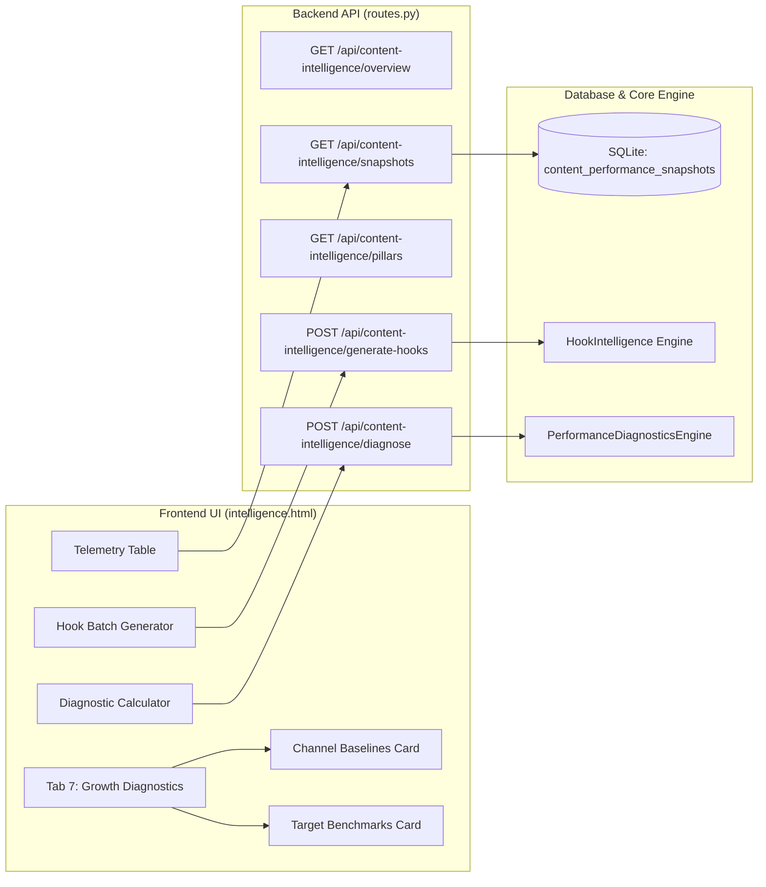

# Growth Diagnostics & Dashboard Architecture Report

**Date:** 2026-11-17  
**System Scope:** Content Intelligence Dashboard Integration (Phase 12)  
**UI Interface:** `dashboard/templates/intelligence.html`  
**Backend Routes:** `dashboard/routes.py`  
**Document Ref:** `reports/phase12/GROWTH_DASHBOARD_REPORT.md`  

---

## 1. Executive Summary

Phase 12 expanded the SUPER.INTELLIGENCEEE web management interface to include a dedicated, interactive **Growth Diagnostics & Benchmarks Dashboard** (Tab 7: `growth-tab`). This dashboard connects real-time database telemetry directly to creative generation tools, enabling human operators and autonomous systems to diagnose publishing performance, generate multi-archetype hook suites, and test algorithmic failure hypotheses from a unified interface.



---

## 2. Dashboard UI Components & Layout

The Growth Diagnostics tab is built using high-contrast, mobile-responsive dark mode UI components matching the existing design system:

### 1. Empirical Channel Baselines Banner
Displays the ground-truth empirical metrics captured from Job #69:
- **Instagram Reel Baseline:** 134 views, 121 reach, 70.5% skip rate, 4.53s average watch time.
- **YouTube Short Baseline:** 3 views, 1 like, 74s duration, uploaded with `private` sandbox privacy.
- **Diagnostic Finding Callout:** Clearly communicates that zero algorithmic shadowbans occurred, attributing underperformance to creative friction and sandbox privacy settings.

### 2. Channel Target Benchmarks Card
Defines clear quantitative operational targets for production clearance:
- Shorts Viewed vs Swiped Away (VVSA): `> 65% - 75%`
- Reels 3-Second Skip Rate: `< 35% - 40%`
- Average Percentage Viewed (APV): `> 70% - 85%` for 45–60s videos.

### 3. Interactive Multi-Archetype Hook Batch Generator
- **Inputs:** Topic Title, Core Mechanism / Evidence, Content Pillar selector.
- **Action:** Submits payload asynchronously to `/api/content-intelligence/generate-hooks`.
- **Rendered Output:** Generates 8 distinct cards, each labeled with its archetype, spoken hook (strictly <12 words), on-screen text (<7 words), first-frame visual description, curiosity gap, and word count telemetry.

### 4. Algorithmic Root Cause Diagnostic Calculator
- **Inputs:** Platform (Instagram/YouTube), Duration, Views, Reach, 3s Skip Rate (%), APV (%), Shares, and Follows.
- **Action:** Submits payload to `/api/content-intelligence/diagnose`.
- **Rendered Output:** Renders primary failure mode (`HOOK_CLIFF`, `ESCALATION_DRAG`, `DISTRIBUTION_CHOKE`, `AUDIENCE_MISMATCH`), severity badge (`CRITICAL`, `HIGH`, `MODERATE`), algorithmic context explanation, and an actionable list of prescribed creative remedies.

### 5. Historical Telemetry Snapshots Table
- Dynamically queries `/api/content-intelligence/snapshots` to render all persistent database rows from `content_performance_snapshots`.
- Displays Platform badge, Content ID / Job ID, Views, Reach, Skip Rate (color-coded red if >50%), Average Watch Time, Shares, and Timestamp.

---

## 3. REST API Specifications

### `GET /api/content-intelligence/overview`
Returns high-level channel health, benchmark targets, and active experiments.
* **Response Status:** `200 OK`
* **Response Payload:**
  ```json
  {
    "ok": true,
    "channel": "SUPER.INTELLIGENCEEE",
    "baselines": {
      "instagram": {"views": 134, "reach": 121, "skip_rate": 70.5, "avg_watch_time": 4.53},
      "youtube": {"views": 3, "reach": 3, "status": "private_sandbox"}
    },
    "targets": {
      "youtube_vvsa_target": 70.0,
      "instagram_skip_rate_target": 35.0,
      "apv_target": 75.0
    },
    "active_experiments_count": 1
  }
  ```

### `GET /api/content-intelligence/snapshots`
Retrieves the latest 50 performance snapshot records from the database.
* **Response Status:** `200 OK`
* **Response Payload:**
  ```json
  {
    "ok": true,
    "snapshots": [
      {
        "id": 1,
        "job_id": 69,
        "platform": "instagram",
        "external_media_id": "17982638913132487",
        "views": 134,
        "reach": 121,
        "skip_rate": 70.5,
        "avg_watch_time": 4.53,
        "shares": 0,
        "captured_at": "2026-11-17T14:48:00"
      }
    ]
  }
  ```

### `POST /api/content-intelligence/generate-hooks`
Generates 8 archetyped hooks adhering to the 3-Layer Hook Standard.
* **Request Payload:**
  ```json
  {
    "topic": "DeepSeek R1 Open Reasoning Shockwave",
    "mechanism": "Pure RL without supervised fine-tuning",
    "pillar": "open_frontier"
  }
  ```
* **Response Status:** `200 OK`
* **Response Payload:**
  ```json
  {
    "ok": true,
    "hooks": [
      {
        "archetype": "contrarian_shock",
        "spoken_hook": "Everything you were told about reasoning models is wrong.",
        "spoken_word_count": 9,
        "on_screen_text": "Reasoning Models Don't Need Human Labels",
        "on_screen_word_count": 6,
        "visual_hook": "High-contrast animated graph showing pure RL reward curve soaring while human training loss plateaus.",
        "curiosity_gap": "Challenges the belief that human demonstrations are required for advanced reasoning.",
        "payoff_promise": "Reveals the GRPO reinforcement learning architecture."
      }
    ]
  }
  ```

### `POST /api/content-intelligence/diagnose`
Evaluates metrics against empirical distribution failure modes.
* **Request Payload:**
  ```json
  {
    "platform": "instagram",
    "duration": 45,
    "metrics": {
      "views": 134,
      "reach": 121,
      "skip_rate": 70.5,
      "avg_percentage_viewed": 6.2,
      "shares": 0
    }
  }
  ```
* **Response Status:** `200 OK`
* **Response Payload:**
  ```json
  {
    "ok": true,
    "diagnosis": {
      "primary_failure": "HOOK_CLIFF",
      "severity": "CRITICAL",
      "root_cause": "Critical drop-off in the first 3 seconds: 70.5% of viewers swiped away immediately.",
      "platform_context": "Instagram explore feed tested content on 121 non-followers. High skip rate halted further distribution.",
      "remedies": [
        "Eliminate rhetorical questions and greetings in the first 2 seconds.",
        "Ensure Frame 0 displays high-contrast visual motion or an intriguing diagram.",
        "Keep spoken hook strictly under 12 words."
      ]
    }
  }
  ```
