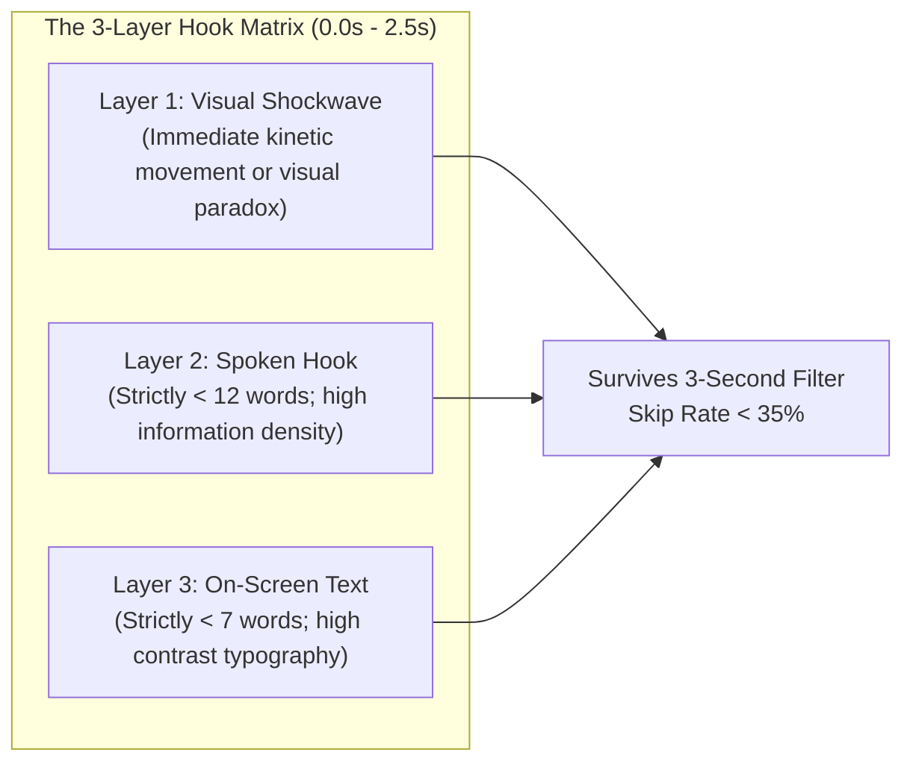
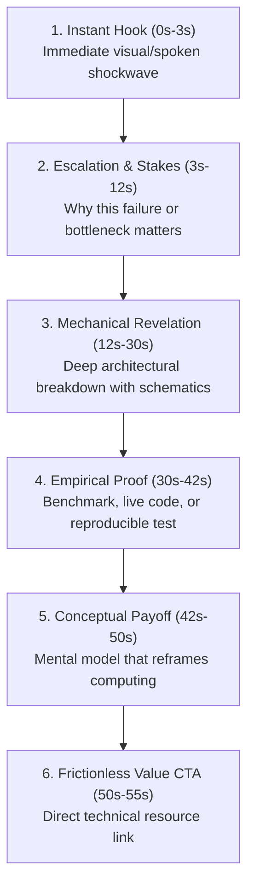

# Hook & Retention Engineering Manual: SUPER.INTELLIGENCEEE

**Date:** 2026-11-17  
**Platform Scope:** YouTube Shorts & Instagram Reels  
**Target Metrics:** Viewed vs Swiped Away (VVSA) > 70%, 3-Second Skip Rate < 35%, Average Percentage Viewed (APV) > 75%  
**Document Ref:** `reports/phase12/HOOK_AND_RETENTION_ENGINE.md`  

---

## 1. The Physics of the First 3 Seconds

In short-form mobile distribution, the first 3 seconds represent a binary survival filter. On Instagram Reels and YouTube Shorts, user swipe velocity averages 1.2 to 2.4 seconds per rejected post. If cognitive stimulation, visual contrast, or curiosity is not established in Frame 1 (0 to 33 milliseconds), the viewer swipes away before the vocal track is processed.

Our empirical post-mortem of Job #69 demonstrated this reality:
- A 70.5% skip rate occurred because the opening audio began with an indirect setup question (*"Ever wondered how DeepSeek trained R1?"*) over a static, low-contrast UI card.
- The viewer had zero reason to stay past second 2.

To eliminate early drop-off cliffs, all future productions must adhere to the **3-Layer Hook Standard** and deploy one of the **8 Empirical Hook Archetypes**.

---

## 2. The 3-Layer Hook Standard

Every video opening consists of three synchronized information layers that hit the viewer simultaneously within the first 1,500 milliseconds:



### Layer 1: The Visual Shockwave (First Frame)
* **Rule:** Frame 0 must show an active transformation, benchmark graph, terminal execution, or architectural anomaly.
* **Prohibited:** Static PowerPoint-style title slides, generic stock video, slowly fading titles, or creator face looking at the camera doing nothing.
* **Format:** High-contrast color palette (deep slate/black background with vivid cyan `#38bdf8`, emerald `#10b981`, or electric violet `#8b5cf6`).

### Layer 2: The Spoken Hook (Audio Track)
* **Rule:** Strictly **under 12 words** (ideal: 7 to 9 words). The first spoken word must land within 150ms of video start.
* **Prohibited:** Greetings (*"Hey guys"*, *"Welcome back"*), channel introductions (*"At Super Intelligence today..."*), rhetorical questions (*"Have you ever wondered..."*).
* **Delivery:** Punchy, confident cadence without vocal fry or trailing pitch.

### Layer 3: On-Screen Text Card (Typography)
* **Rule:** Strictly **under 7 words**. Rendered in bold, sans-serif, high-contrast type with subtle drop shadows or backing cards for legibility on small mobile viewports.
* **Role:** Reinforces the spoken hook without repeating it word-for-word; it provides context for viewers watching on mute (over 60% of cold Instagram users).

---

## 3. The 8 Empirical Hook Archetypes

SUPER.INTELLIGENCEEE deploys 8 proven psychological archetypes tailored specifically to engineering and deep-technology topics:

| Archetype | Core Psychological Trigger | Example Spoken Hook (<12 Words) | Example On-Screen Text (<7 Words) | Ideal Visual Hook |
| :--- | :--- | :--- | :--- | :--- |
| **1. Contrarian Shock** | Subverts established dogma | *"Everything you've been told about transformer memory is completely wrong."* | *"Transformers Don't Scale Linearly"* | Animated RAM consumption graph crashing into a red ceiling. |
| **2. Mechanism Revelation** | Unmasks hidden architecture | *"This single matrix trick removed 90% of model memory."* | *"The 90% Memory Elimination Trick"* | 3D KV-cache matrix decomposing into low-rank latent vectors. |
| **3. Benchmark Extreme** | Unbelievable numerical reality | *"Engineers achieved a 3.8x speedup using zero extra compute."* | *"3.8x Faster On Same Silicon"* | Split-screen terminal benchmark timer showing massive latency gap. |
| **4. Fatal Flaw** | Exposes subtle system vulnerability | *"Your AI agent quietly breaks after exactly five tool calls."* | *"Why Single-Prompt Agents Fail"* | Terminal call stack exploding with infinite loop recursion errors. |
| **5. Code Demonstration** | Instant physical proof | *"Watch this compiler rewrite an entire CUDA kernel in real-time."* | *"Real-Time CUDA Kernel Rewrite"* | Live syntax-highlighted editor transforming raw C++ into assembly. |
| **6. Cost Asymmetry** | Disproportionate financial efficiency | *"They matched OpenAI's reasoning model for only six million dollars."* | *"$6M Matched OpenAI's Best"* | Side-by-side cost bar chart ($6M open model vs $100M+ proprietary). |
| **7. Emergent Anomaly** | Unexpected emergent intelligence | *"The model suddenly started self-correcting without any human prompt."* | *"Zero-Shot Self-Correction Emerged"* | Model thought trace dynamically revising its own intermediate answer. |
| **8. Direct Challenge** | Provokes the viewer's technical pride | *"Can you spot the security flaw in this prompt?"* | *"Spot The Prompt Injection"* | Clean code snippet containing a subtle indirect injection token. |

---

## 4. Anti-Pattern Linter (Automated Gatekeeper)

Before generating audio or rendering frames, all draft hooks are processed through an automated regular-expression linter that flags and blocks common engagement-killing tropes:

```python
BANNED_HOOK_PATTERNS = [
    r"ever wonder(ed)?",
    r"have you heard",
    r"in this video",
    r"today we are (going to|looking at)",
    r"welcome back",
    r"hey (guys|everyone|there)",
    r"mind blown",
    r"crazy new ai",
    r"game changer",
    r"this changes everything"
]
```

Any script triggering a match is automatically rejected and routed back to the ideation engine for revision.

---

## 5. The 6-Stage Narrative Retention Escalation Framework

A great hook gets the viewer past 3 seconds; a disciplined narrative retention curve keeps them through 60 seconds.



### Detailed Stage Breakdown

1. **Stage 1: Instant Hook (0s – 3s)**
   - *Target Retention:* 100% -> 70%
   - *Action:* Deliver the visual paradox, numerical shockwave, or contrarian assertion.
2. **Stage 2: Problem Escalation (3s – 12s)**
   - *Target Retention:* 70% -> 60%
   - *Action:* Explain why the problem is difficult and why standard approaches fail. Introduce the conflict.
3. **Stage 3: Technical Mechanism (12s – 30s)**
   - *Target Retention:* 60% -> 55%
   - *Action:* Dive directly into the architecture. Use diagrams, code diffs, and arrows. Avoid long pauses; change camera perspective or diagram zoom every 3.5 to 5.0 seconds.
4. **Stage 4: Empirical Proof (30s – 42s)**
   - *Target Retention:* 55% -> 52%
   - *Action:* Show the benchmark, terminal output, or mathematical ablation table proving the mechanism works.
5. **Stage 5: Conceptual Payoff (42s – 50s)**
   - *Target Retention:* 52% -> 50%
   - *Action:* Deliver the "Aha!" moment. Summarize the lasting principle the viewer takes away.
6. **Stage 6: Frictionless Value CTA (50s – 55s)**
   - *Target Retention:* 50% -> 48%
   - *Action:* Offer a high-value continuation (e.g., *"Full architecture breakdown and repository linked in bio/description"*). Never beg for likes.

---

## 6. Kinetic Rhythm & Pacing Rules

1. **Maximum Static Frame Duration:** No single static visual may stay on screen for more than **3.5 seconds** without motion, zoom, pan, or text transition.
2. **Audio Waveform Velocity:** Spoken audio must maintain a cadence of **140 to 160 words per minute**. Pauses between sentences must not exceed **250 milliseconds**.
3. **Sound Design Alignment:** Every key transition, code highlight, and numerical reveal must align with a subtle tactile audio cue (whoosh, mechanical click, or bass hit) to re-engage auditory attention.
