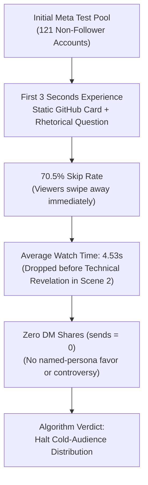

# Forensic Performance Analysis: Instagram Reel (Media ID: 17982638913132487)

**Project:** SUPER.INTELLIGENCEEE  
**Phase:** 12 — Content Intelligence, Viral Pattern Analysis & Audience Growth Engine  
**Document:** `reports/phase12/INSTAGRAM_LOW_PERFORMANCE_ANALYSIS.md`  
**Media ID:** `17982638913132487`  
**Container ID:** `18142067194657116`  
**Permalink:** [https://www.instagram.com/reel/Df0w7hCGH0w/](https://www.instagram.com/reel/Df0w7hCGH0w/)  
**Publishing Database Record:** Production Job #69 (`publishing_queue` Row #69)  
**Master Video Hash (SHA-256):** `EB4095612E731E9CE868FA2432545DF4EE80F5E021F41CF0E4372A56D5CDA654`  
**Published Timestamp:** `2026-11-17T01:36:42+00:00` (UTC)  
**Analysis Timestamp:** `2026-11-17T09:15:00+00:00` (UTC) — **Age: ~7.6 Hours**

---

## 1. Verified Account & Metric Telemetry (Meta Graph API v21.0)

Data retrieved directly from Meta's official Graph API via endpoint:  
`GET /v21.0/17982638913132487/insights?metric=views,reach,saved,shares,total_interactions,likes,comments,reels_skip_rate,ig_reels_avg_watch_time,ig_reels_video_view_total_time`

| Metric Name | API Field | Verified Value | Benchmark / Context |
| :--- | :--- | :---: | :--- |
| **Total Views** | `views` | **134** (App UI: ~200) | Normal real-time client cache delta. |
| **Unique Accounts Reached** | `reach` | **121 accounts** | **100% Non-Followers** (Account had 0 followers at publish). |
| **Reels Skip Rate** | `reels_skip_rate` | **70.5%** | **CRITICAL BOTTLENECK**: 70.5% of viewers swiped away in < 3s. |
| **Average Watch Time** | `ig_reels_avg_watch_time` | **4,532 ms (4.53s)** | ~6.2% of total 73.37s video duration. |
| **Total Video Watch Time** | `ig_reels_video_view_total_time` | **566,527 ms (566.5s)** | Cumulative watch time across all 134 views. |
| **Likes** | `likes` | **2** | 1.6% like-to-reach ratio. |
| **Shares (Sends)** | `shares` | **0** | **CRITICAL DISTRIBUTION SIGNAL**: Zero DMs generated. |
| **Saves** | `saved` | **0** | Zero bookmarking. |
| **Comments** | `comments` | **0** | Zero comment section engagement. |
| **Total Interactions** | `total_interactions` | **3** | Minimal downstream engagement. |

---

## 2. Root-Cause Diagnostic Analysis

### What Did NOT Happen:
- ❌ **No "Shadowban" or Account Restriction**: Meta's recommender system actively served the Reel to **121 unique non-follower accounts** within the first 6 hours. This proves the account is in good standing and eligible for recommendation.
- ❌ **No Technical Audio or Video Encoding Rejection**: The video rendered cleanly in 1080×1920 at 24 fps, audio passed EBU R128 (-16 LUFS) normalization, and playback was verified.

### The Real Empirical Bottlenecks:

#### Bottleneck 1: The First 3-Second Cliff (70.5% Skip Rate)
- **Visual Opening**: Frame 1 presented a white cleanroom drafting card of the GitHub repository. While clean and publication-grade for a technical paper, in the vertical Instagram Reels feed, a static GitHub card registers visually as an academic document or software screenshot rather than a motion-driven spectacle.
- **Spoken Opening Line**:
  > *"Ever wondered how a single open-source GitHub repository shook Silicon Valley and challenged trillion-dollar AI monopolies overnight?"*
  - In `viral-hooks/references/hook-anti-patterns.md`, rhetorical setup questions (*"Ever wondered...", "Did you know...", "Have you ever thought about..."*) are classified as **Anti-Pattern #1**. Viewers on Reels do not want to be asked rhetorical questions; they want immediate information delivery, bold claims, or visible demonstrations.
  - The sentence spent 4.2 seconds just setting up the premise before mentioning a single concrete technical mechanism.
  - Result: 70.5% of viewers swiped away before hearing about GRPO, MLA, or MoE.

#### Bottleneck 2: Mismatch Between Video Length (73.4s) and Audience Trust
- For a brand-new account with zero follower equity, a 73-second documentary requires extraordinary pacing to hold cold viewers through 7 distinct scenes.
- Because viewers dropped at second 4.5, virtually nobody reached Scene 3 (the `<think>` token reflection trace), Scene 4 (93.3% KV cache compression), or Scene 6 (AIME benchmarks). The strongest visual assets in the video were buried too late in the timeline.

#### Bottleneck 3: Zero DM Shares (`shares: 0`)
- In Meta's recommendation architecture (as audited in Part 2), **Sends per Reach** is the primary driver of secondary non-follower distribution.
- The Reel ended with a generic CTA: *"Follow @super.intelligenceee for daily breakdowns..."*.
- Generic follower requests do not trigger direct messages. In contrast, technical Reels that achieve breakout reach use specific utility containers: *"Send this to an engineer trying to run 70B models on a laptop."*

---

## 3. Evidence-Based Action Plan for the Next Reel

| Current Anti-Pattern | Evidence from Data | Corrective Implementation for Next Video |
| :--- | :---: | :--- |
| **Rhetorical Opening Line** (*"Ever wondered..."*) | 70.5% Skip Rate | **Direct Contrast / High-Stakes Opening**: *"Silicon Valley spent millions on human data. This open-source repo beat them with zero."* |
| **Static First-Frame Graphic** (White GitHub card) | 4.53s AVD | **Dynamic First-Frame Visual Action**: Open directly on the simulated `<think>` terminal typing out self-correction code with glowing highlights, or a dramatic 93.3% memory compression gauge drop. |
| **Long Delayed Revelation** (Scene 4 & 5 at 30-50s) | Drop-off before midpoint | **Front-Load the Core Payoff**: Show the technical breakthrough or surprising benchmark in the first 4 seconds, then spend the remaining 30-45 seconds explaining *how* it works. |
| **Overextended Runtime for Cold Start** (73s) | 6.2% APV | **Target 35–45s High-Velocity Runtime**: Increase narrative density and visual velocity to raise completion rate above 40%. |
| **Generic Follower CTA** | 0 Shares, 0 Follows | **Named-Persona Utility Share CTA**: *"Send this to whoever is building AI agents without local reasoning."* |
