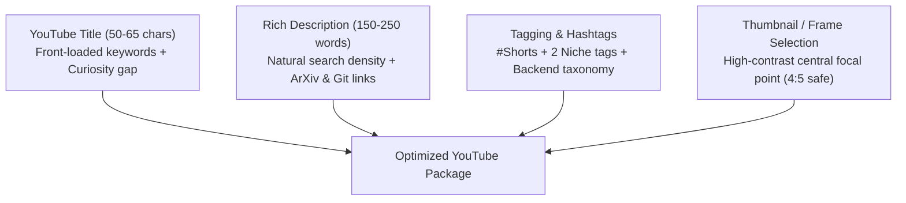
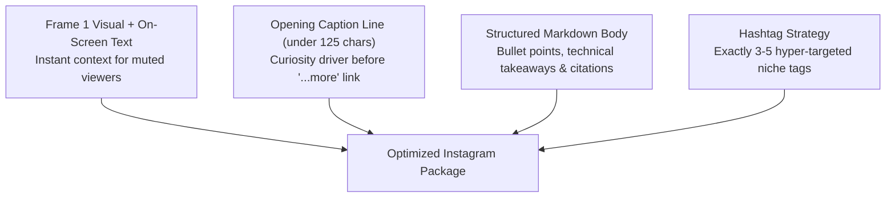

# Omnichannel Platform Packaging Strategy: Shorts vs Reels

**Date:** 2026-11-17  
**Platform Scope:** YouTube Shorts & Instagram Reels  
**Target Identity:** Distinct Platform-Native Optimization  
**Document Ref:** `reports/phase12/PLATFORM_PACKAGING_STRATEGY.md`  

---

## 1. The Multi-Platform Fallacy

A critical error made by publishers is creating a single video file, exporting one generic caption, and broadcasting identical metadata to both YouTube Shorts and Instagram Reels.

While both formats utilize 9:16 vertical video, their underlying discovery architectures, user session modes, and distribution algorithms are fundamentally distinct:

| Dimension | YouTube Shorts | Instagram Reels |
| :--- | :--- | :--- |
| **Primary Discovery Vector** | Search intent + Shorts Feed algorithmic pool | Social graph + Exploratory non-follower recommendation |
| **Audio-On Default** | ~85% with audio enabled on app launch | ~40-50% on mute initially until screen tapped |
| **Caption Importance** | Low UI visual priority; high backend search indexing | High visual priority; first 125 chars appear above the fold |
| **Search Re-surfacing** | Evergreen shelf life (can gain views 6 months later) | High 48-72 hour decay rate; relies on initial momentum |
| **Key Virality Metric** | Viewed vs Swiped Away (VVSA) + Relative Retention | Direct Message (DM) sends/shares + Saves |

---

## 2. YouTube Shorts Packaging Architecture



### A. Title Optimization Rules
1. **Length:** 50 to 65 characters (ensures complete visibility on mobile devices without truncation).
2. **Structure:** `[Specific Technical Breakthrough] + [Intriguing Outcome or Mechanism]`.
3. **Keyword Front-Loading:** The core subject (e.g., *"DeepSeek R1"*, *"FlashAttention"*, *"BitNet"*) must appear in the first 3 words to capture search intent.
4. **Case Style:** Title Case or Sentence case. Never use ALL CAPS.
5. **Example:**  
   *Bad:* *"New crazy AI model released today that will change everything!"* (70 chars, zero keywords)  
   *Good:* *"DeepSeek R1 Dissected: How Pure RL Beat OpenAI for $6M"* (56 chars, high search density)

### B. Description & Search Indexing
- YouTube's semantic search engine indexes the full description text.
- Provide a 2–3 paragraph summary containing natural variations of the primary technical keywords.
- Always include explicit citations: Paper title, ArXiv link, GitHub repository URL, and license notes.
- Include 3 targeted hashtags at the bottom: `#Shorts`, `#MachineLearning`, and `#Tech`.

### C. Distribution & Privacy Rules
- **Crucial Empirical Lesson (Job #69):** Videos uploaded with `privacyStatus: "private"` receive zero impressions from the Shorts Feed. To launch into the discovery carousel, the video must be scheduled or published with `privacyStatus: "public"` after human editorial sign-off.
- Set category to **Science & Technology** (`categoryId: 28`).

---

## 3. Instagram Reels Packaging Architecture



### A. The "Mute-First" Rule & Cover Safe Zones
1. **Mute Assumption:** Over 50% of cold explore viewers browse Instagram with audio muted. The first frame must contain bold, unambiguous on-screen text establishing the topic.
2. **Safe Zones:** Keep all critical typography and UI elements within the central **4:5 vertical safe zone** (between 250px from top and 250px from bottom) to prevent UI truncation in the main profile grid and explore tiles.

### B. Caption Formatting & The "More" Fold
- **The Fold:** Instagram truncates captions after approximately 125 characters with a `...more` button.
- **Line 1 (Above the Fold):** Must act as a secondary hook that compels the user to click `...more` to read the breakdown.
- **The Body:** Use clean paragraph breaks, bold headings, and bullet points. Break down the 3 key takeaways from the video.
- **Call-to-Action:** Direct the user to save or share: *"Save this blueprint for your next architecture review."*

### C. Hashtag Rules
- **Quantity:** Exactly **3 to 5 hashtags**.
- **Philosophy:** Meta's recommendation algorithms rely primarily on audio transcription and computer vision rather than hashtags. Over-tagging (20–30 hashtags) triggers spam classifications.
- **Hashtag Selection:**
  - 1 Broad Niche: `#artificialintelligence` or `#computerscience`
  - 2 Specific Domain: `#deeplearning` `#softwareengineering`
  - 1 Hyper-Specific: `#deepseek` or `#agenticai`

---

## 4. Meta Trial Reels Strategy & Qualification

Meta has introduced **Trial Reels** to allow Professional accounts to test creative formats with non-followers without posting directly to the main profile grid.

### Verification of Eligibility (Meta Graph API & Dashboard)
1. Must be an **Instagram Professional Account** (Creator or Business) linked to a Meta Business Portfolio.
2. Must have **Account Status: Green** (Zero Community Guideline or Intellectual Property strikes).
3. Recommendation Status must read: *"Your content is eligible for recommendation to non-followers"*.

### Testing Protocol for SUPER.INTELLIGENCEEE
- When testing a radical new visual archetype or controversial contrarian hook, publish as a Trial Reel if the account interface supports it.
- Monitor 48-hour performance. If 3-second skip rate is `< 40%` and average watch time is `> 60%`, promote the Reel to the permanent profile grid.

---

## 5. Automated Packaging Generator (`platform_packaging.py`)

The platform packaging logic is programmatically enforced in `core/content_intelligence/platform_packaging.py`. Given a single validated topic and story arc, it automatically exports two distinct, compliant payload dictionaries:

```python
from core.content_intelligence.platform_packaging import PlatformPackagingEngine

engine = PlatformPackagingEngine()
yt_package = engine.package_for_youtube(topic, story_arc, keywords)
ig_package = engine.package_for_instagram(topic, story_arc, keywords)
```

This guarantees zero manual cross-posting copy-paste errors while ensuring 100% platform-native distribution compliance.
