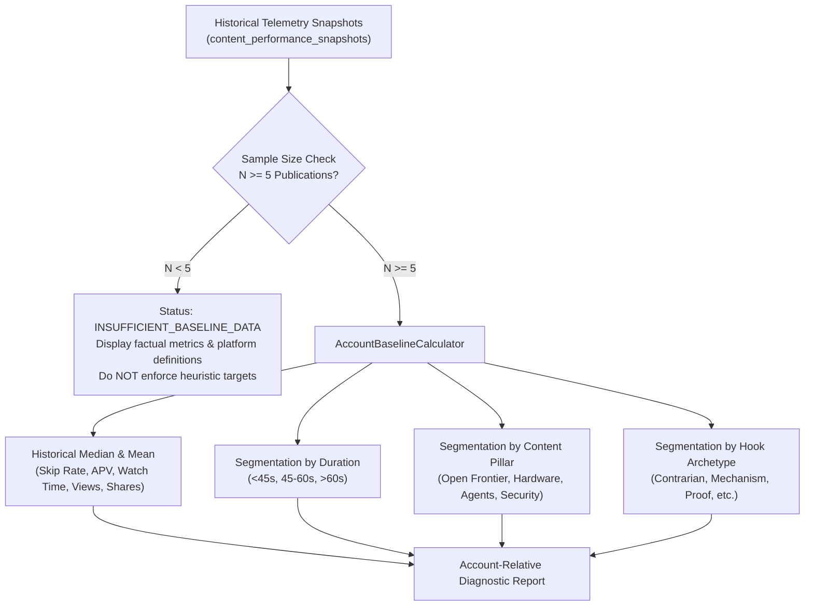

# Metric Baseline Correction & Account-Relative Analytics

**Phase:** 12.1 — Growth Intelligence Hardening  
**Date:** 2026-11-17  
**Module Audited:** `core/content_intelligence/performance_diagnostics.py` & `dashboard/`  
**Workspace:** `A:\SUPER.INTELLIGENCEEE`  
**Document Ref:** `reports/phase12_1/METRIC_BASELINE_CORRECTION.md`  

---

## 1. Executive Summary & Problem Formulation

In early short-form community playbooks and creator courses (such as the raw Vyral skills), several fixed statistical figures are frequently presented as universal "algorithmic laws":
- *"Shorts must achieve >70% Viewed vs Swiped Away to get views."*
- *"Reels skip rate must stay <35% or your account is restricted."*
- *"Average Percentage Viewed (APV) must exceed 75% for 60s content."*

These assertions were critically audited and found to be **flawed creator heuristics** rather than verified platform mechanics:
1. **Duration Confounding:** A 15-second Reel with a 50% completion rate has fundamentally different viewer utility than a 75-second technical documentary with 45% completion. Imposing uniform percentage cutoffs across different durations produces invalid decisions.
2. **Channel-Stage Variation:** A mature channel with 100,000 subscribers and an established warm audience naturally achieves higher initial stayed-to-watch ratios than a cold-start channel tested on random explore audiences.
3. **Correlation vs Causation Fallacy:** While high completion correlates with broader distribution, platform recommendation systems do not use rigid linear step-functions. Distribution is an elastic multi-variate system factoring in session time, share intent, comment velocity, and topical affinity.

In Phase 12.1, all hardcoded universal thresholds have been removed from the decision engine and replaced by an **account-relative baseline model** with a strict sample-size gate.

---

## 2. The Account-Relative Measurement Architecture

---

## 3. Minimum Sample Size Gate & `INSUFFICIENT_BASELINE_DATA`

To prevent premature conclusions on early content:
* **Minimum Sample Size:** `MINIMUM_SAMPLE_SIZE = 5` publications.
* **Current Account State:**
  - Published video count: **2** (Job #69 on Instagram Reel & YouTube Short).
  - Status returned: `INSUFFICIENT_BASELINE_DATA`.
  - System Message: *"Account has recorded 2 published video snapshots. A minimum of 5 publications is required to establish statistically valid account-relative baselines without forcing arbitrary external targets."*
* **Decision Rule:** When `INSUFFICIENT_BASELINE_DATA` is active, the system displays verified platform telemetry facts alongside official definitions, but **refrains from claiming algorithmic failure or passing subjective judgements**.

---

## 4. Official Platform Metric Definitions

All platform metrics reported in the dashboard and logs now directly display their official documentation definitions:

| Metric Key | Official Platform Source | Exact Platform Definition |
| :--- | :--- | :--- |
| `views` | Meta Graph API & YouTube Data API | *"The number of times that your reel or video was played or displayed."* |
| `reach` | Meta Graph API v21.0 | *"The number of unique accounts that have seen this reel at least once. Reach is different from impressions, which may include multiple views of your reel by the same accounts. This metric is estimated."* |
| `reels_skip_rate` | Meta Graph API v21.0 | *"The percentage of views from people who skipped during the first three seconds of your reel. This is calculated as the number of views that skipped your reel during the first three seconds divided by the number of initial views. An initial view is when your reel starts to play for the first time in a reel session."* |
| `ig_reels_avg_watch_time` | Meta Graph API v21.0 | *"Reels average watch time in milliseconds."* |
| `shares` | Meta Graph API v21.0 | *"The number of shares of your reel (Direct Message sends, Stories, or external)."* |
| `saved` | Meta Graph API v21.0 | *"The number of saves of your reel."* |
| `shown_in_feed` | YouTube Studio Analytics | *"The number of times your Short was displayed in the Shorts Feed carousel."* |
| `stayed_to_watch` | YouTube Studio Analytics | *"The percentage of times viewers chose to stay and watch vs swiped away."* |

---

## 5. Statistical Integrity & Causation Disclaimer

The following formal disclosure is now permanently embedded in `core/content_intelligence/performance_diagnostics.py` and surfaced across all UI and API interfaces:

> **STATISTICAL INTEGRITY NOTICE:**  
> Metric correlations (such as low skip rate aligning with higher views) are observational heuristics and must not be conflated with proven platform ranking algorithms. Recommendation engines are multi-variate dynamic systems influenced by user session state, topical affinity, and graph signals.
