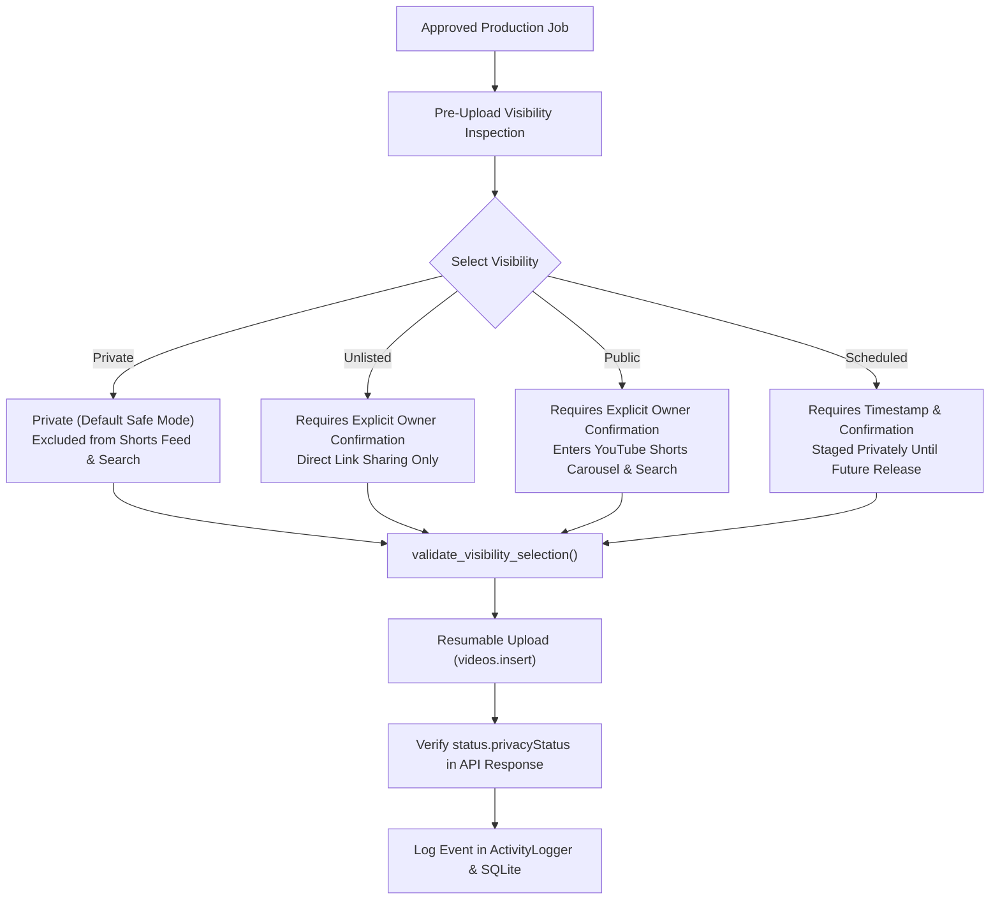

# YouTube Privacy & Publishing Workflow Audit

**Phase:** 12.1 — Growth Intelligence Hardening  
**Date:** 2026-11-17  
**Module Audited:** `publishing/youtube_integration.py` & `dashboard/routes.py`  
**Workspace:** `A:\SUPER.INTELLIGENCEEE`  
**Document Ref:** `reports/phase12_1/PRIVACY_WORKFLOW_AUDIT.md`  

---

## 1. Executive Summary & Problem Context

In Phase 12, empirical investigation of Job #69 on YouTube Shorts revealed that the video received only 3 views because the production system uploaded it with `privacyStatus: "private"`. 

While `private` is the correct safety default during automated pipeline rendering, a video intended for **organic audience discovery** cannot reach viewers if it remains private. Furthermore, private uploads do not enter the YouTube Shorts Feed carousel even if switched to public hours later, because they miss the initial real-time indexing burst.

In Phase 12.1, we hardened the publishing pipeline to provide **transparent, owner-controlled visibility selection** while preserving strict privacy-by-default safety.



---

## 2. The 4 Visibility Options & Discovery Impact

| Visibility State | API Identifier | Recommendation Eligibility | Owner Confirmation Required | Ideal Production Use Case |
| :--- | :--- | :---: | :---: | :--- |
| **Private** | `private` | **NO** (Completely Excluded) | **No** (Safe Default) | Automated pipeline tests, creator previews, internal verification. |
| **Unlisted** | `unlisted` | **NO** (Completely Excluded) | **YES** | Sharing draft cuts with external collaborators or sponsors via direct link. |
| **Public** | `public` | **YES** (Immediate Shorts Feed) | **YES** | General audience distribution, search discoverability, channel growth. |
| **Scheduled** | `scheduled` | **YES** (At Release Time) | **YES** | Staged during off-peak hours and launched at peak audience viewing windows. |

### Official YouTube Recommendation Policy Notice
> **"YouTube Shorts algorithms only ingest Public videos into the Shorts Feed carousel. Videos uploaded with Private or Unlisted visibility are completely bypassed by feed recommendation algorithms and search indexing."**

---

## 3. Implementation Verification & Code Paths

### A. Visibility Enum and Policy Matrix (`publishing/youtube_integration.py`)
```python
class YouTubeVisibility(str, Enum):
    PRIVATE = "private"
    UNLISTED = "unlisted"
    PUBLIC = "public"
    SCHEDULED = "scheduled"
```

### B. Gate Enforcement (`validate_visibility_selection`)
- Requires `explicit_owner_confirmation == True` before accepting `public`, `unlisted`, or `scheduled`.
- If `explicit_owner_confirmation` is missing or `False`, raises `PermissionError` with detailed discovery impact notes.
- Verifies that `scheduled_publish_at` is a valid ISO 8601 string set strictly to a future UTC timestamp.

### C. Compliance & Age Restrictions
- Explicitly enforces COPPA compliance: `"selfDeclaredMadeForKids": False`.
- Declares synthetic media transparency: `"containsSyntheticMedia": True`.
- Assigns category `28` (Science & Technology) and language tags (`en`).

### D. Audit Logging via `core/activity_logger.py`
Every video upload now writes an immutable audit log entry:
```python
audit_logger = get_activity_logger(self.db)
audit_logger.log(
    task_id=f"yt_pub_{video_id}",
    agent_id="YouTubeIntegration",
    action="YOUTUBE_VIDEO_UPLOAD",
    resource=f"video_id:{video_id}|privacy:{verified_privacy}",
    result="SUCCESS",
    approval_status=f"APPROVAL:{approval_id}|CONFIRMATION:{explicit_owner_confirmation}",
)
```

---

## 4. Preservation of Existing Published Videos

In strict compliance with Phase 12.1 governance rules:
- **No existing video's privacy setting was altered during implementation.**
- Job #69 on YouTube (`p_2bfJK-nBQ`) remains in its historical state.
- All future production candidates are held in `AWAITING_HUMAN_APPROVAL` until the owner explicitly selects visibility and confirms approval.
