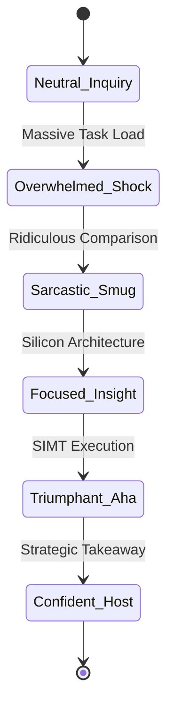

# Phase 15 — Character Personality & Animation Rig Specification

**Character Identifier:** Kavi (Recurring Host & Investigator)  
**Project:** SUPER.INTELLIGENCEEE  
**Reference Assets:** `character.me.png` | `Character 3D.mp4`  
**Date:** 2026-11-17  

---

## 1. Character Personality Profile

Kavi is not a corporate spokesperson or a dry lecturer. He is an energetic, deeply curious builder-engineer who loves demystifying how complex computing systems actually operate.

### Personality Pillars:
- **Relentlessly Curious:** Fascinated by the intricate machinery behind everyday computing. He approaches technology with genuine wonder.
- **Naturally Humorous & Self-Aware:** Finds amusement in engineering absurdities. When software crashes or a single core gets bottlenecked, he reacts with wry, dry humor rather than sterile indifference.
- **Approachable & Non-Arrogant:** Explains high-level computer science concepts without condescension, using clear physical metaphors that respect the audience's intelligence.
- **Expressive & Animated:** Communicates as much through facial reactions, eye shifts, and hand gestures as through speech.
- **Relatable Vulnerability:** Not immune to confusion; when confronted with an overwhelming problem (like computing 8 million pixels in a millisecond), he physically feels the pressure before solving it.

---

## 2. Character Expression Library

The character rig supports 5 foundational expressive states that transition smoothly based on narrative beats:



### Expression Specifications:

1. **Overwhelmed / Shocked (`overwhelmed`):**
   - *Eyes:* Sclera widened, pupils contracted, white rim visible.
   - *Eyebrows:* High arched curve, raised forehead tension.
   - *Mouth:* Open "O" shape or slight wavy quiver.
   - *Prop / Body:* Shoulders raised, hands lifted defensively, small comical sweat bead on temple.
   - *Narrative Beat:* Encountering extreme scale, impossible workloads, or catastrophic bottlenecks.

2. **Sarcastic / Amused Smug (`smug_sarcastic`):**
   - *Eyes:* Slight asymmetrical squint, one eyelid lowered.
   - *Eyebrows:* Left brow arched upward, right brow neutral.
   - *Mouth:* Subtle asymmetrical smirk upturned on one side.
   - *Prop / Body:* Head tilted $2.5^\circ$, pencil casually gesturing toward the flawed comparison.
   - *Narrative Beat:* Pointing out why a single CPU core trying to render 4K is hilarious folly.

3. **Focused Insight (`focused_insight`):**
   - *Eyes:* Analytical gaze directed downward/inward toward the held prop or silicon die.
   - *Eyebrows:* Lowered and focused inward, intense analytical concentration.
   - *Mouth:* Set neutral line, transition to subtle lip-sync visemes.
   - *Prop / Body:* Holding the glowing compute core close to eye level, notebook open in left hand.
   - *Narrative Beat:* Investigating microscopic silicon dies, Streaming Multiprocessors, or ALUs.

4. **Triumphant / "Aha!" Discovery (`triumphant`):**
   - *Eyes:* Bright white catchlights, widened with clarity, smiling eye corners.
   - *Eyebrows:* Relaxed, elevated in enlightenment.
   - *Mouth:* Broad beaming smile showing teeth, active speech viseme modulation.
   - *Prop / Body:* Pencil raised with purpose, radiating energy, affirmative head nod.
   - *Narrative Beat:* Explaining the breakthrough moment of SIMT lockstep execution.

5. **Confident Host / Sign-off (`confident_host`):**
   - *Eyes:* Direct, warm eye contact with the viewer.
   - *Eyebrows:* Natural, friendly resting position.
   - *Mouth:* Warm conversational smile, synchronizing to Kokoro voice cadence.
   - *Prop / Body:* Relaxed upright posture, notebook held comfortably at chest level.
   - *Narrative Beat:* Introducing the episode or delivering the closing editorial takeaway.

---

## 3. Kinetic & Prop Rigging Architecture

The character is implemented as a multi-layered 2.5D kinematic rig that maintains 100% fidelity to the canonical artwork while delivering lifelike motion:

```
[Character Layer Stack]
  ├─ Drop Shadow (Directional elliptical blur on ground plane)
  ├─ Torso & Field Jacket (Charcoal grey + orange piping, respiration sway)
  ├─ Left Arm & Spiral Field Notebook (Chest-level reference accessory)
  ├─ Head & Neck (Micro-tilt, breathing articulation)
  ├─ Face Expression Base (Neutral / Overwhelmed / Smug / Focused / Triumphant)
  ├─ Eyes & Eyelids (Deterministic 3.2s blink cycle, gaze tracking)
  ├─ Dynamic Mouth Visemes (Closed, Slight, Open, Round with feather blend)
  ├─ Held Prop Layer (Illuminated 3D ALU core, floating task stack, or notebook)
  └─ Right Arm & Articulated Drafting Pencil (Shoulder pivot rotation, pointing kinematics)
```

- **Respiration:** Smooth $0.35\text{ Hz}$ sinusoidal vertical motion ($3.5\text{ px}$ amplitude).
- **Speech Lip-Sync:** 4-state visemes synchronized to speech envelope and phonetic rate ($4.8\text{ Hz}$).
- **Eye Kinematics:** $150\text{ ms}$ eyelid blink every $3.2\text{ s}$ with random micro-jitter.
- **Interactive Props:** Dedicated alpha-composited prop anchor capable of rendering glowing silicon cores, calculation blocks, or laser targeting beams.
