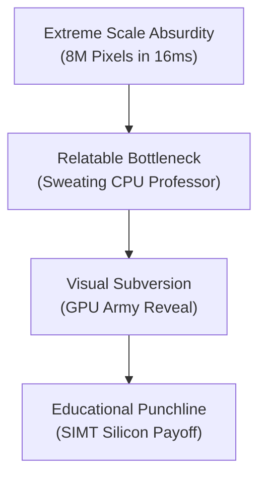

# Phase 15 — Humour & Storytelling Engine

**Project:** SUPER.INTELLIGENCEEE  
**Phase:** 15 (Character-Led 3D Educational Entertainment Engine)  
**Date:** 2026-11-17  

---

## 1. Editorial Philosophy: Intelligent Tech Comedy

Humour in SUPER.INTELLIGENCEEE is an educational accelerator, not a distraction. When viewers laugh at an engineering absurdity, their cognitive engagement peaks, making the subsequent technical explanation significantly more memorable.

### Target Tone:
- **Sophisticated & Wry:** Dry, observant, self-aware engineering humor similar to high-prestige technology documentaries and thoughtful tech commentary.
- **Rooted in Reality:** Comedy stems from the actual extremes of physics, silicon constraints, and software architectures.
- **Never Juvenile:** Zero slapstick banana peels, zero random internet meme popups, zero screaming sound effects.

---

## 2. The 4 Comic Mechanisms in Tech Storytelling

### 1. The Absurdity of Scale
- **Concept:** Numbers in computing are incomprehensibly large (billions of transistors, nanosecond cycles, millions of pixels).
- **Execution:** Visualizing this scale physically. In the GPU episode, instead of saying *"4K has 8.3 million pixels,"* a giant, teetering mountain of physical pixel calculation blocks falls onto the character's desk, forcing him to hold it up with a shocked, overwhelmed expression.

### 2. The Mismatched Tool (The Overqualified Worker)
- **Concept:** Using the wrong architecture for a task creates comical inefficiency.
- **Execution:** Portraying the CPU as a hyper-intellectual math professor solving $1+1=2$ for millions of pixels one at a time with a ticking clock, while remarking: *"Brilliant for running an operating system, but absolute torture for rendering a video game."*

### 3. The Visual Reveal / Scale Transition
- **Concept:** Moving from human perspective to microarchitecture scale.
- **Execution:** The character steps back from the chalkboard to reveal an endless stadium filled with tiny, synchronized worker bots holding paintbrushes, ready to paint all pixels in a single synchronized stroke.

### 4. Understatement & Punchline Delivery
- **Concept:** Delivering high-tech insights with calm, understated irony.
- **Execution:** Kavi looks directly at the camera with an amused smirk: *"So let your CPU handle the strategy, and let the GPU do the heavy lifting."*

---

## 3. Editorial Guardrails

| Prohibited Techniques | Approved Educational Techniques |
| :--- | :--- |
| Random unrelated jokes inserted every 5 seconds. | Humor strictly tied to the engineering problem being solved. |
| Exaggerated cartoon sound effects (boings, farts, slide whistles). | Clean, tactile Foley sound design (chalk scribbles, mechanical relays, silicon hum). |
| Condescending or childish characters. | Curious, articulate, and respectful adult engineering persona. |
| Humor that obscures or misleads the technical fact. | Humor that highlights the core architectural tradeoff. |
