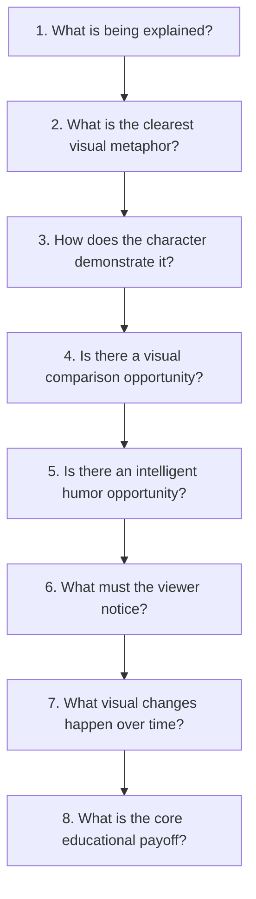

# Phase 15 — Scene Planner Architecture & GPU Storyboard

**Project:** SUPER.INTELLIGENCEEE  
**Phase:** 15 (Character-Led 3D Educational Entertainment Engine)  
**Topic:** How a GPU Works (Serial vs. Parallel Microarchitectures)  
**Date:** 2026-11-17  

---

## 1. The 8-Question Scene Planning Framework

Every scene in the character-led educational engine is systematically planned through eight essential criteria:

---

## 2. Complete Storyboard Specification: "How a GPU Works"

### Scene 1: The Task Overload
- **1. Information:** 4K 60fps rendering requires computing over 8 million independent pixel values every 16 milliseconds.
- **2. Visual Representation:** A physical workshop desk where calculation requests materialize as a massive stack of glowing red cubic blocks.
- **3. Character Role:** Kavi physically braces against the teetering tower with raised hands, wide eyes, and an overwhelmed expression.
- **4. Comparison:** The sheer scale of graphics calculations vs. standard human or sequential math.
- **5. Humour:** Physical comedy of an engineer buried under a landslide of pixel math.
- **6. Viewer Focus:** The sheer absurdity of the number: "8,294,400 calculations / frame".
- **7. Visual Change:** Stack grows dynamically, wobbles, and fills the screen.
- **8. Payoff:** Viewer realizes why conventional single-core computing immediately chokes on graphics.

### Scene 2: The Humorous Comparison (Serial vs. Parallel)
- **1. Information:** CPUs are optimized for low-latency serial execution; GPUs are optimized for high-throughput parallel execution.
- **2. Visual Representation:** Split arena:
  - *Left (CPU):* A frantic, sweating professor at a chalkboard solving equation 1 of 8,000,000 while an analog clock ticks frantically.
  - *Right (GPU):* An army of 1,024 disciplined robot workers, each holding a paintbrush and painting one pixel simultaneously.
- **3. Character Role:** Kavi stands between them with an amused, sarcastic smirk, gesturing toward the exhausted CPU worker and introducing the GPU team.
- **4. Comparison:** Single genius executing sequentially vs. thousands of simple workers executing concurrently.
- **5. Humour:** The contrast between the sweating genius and the effortless synchronized paint crew.
- **6. Viewer Focus:** The speed difference: CPU takes hours; GPU takes 1 frame.
- **7. Visual Change:** Chalk dust flying on the left vs. clean green wave of painted pixels on the right.
- **8. Payoff:** Intuitive understanding of latency-optimized vs. throughput-optimized hardware.

### Scene 3: Environment Transformation (Into Silicon)
- **1. Information:** GPU silicon replaces complex branch predictors with dense arrays of Arithmetic Logic Units (ALUs).
- **2. Visual Representation:** The comparison arena dematerializes into an illuminated 3D silicon landscape with glowing traces and bus lines.
- **3. Character Role:** Kavi physically steps onto the silicon die, walking along the high-bandwidth memory bus.
- **4. Comparison:** Macro-world metaphor transitioning directly into real microarchitecture.
- **5. Humour:** Character observing the silicon landscape with awe, consulting his field notebook.
- **6. Viewer Focus:** High density of identical compute tiles on the die.
- **7. Visual Change:** Smooth camera tracking moving from human scale down to nanometer scale.
- **8. Payoff:** Visualizing how billions of transistors are physically arranged for parallel dataflow.

### Scene 4: Physical Component Exploration
- **1. Information:** Streaming Multiprocessors (SMs) bundle register files, warp schedulers, and ALUs.
- **2. Visual Representation:** An illuminated floating ALU core levitating in front of the character.
- **3. Character Role:** Kavi reaches out, holding the glowing compute core in his hand, examining its internal logic gates with focused curiosity.
- **4. Comparison:** Individual simple ALU vs. massive complex CPU core with large cache hierarchies.
- **5. Humour:** Kavi tapping the core: *"Stripped of all unnecessary bureaucracy—pure, raw arithmetic."*
- **6. Viewer Focus:** The simplicity and compact footprint of an individual GPU ALU.
- **7. Visual Change:** Core glows bright emerald green, casting light onto Kavi's jacket and face.
- **8. Payoff:** Demystifies why thousands of GPU cores can fit onto a single silicon chip.

### Scene 5: Scientific Payoff (SIMT Execution)
- **1. Information:** Single Instruction, Multiple Threads (SIMT). One instruction broadcast executes across 32 or 128 cores in lockstep.
- **2. Visual Representation:** Exploded Streaming Multiprocessor grid with a central Warp Scheduler broadcasting an instruction wave.
- **3. Character Role:** Kavi traces the broadcast wave with his drafting pencil, beaming with a triumphant "aha!" expression.
- **4. Comparison:** Independent instruction streams (MIMD) vs. Lockstep vectorized execution (SIMT).
- **5. Humour:** The sheer elegance of thousands of cores doing math in unison like a perfectly choreographed orchestra.
- **6. Viewer Focus:** The green synchronous wave lighting up every ALU simultaneously.
- **7. Visual Change:** Wave pulses across the grid; output register bars fill instantaneously.
- **8. Payoff:** The exact computer science principle behind both modern ray tracing and deep learning matrix multiplication.

### Scene 6: Humorous Reinforcing Comparison
- **1. Information:** CPUs and GPUs are complementary, not competing architectures.
- **2. Visual Representation:** The CPU math professor is now sitting comfortably in an armchair sipping coffee, while the GPU grid purrs quietly in the background.
- **3. Character Role:** Kavi winks at the viewer, showing that engineering is about matching the right tool to the problem.
- **4. Comparison:** Task delegation in modern computing systems.
- **5. Humour:** The once-exhausted CPU professor finally relaxing while the GPU does the heavy lifting.
- **6. Viewer Focus:** Both chips working together on a unified motherboard.
- **7. Visual Change:** Smooth lighting transition into warm architectural studio.
- **8. Payoff:** Dispels the common misconception that GPUs replace CPUs.

### Scene 7: Concise Educational Conclusion
- **1. Information:** The overarching takeaway: GPUs are the engines of the AI and 3D revolution because nature is fundamentally parallel.
- **2. Visual Representation:** Warm architectural studio with restrained editorial branding (`SUPER.INTELLIGENCEEE // Understand What's Next`).
- **3. Character Role:** Kavi delivers a confident, inspiring sign-off directly to camera with his notebook in hand.
- **4. Comparison:** Present computing paradigms vs. the future of accelerated computing.
- **5. Humour:** Warm, friendly sign-off with natural conversational ease.
- **6. Viewer Focus:** Brand signature and memorable mental model.
- **7. Visual Change:** Soft bokeh fade and clean closing title card.
- **8. Payoff:** High audience retention and eagerness for the next episode.

---

## 3. Prototype Implementation Mapping (38.5s Proof-of-Concept)

To validate this engine on our 8 GB RAM hardware without unnecessary rendering overhead, the prototype consolidates these 7 storyboard beats into a pristine **5-scene, 38.5-second master video**:

| Scene | Duration | Storyboard Beats Covered | Core Environment | Character Expression & Action |
| :--- | :--- | :--- | :--- | :--- |
| **Scene 1: The Task Overload** | 6.8s | Beat 1 | Workshop Task Desk | `overwhelmed` — Bracing against falling stack of 8M pixel calculation blocks. |
| **Scene 2: Serial vs. Parallel** | 8.8s | Beats 2 & 6 | The Comparison Arena | `smug_sarcastic` — Amused comparison of sweating CPU professor vs. GPU paint brigade. |
| **Scene 3: Inside the Silicon Die** | 7.8s | Beats 3 & 4 | Glowing 3D Silicon Die | `focused_insight` — Physically holding and inspecting an illuminated glowing ALU core. |
| **Scene 4: The SIMT Power Wave** | 8.6s | Beat 5 | Exploded SIMT Grid | `triumphant` — Tracing the synchronous instruction broadcast across the core array. |
| **Scene 5: The Strategic Conclusion**| 6.5s | Beat 7 | Warm Studio Bokeh | `confident_host` — Relaxed sign-off, CPU having coffee, restrained brand signature. |
